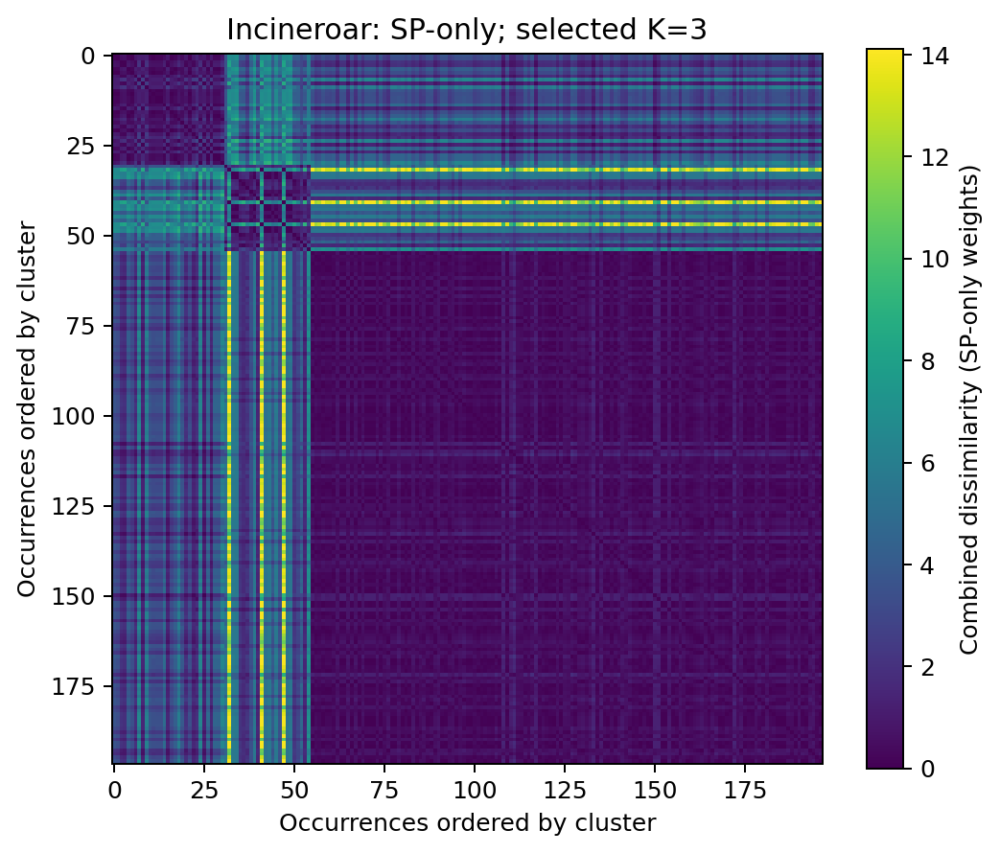
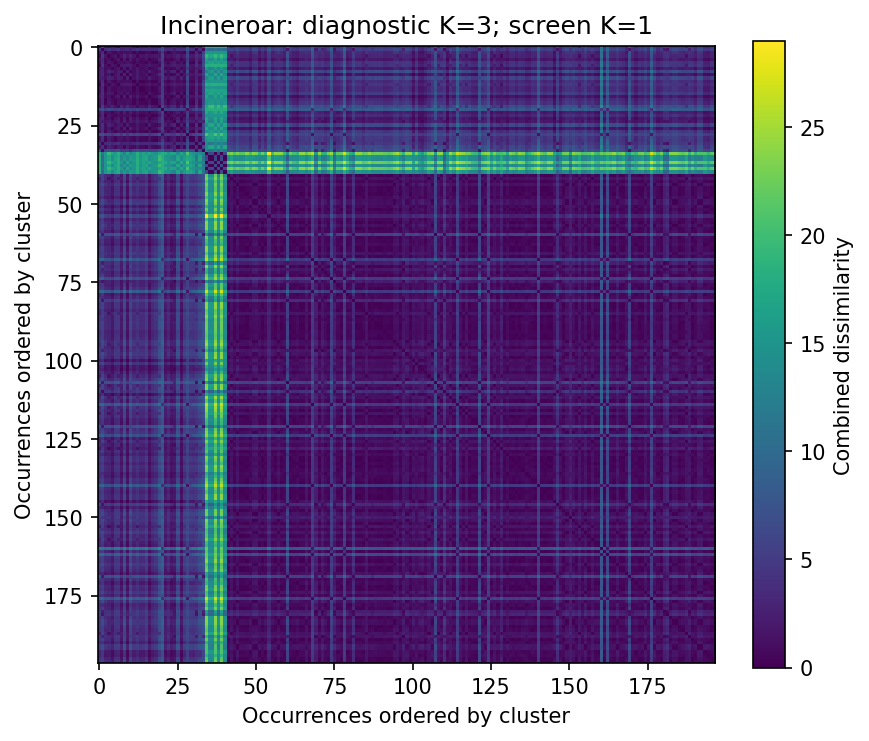
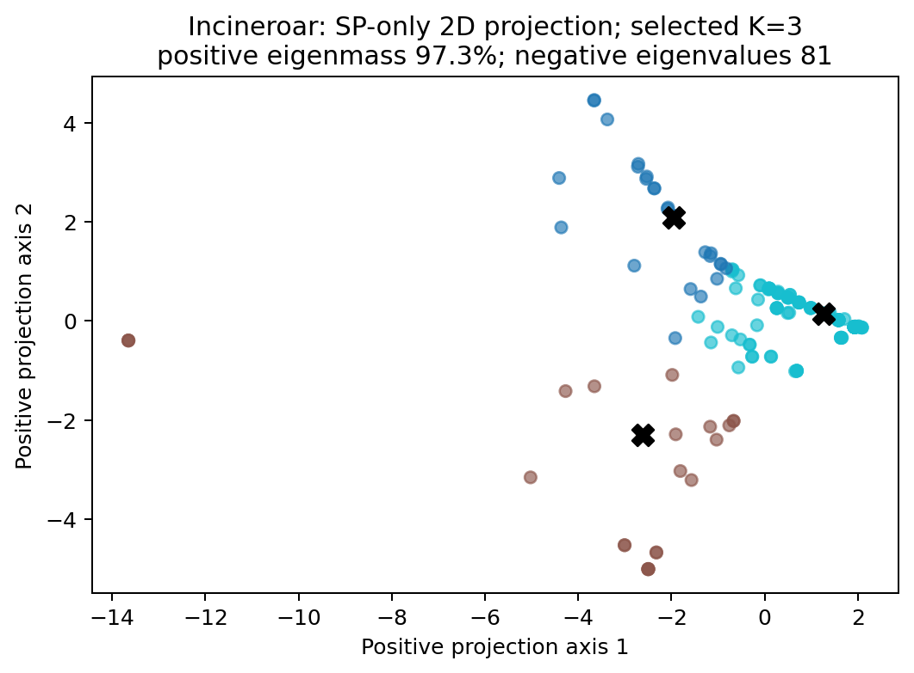
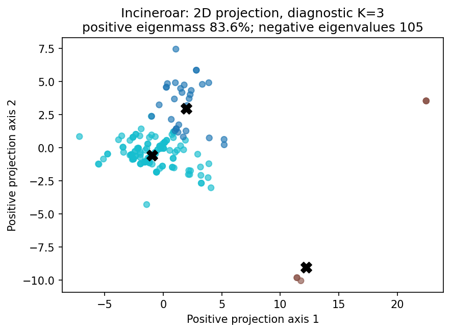
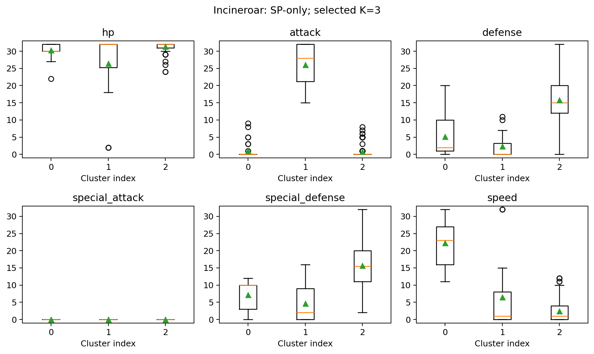
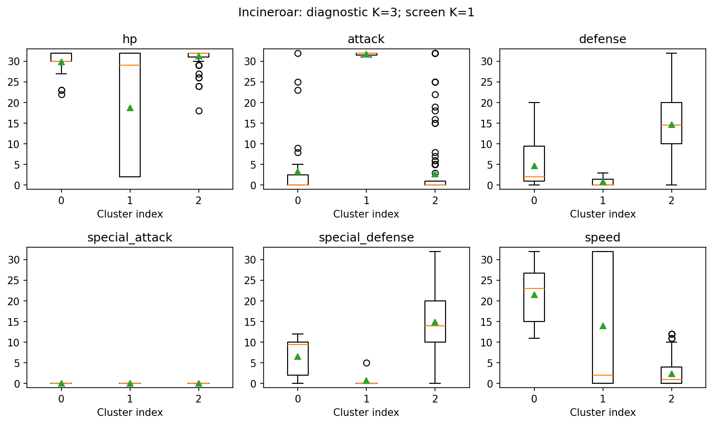
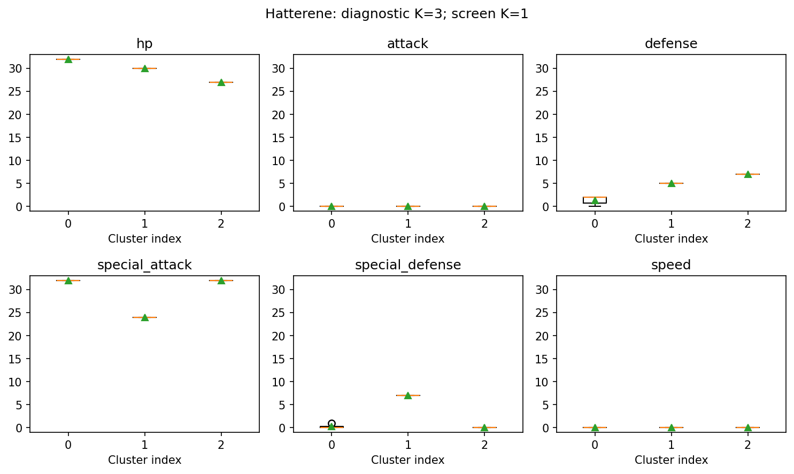
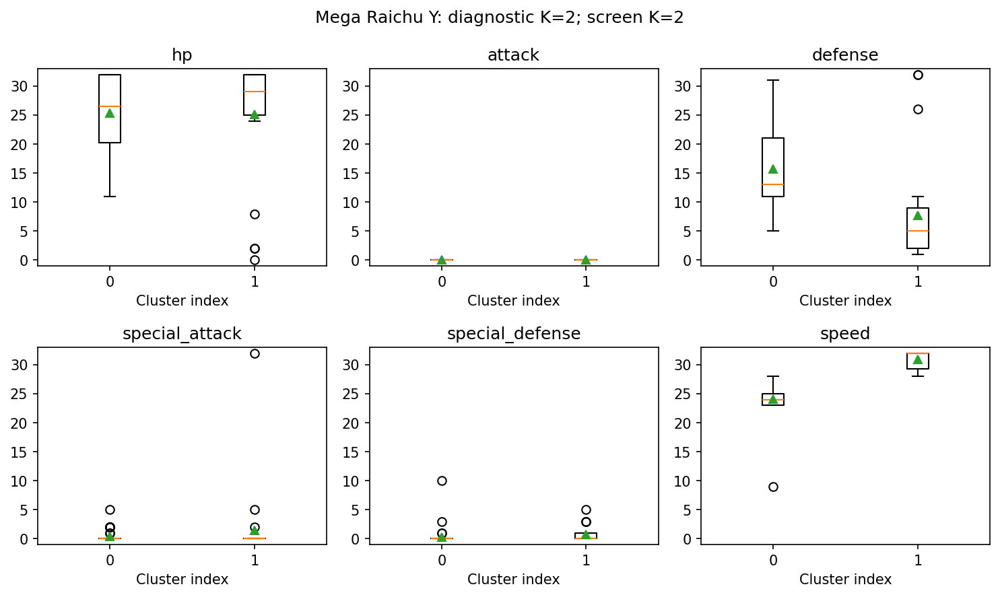

# M3.5.1 — Exploring Pokémon builds through clustering

*Pokémon Champions Assistant · 24 October 2026 · approximately 8–10 minutes*

This milestone built an offline experiment for comparing complete Pokémon builds and finding recurring neighborhoods in published teams. The strongest result came from a relatively simple idea: compare **how training points are allocated**, with a nonlinear penalty for large differences. For Incineroar, that produced a repeatable three-cluster partition under the study's limited stability checks.

We also learned a moveset representation from published four-move combinations. It revealed an interesting seven-observation Incineroar package, but **adding learned moveset similarity did not improve any tested numeric reconstruction target over SP-only**. That mixed result is useful: we now have a reproducible comparison, interpretable figures, and evidence about where extra model complexity helps or hurts.

This is a completed exploratory experiment. Its clusters are not accepted tactical roles, and its similarity scores are not probabilities of an opponent's hidden build.

## What we built, and why

Battle evidence can narrow an opponent's legal configurations without identifying one exact build. Published teams offer another perspective: which complete configurations have people actually used, and which are close to one another?

Exact matching is brittle. Two builds can differ by a few defensive points while sharing most of their investment pattern; two builds with similar totals can instead put their points into very different offensive or Speed investments. We wanted a configurable comparison that preserves those distinctions, then asked whether observed moveset associations add useful information.

The implementation provides nonlinear SP dissimilarities, exact move-overlap and learned moveset baselines, species-specific clustering, stability diagnostics, and grouped held-out evaluation. PAM (k-medoids) chooses **actual observed builds** as representatives. Average-linkage clustering supplies a second descriptive comparison. No synthetic configurations or averaged “representative builds” enter the experiment.

The study reused the existing read-only VGC adapter and pinned identity/form checks. It made no changes to battle inference, empirical ranking, damage calculations, replay, or team constraints.

### The observations behind the plots

The cached source population contains 1,083 publications and 6,498 member records. Of those, 3,392 are complete; compatibility and complete-core/four-move filtering leaves **3,388 occurrences** for learning move associations, spanning 551 connected source/team groups.

| Clustering context | Occurrences | Distinct complete builds | Connected source groups |
|---|---:|---:|---:|
| Hatterene | 13 | 9 | 13 |
| Incineroar | 197 | 168 | 192 |
| Mega Raichu Y | 72 | 53 | 70 |

Identical builds remain separate published occurrences. Distinct-build counts describe diversity; they do not replace occurrence weights. Related publications and exact team signatures are connected for evaluation to reduce leakage. This cannot guarantee that all source dependence has been found.

Four Raichu records fail the existing native-ability compatibility check and are excluded from the Mega Raichu Y context. Original configurations, source assertions, IDs and exclusion reasons are preserved. Clustering is species/form specific; move associations are learned across eligible species.

## Comparing training investment

Write a build's six SP values as $(H,A,D,C,R,V)$: HP, Attack, Defense, Special Attack, Special Defense, and Speed. Let $B=H+D+R$ be total defensive investment, and define:

$$
\phi_\gamma(t)=e^{\gamma t}-1.
$$

The default SP dissimilarity is:

$$
\begin{aligned}
d_{\mathrm{SP}}(x,y)={}&
\lambda_B\phi_\gamma\!\left(\frac{|B_x-B_y|}{66}\right)
+\lambda_D\sum_{j\in\{H,D,R\}}\phi_\gamma\!\left(\frac{|x_j-y_j|}{48}\right)\\
&+\lambda_A\phi_\gamma\!\left(\frac{|A_x-A_y|}{32}\right)
+\lambda_C\phi_\gamma\!\left(\frac{|C_x-C_y|}{32}\right)
+\lambda_V\phi_\gamma\!\left(\frac{|V_x-V_y|}{32}\right).
\end{aligned}
$$

Defaults are $\gamma=2$, $\lambda_B=1$, $\lambda_D=0.3$, $\lambda_A=\lambda_C=1$, and $\lambda_V=1.2$.

The bulk term measures how much goes into defense overall. The smaller coordinate terms distinguish redistribution among HP and the two defenses. Separate offensive and Speed terms penalize large changes more strongly than small adjustments. For example, with other coordinates fixed, an Attack change from 0 to 32 contributes about 6.389; a change from 0 to 16 contributes about 1.718.

These coefficients and scales are experimental choices. The denominator **48 is a sensitivity scale, not a legal per-stat cap**. The reused Champions validator requires six explicit integer values in 0–32 with total at most 66; unspent points remain legal. A proportional defensive-allocation alternative and nearby weights were also tested.

Despite the convenient word “distance,” this is a **dissimilarity, not a mathematical metric**: the exponential penalty can violate the triangle inequality. The implementation does not rely on metric pruning or assume Euclidean geometry.

## Incineroar: the clearest comparison

The same 197 occurrences give different answers depending on whether moves enter the comparison.

| Incineroar model / partition | K | Cluster sizes | Silhouette | Conservative selection |
|---|---:|---|---:|---|
| SP-only | 3 | 31 / 24 / 142 | 0.727 | **K=3** |
| SP + learned moves, diagnostic | 3 | 34 / 7 / 156 | 0.545 | **K=1** |
| SP + learned moves, diagnostic | 2 | 190 / 7 | 0.838 | **K=1** |

Silhouette measures separation relative to within-group spread; larger is better separated under that particular dissimilarity. It is not a measure of tactical correctness.

The conservative screen takes the smallest candidate K with silhouette at least 0.25, every group containing at least $\max(3,\lceil0.1N\rceil)$ occurrences, and mean adjusted Rand index (ARI) at least 0.65 across three seeded 80% source-group subsamples. ARI measures agreement between partitions of retained observations. If nothing qualifies, the display stays at K=1. These are explicit modeling thresholds, not discovered rules.

For SP-only K=3, all three subsample ARIs are 1.000. This is encouraging repeatability under a narrow check, with no independent external validation. For the combined diagnostic K=3, ARIs are 1.000 / 0.759 / 0.765, but its seven-member group misses the minimum size of 20. Its K=2 split also has unstable resample agreement despite the high silhouette. **K=1 means the screen declined a multi-cluster display; it does not mean every observed build is identical.**

### The actual distance heatmaps



**SP-only, selected K=3.** Each cell compares two observed builds. Rows and columns are ordered by cluster, so darker blocks along the diagonal show groups with smaller internal dissimilarities.



**Combined distance, diagnostic K=3; selected K=1.** The small moveset-associated group becomes conspicuous. The two heatmaps have different color scales and row orderings: matching pixel positions do not identify matching build pairs.

### A two-dimensional view





Each point is an occurrence, colored by its saved partition. Classical multidimensional scaling projects the dissimilarity matrix onto two positive axes; clustering happened in the original dissimilarity space. Black crosses mark observed medoids. Overlapping points can hide repeated or nearby builds. Negative eigenvalues and discarded dimensions mean these maps distort the original relationships. A dramatic gap is a useful inspection cue, not proof of a better model.

### What the groups actually invest in





These plots return to the original six SP coordinates. Boxes show the middle half of observations, lines mark medians, triangles mark means, and circles show outliers beyond the whiskers. Cluster numbers belong to each model separately.

In the SP-only plots, group 0 emphasizes higher Speed, group 1 contains the larger Attack investments, and group 2 concentrates more points in defensive coordinates with low Speed. These are investment patterns, not assigned tactical labels.

The combined partition contains a relatively higher-Speed group of 34 observations (Speed 11–32), a seven-observation group with Attack 31–32, and a larger group of 156 with Speed 0–13. All seven high-Attack observations share **Fake Out / Close Combat / Flare Blitz / Darkest Lariat**. Their items are Life Orb (4), White Herb (2), and Charcoal (1).

That recurring package is interesting, but it is **not the 24-member SP-only cluster**. The saved overlap makes the distinction concrete:

| SP-only group | Combined 0 | Combined 1 | Combined 2 |
|---|---:|---:|---:|
| 0: 31 occurrences | 31 | 0 | 0 |
| 1: 24 occurrences | 3 | 7 | 14 |
| 2: 142 occurrences | 0 | 0 | 142 |

The learned representation reorganizes one investment neighborhood around a specific moveset package. It does not produce a clean attacker/support dichotomy: nonzero and high Attack investments also occur outside the seven-member group. The evidence supports descriptions of allocations and moves, without assigning exclusive tactical roles.

## What learned moveset similarity added—and why it fell short

The experiment starts with a binary occurrence-by-move matrix: 3,388 builds and 279 moves. It counts individual moves and pairs, smooths the pair tables, retains positive pointwise mutual information, caps associations at 3, and shrinks low-support pairs by $c_{ij}/(c_{ij}+5)$. Unobserved pairs have zero association.

Singular value decomposition compresses this association matrix into 16-dimensional move vectors. Averaging a complete build's four vectors produces its moveset vector; one minus cosine similarity gives the moveset dissimilarity. Dimensions 8 and 32 were sensitivity checks. An exact-overlap Jaccard baseline tests whether learning adds value beyond simply sharing moves.

For the default combined model:

$$
d_{\mathrm{combined}}(x,y)=
\frac{d_{\mathrm{SP}}(x,y)}{s_{\mathrm{SP}}}
+\frac{d_{\mathrm{moves}}(x,y)}{s_{\mathrm{moves}}}.
$$

Each scale is the median strictly positive pairwise distance in the relevant training species context. Item/nature mismatch terms are optional ablations; ability is retained for diagnostics but is not a distance component.

Three limitations help explain the mixed findings:

- **Association is not interchangeability.** Moves appearing together can complement one another rather than serve the same function. Mean pooling also loses interactions between particular combinations.
- **Rare pairs have weak support.** Of 1,783 observed move pairs, 1,050 occur at most twice. Regularization reduces their influence without creating new evidence.
- **Normalization can amplify unusual packages.** Incineroar's descriptive positive-median move scale is about 0.014, versus 1.531 for SP. Small raw move differences can have large normalized contributions. Equal component weights do not equalize their tails.

These are plausible explanations supported by diagnostics, not isolated causal findings. The decisive practical check was held-out reconstruction.

### Did the neighborhoods predict withheld information?

Three folds separate connected source/team groups. Each fold fits vocabulary, associations, embeddings and scales using training data only. Five nearest training occurrences predict a masked numeric field by its median; masking removes the relevant SP term, including all three defensive coordinates for bulk. Item prediction removes item mismatch. Other observed fields can remain predictors, so this is **conditional reconstruction of published builds**, not prediction from battle footage.

| Target | Training median/mode | SP-only | SP + Jaccard | SP + learned |
|---|---:|---:|---:|---:|
| Incineroar Speed MAE | 5.787 | **1.421** | 2.142 | 2.898 |
| Incineroar Attack MAE | 3.893 | **1.482** | 1.990 | 1.558 |
| Incineroar bulk MAE | 8.949 | **1.320** | 2.076 | 2.832 |
| Incineroar item error | 0.310 | 0.381 | 0.325 | **0.305** |
| Mega Raichu Y Speed MAE | 3.347 | **1.125** | 1.736 | 1.458 |
| Mega Raichu Y bulk MAE | 3.806 | **1.069** | 1.361 | 1.153 |

Lower is better. Numeric errors use SP units; item error is a fraction of incorrect identities. Learned moves improve none of the four tested numeric targets over SP-only in any of the three species. Incineroar item error shows a small exploratory gain over the mode baseline, without uncertainty estimates or external replication. Better visual separation therefore did not translate into better numeric reconstruction.

## Two useful contrasts: Hatterene and Mega Raichu Y

### Hatterene: defensive variation, too little evidence for archetypes

All 13 observations have zero Attack and Speed SP. Both SP-only and combined screens select K=1. The combined diagnostic K=2 split is 12/1 with silhouette 0.802: a visually well-separated singleton is still one observation. At diagnostic K=3, sizes are 8/1/4.



The plots show defensive redistribution around a nearly constant offensive core. All tested main methods tie on held-out errors: Special Attack MAE 0.615 and bulk MAE 0.846. Zero error on constant Attack/Speed does not demonstrate learned generalization. This sample is useful for inspecting nearby allocations, but provides weak support for recurring separate archetypes.

### Mega Raichu Y: a default split that depends on the model

The combined screen selects K=2 (46/26), silhouette 0.442, with subsample ARIs 0.747 / 0.734 / 0.746. SP-only selects K=1. The two combined groups span Speed SP 9–28 and 28–32; their observed medoids have Speed 24 and 32.



Every observation has zero Attack SP, and 59 of 72 have zero Special Attack SP. This dataset cannot test discrimination between Attack-investment patterns. Nearby weight/formulation settings select K=1, 2, or 3, and the learned model still fails to improve numeric reconstruction over SP-only. A repeatable default split is a descriptive finding, not an established number of tactical roles.

## Why this stage matters, and what remains unresolved

We can now compare build neighborhoods without losing original configurations or publication provenance. Incineroar supplies evidence that nonlinear SP differences alone can expose repeatable investment structure. The learned experiment adds a concrete observation about a recurring four-move package, while showing that a richer representation can worsen the task we hoped it would help.

The limits remain substantial: one selectively published regulation/source population, correlated occurrences, only three stability resamples and three evaluation folds, small species samples, and a fixed 13-configuration sensitivity grid. No independent tactical labels, calibrated membership probabilities, or external test population were available. Co-occurrence establishes neither Champions mechanics nor move legality, equipped slots, or probabilities for unseen builds. Existing pinned rules and form checks were reused; this milestone required no new 52Poké retrieval.

Useful next questions are whether independent sources reproduce the SP-only structure, whether scale capping improves held-out results, whether interaction-aware moveset representations beat exact overlap, and how rare recurring packages should be assessed without changing thresholds to suit an appealing story. Those questions remain future work. No prior over unknown builds, synthetic sampling, strategy recommendation, or battle-facing integration was implemented.

## Evidence and reproduction

The completed numerical run is **`7933afbb341cdbeddbe3`**. The tracked [evidence summary](M3.5.2_Midterm_Research_Report/evidence-summary.json) preserves aggregate results, exact representative builds and source URLs, input/output hashes, partition overlap, sensitivity results, and figure provenance. The [detailed experiment snapshot](Previous_Milestones/M3.5.1_Build_Similarity/report.md) contains full tables and method settings; its large diagnostic outputs are explicitly local.

For a checkout containing the study implementation and cached published-team database, the original resume command is:

```sh
.venv/bin/python -m experiments.build_similarity.study
```

Full observations, matrices, assignments, predictions, and the 47-stage manifest remain under `.cache/research/m351/7933afbb341cdbeddbe3/`. The runner validates fingerprints and output hashes before reuse. These caches and the uncommitted research implementation are **not distributed by this report-only change**; the bundled figures and compact summary are reviewable without them.

The prior local validation record (`reports/M3.5.1-validation.md`) records 129 passing portable checks and three deselected historical-artifact cases, independent recomputation of the three default learned fits, and a resume with all 47 stages reused. Those are experiment checks, not recognition-accuracy measurements. This report reuses the tracked figures, including three SP-only presentation plots prepared from saved matrices and assignments; no numerical fitting was rerun.

The existing [PDF/LaTeX research draft](M3.5.2_Midterm_Research_Report/README.md) remains optional supplementary material. This Markdown report is the primary milestone presentation.
