# M3.5.3 follow-up — Incineroar movesets, items and SP clusters

*25 October 2026 · offline diagnostic experiment · no predictor or annotation changes*

Manual review of the no-SP predictions fell below expectations. Before changing that predictor, this study asks whether moveset neighborhoods actually align with the SP investment neighborhoods they were being used to predict. It also follows the request to include held items as part of the observed four-move package.

The main finding is **weak SP alignment despite recurring moveset packages**. Jaccard selects a stable 143/54 split, but its ARI with SP-only is 0.056. Learned moves isolate rare Close Combat and Helping Hand packages; the conservative screen selects K=1. Adding items leaves the selected and forced K=3 memberships unchanged under both definitions tested here.

## Same observations, different questions

Every comparison retains the same **197 original complete Incineroar occurrences**, representing **168 distinct full builds**, **16 complete movesets**, and **192 connected M3.5.1 source groups**. Identical published builds keep their original occurrence weights. Assignments join by immutable occurrence ID, never by cluster number. Original SP, canonical moves, nature/alignment, ability, item and publications remain in the source artifacts and local diagnostic run.

The SP-only selected K=3 (31/24/142), combined SP + learned diagnostic K=3 (34/7/156; selected K=1), and combined SP + Jaccard diagnostic K=3 (112/66/19; selected K=1) are reused unchanged. No baseline is refitted. Source-stage hashes are checked against the completed manifest and the tracked M3.5.2 evidence where available.

Four new dissimilarities are compared:

- **Learned moves only:** saved shrunk-PPMI/SVD move vectors, original mean pooling and cosine dissimilarity, divided by the exact saved Incineroar positive-median scale. The full-population embedding is restored, never retrained.
- **Jaccard moves only:** one minus intersection/union of the four canonical move sets.
- **Jaccard moves + item:** the set has four typed move tokens and one typed item token. Item identity contributes to exact package overlap without pretending it is a learned move. All 197 original items are known.
- **Learned moves + item:** normalized learned move dissimilarity plus **0.5 × normalized item mismatch**. The 0.5 coefficient comes from M3.5.1’s existing categorical ablation; nature is excluded and no weight is tuned. This is a separate diagnostic, not an item embedding or predictor change.

For move sets, $d_J=1-|M_i\cap M_j|/|M_i\cup M_j|$; the item-token variant uses the same expression on five typed tokens. Positive-median normalization changes units, not PAM or linkage partitions. Each model has its own scale; combining learned moves with item mismatch does depend on their stated relative weight.

## What clustering produces

All new models use the existing deterministic precomputed-distance PAM and occurrence-weighted average linkage, with K=1–4. The conservative PAM screen is unchanged: silhouette ≥0.25, minimum cluster size ≥20, and mean retained-anchor ARI ≥0.65 computed from three available resamples; choose the smallest qualifying K, otherwise K=1. K=1 silhouette is undefined and its ARI of one is automatic. Forced K=3 remains diagnostic.

| Distance | Selected K | Selected sizes | Selected silhouette | Diagnostic K=3 sizes | K=3 silhouette |
|---|---|---|---|---|---|
| Learned moves only | 1 | 197 | — | 179 / 7 / 11 | 0.919 |
| Jaccard moves only | 2 | 143 / 54 | 0.544 | 46 / 97 / 54 | 0.688 |
| Learned moves + item | 1 | 197 | — | 179 / 7 / 11 | 0.879 |
| Jaccard moves + item token | 2 | 143 / 54 | 0.394 | 46 / 97 / 54 | 0.473 |

Full-data learned distances reconstruct the original combined matrix after adding the saved SP component. Jaccard likewise reconstructs its saved combined baseline. For stability only, three 80% source-group subsets use exactly the original seeds 351–353 and global group pool. The embedding is refitted on each subset once and shared across new methods; normalization and PAM are also refitted. These are pipeline-stability checks, not a new full-data representation, tuning, independent validation, or confidence intervals.

<details>
<summary>All K candidates, stability values and average-linkage cuts</summary>

| PAM distance | K | Sizes | Silhouette | Three resample ARIs | Status |
|---|---|---|---|---|---|
| Learned moves only | 1 | 197 | — | 1.000 / 1.000 / 1.000 | selected |
| Learned moves only | 2 | 190 / 7 | 0.908 | 1.000 / -0.034 / -0.011 | candidate |
| Learned moves only | 3 | 179 / 7 / 11 | 0.919 | 1.000 / 1.000 / 0.353 | candidate |
| Learned moves only | 4 | 18 / 161 / 7 / 11 | 0.789 | 0.369 / 1.000 / 0.703 | candidate |
| Jaccard moves only | 1 | 197 | — | 1.000 / 1.000 / 1.000 | candidate |
| Jaccard moves only | 2 | 143 / 54 | 0.544 | 1.000 / 1.000 / 1.000 | selected |
| Jaccard moves only | 3 | 46 / 97 / 54 | 0.688 | 1.000 / 1.000 / 1.000 | candidate |
| Jaccard moves only | 4 | 35 / 97 / 54 / 11 | 0.724 | 1.000 / 1.000 / 1.000 | candidate |
| Learned moves + item | 1 | 197 | — | 1.000 / 1.000 / 1.000 | selected |
| Learned moves + item | 2 | 190 / 7 | 0.888 | 1.000 / -0.034 / -0.011 | candidate |
| Learned moves + item | 3 | 179 / 7 / 11 | 0.879 | 1.000 / 1.000 / 0.353 | candidate |
| Learned moves + item | 4 | 18 / 161 / 7 / 11 | 0.677 | 0.389 / 0.476 / 0.703 | candidate |
| Jaccard moves + item token | 1 | 197 | — | 1.000 / 1.000 / 1.000 | candidate |
| Jaccard moves + item token | 2 | 143 / 54 | 0.394 | 1.000 / 1.000 / 1.000 | selected |
| Jaccard moves + item token | 3 | 46 / 97 / 54 | 0.473 | 1.000 / 0.571 / 1.000 | candidate |
| Jaccard moves + item token | 4 | 38 / 95 / 53 / 11 | 0.502 | 1.000 / 1.000 / 0.826 | candidate |

| Average-linkage distance | K | Sizes | Silhouette |
|---|---|---|---|
| Learned moves only | 1 | 197 | — |
| Learned moves only | 2 | 190 / 7 | 0.908 |
| Learned moves only | 3 | 179 / 7 / 11 | 0.919 |
| Learned moves only | 4 | 178 / 7 / 1 / 11 | 0.844 |
| Jaccard moves only | 1 | 197 | — |
| Jaccard moves only | 2 | 187 / 10 | 0.459 |
| Jaccard moves only | 3 | 187 / 8 / 2 | 0.401 |
| Jaccard moves only | 4 | 136 / 8 / 51 / 2 | 0.551 |
| Learned moves + item | 1 | 197 | — |
| Learned moves + item | 2 | 190 / 7 | 0.888 |
| Learned moves + item | 3 | 179 / 7 / 11 | 0.879 |
| Learned moves + item | 4 | 178 / 7 / 1 / 11 | 0.769 |
| Jaccard moves + item token | 1 | 197 | — |
| Jaccard moves + item token | 2 | 190 / 7 | 0.479 |
| Jaccard moves + item token | 3 | 187 / 3 / 7 | 0.442 |
| Jaccard moves + item token | 4 | 186 / 3 / 7 / 1 | 0.359 |

Average linkage is a descriptive cross-check; the conservative selection rule applies to PAM, as in M3.5.1. Resamples retain 158, 155 and 159 Incineroar anchors.

</details>

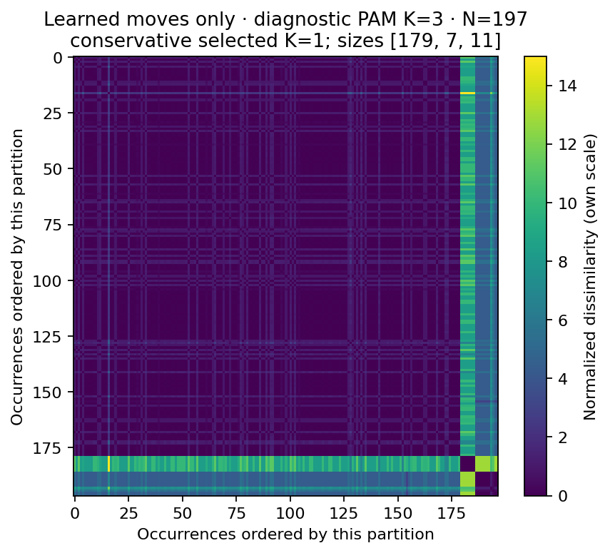

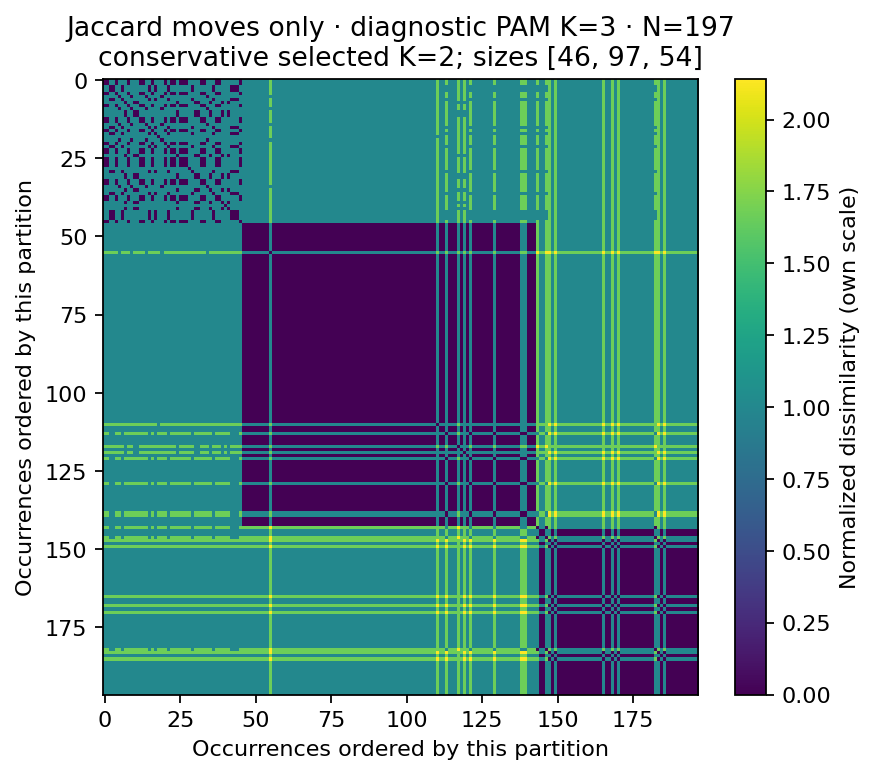

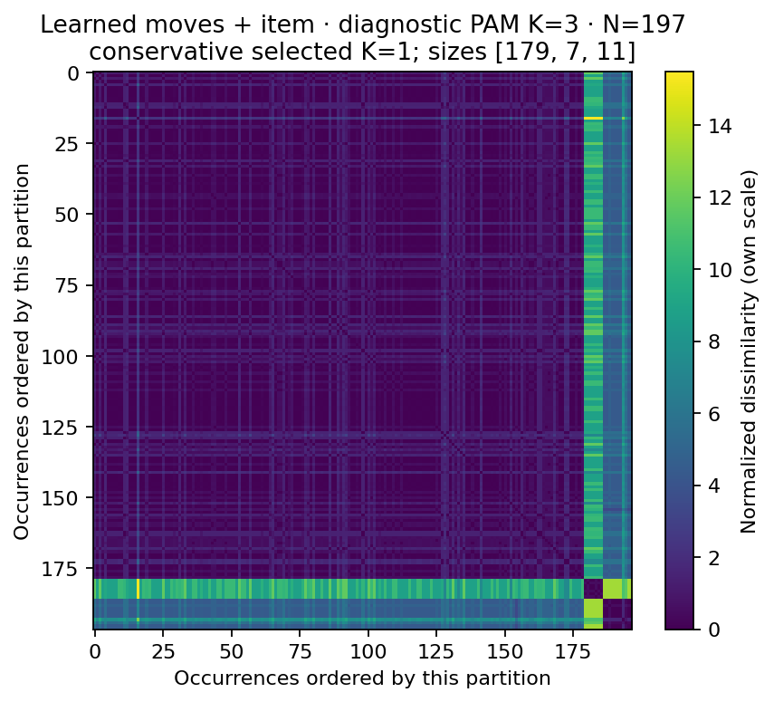

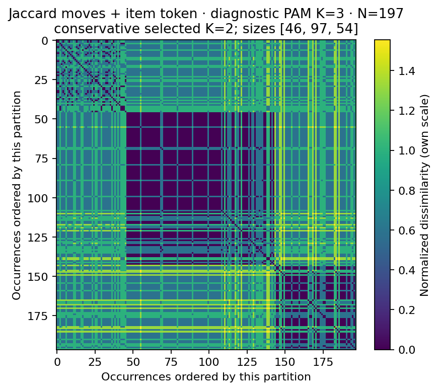

Each distance cell compares two original occurrences. Rows and columns follow that model’s diagnostic K=3 labels; low-distance blocks may reflect repeated exact packages. Color is dissimilarity, not a tactical class. The heatmaps have separate scales/orderings and cannot be compared pixel for pixel.

The learned K=3 groups are 179 broad observations, seven sharing Fake Out / Close Combat / Flare Blitz / Darkest Lariat, and 11 all carrying Helping Hand. The seven-member group contains five connected source groups and is one exact moveset; the 11-member group has three complete movesets, nine of them identical. Both groups fall below the 20-occurrence size threshold. Their separation therefore does not establish three recurring SP archetypes.

Jaccard PAM instead separates the 54 Darkest Lariat observations from 143 others at selected K=2. Forced K=3 separates a 97-member Throat Chop group and a 46-member mixture centered on Snarl/Protect/Helping Hand variants. This partition is stable under the narrow resampling check, but average linkage gives a very different 187/10 K=2 split. The clustering algorithm matters as well as the dissimilarity.

## How much do the partitions agree with SP?

| Partition versus SP-only K=3 | Sizes | ARI | NMI | Interpretation |
|---|---|---|---|---|
| Learned moves only K=1 (selected) | 197 | 0.000 | 0.000 | K=1: no grouping claim |
| Learned moves only K=3 (diagnostic) | 179 / 7 / 11 | 0.104 | 0.148 | descriptive |
| Jaccard moves only K=2 (selected) | 143 / 54 | 0.056 | 0.071 | descriptive |
| Jaccard moves only K=3 (diagnostic) | 46 / 97 / 54 | 0.022 | 0.061 | descriptive |
| Learned moves + item K=1 (selected) | 197 | 0.000 | 0.000 | K=1: no grouping claim |
| Learned moves + item K=3 (diagnostic) | 179 / 7 / 11 | 0.104 | 0.148 | descriptive |
| Jaccard moves + item token K=2 (selected) | 143 / 54 | 0.056 | 0.071 | descriptive |
| Jaccard moves + item token K=3 (diagnostic) | 46 / 97 / 54 | 0.022 | 0.061 | descriptive |
| SP + learned moves K=3 (diagnostic) | 34 / 7 / 156 | 0.759 | 0.709 | descriptive |
| SP + Jaccard moves K=3 (diagnostic) | 112 / 66 / 19 | 0.177 | 0.336 | descriptive |

ARI adjusts pair agreement for chance. NMI uses arithmetic-mean entropy normalization, $2I/(H_1+H_2)$, with natural logarithms. Both are invariant to renumbering clusters. K=1 comparisons are exported but cannot establish successful multicluster grouping. Unequal group sizes and related publications still affect what apparent agreement means.

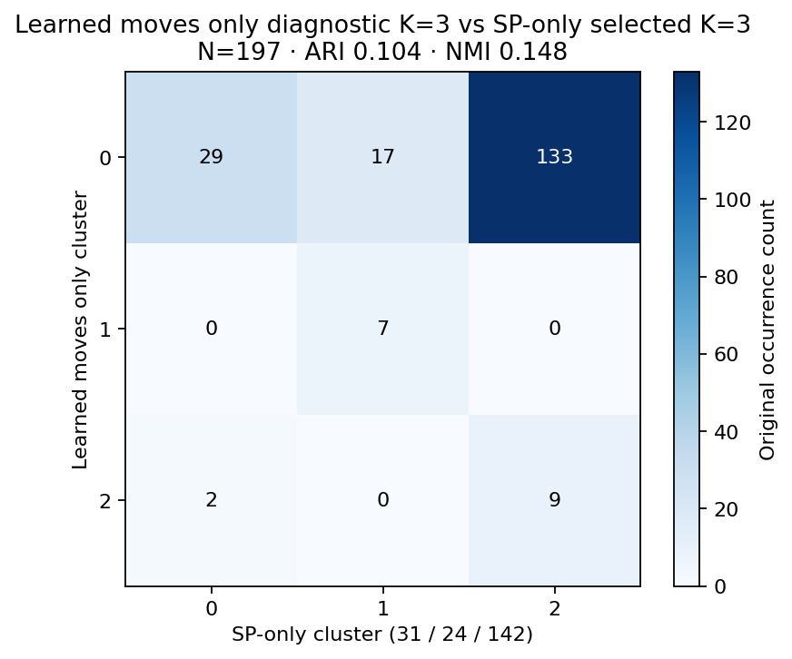

**Rows: Learned moves only K=3 (diagnostic). Columns: SP only K=3 (selected + diagnostic).**

| Row cluster | C0 | C1 | C2 | Row total |
|---|---|---|---|---|
| C0 | 29 | 17 | 133 | 179 |
| C1 | 0 | 7 | 0 | 7 |
| C2 | 2 | 0 | 9 | 11 |
| Column total | 31 | 24 | 142 | 197 |

Row-conditional memberships: C0 → 16.2% / 9.5% / 74.3%; C1 → 0.0% / 100.0% / 0.0%; C2 → 18.2% / 0.0% / 81.8%.
Column-conditional memberships (column clusters back to row clusters): C0 → 93.5% / 0.0% / 6.5%; C1 → 70.8% / 29.2% / 0.0%; C2 → 93.7% / 0.0% / 6.3%.

**Rows: Learned moves only K=1 (selected). Columns: SP only K=3 (selected + diagnostic).**

| Row cluster | C0 | C1 | C2 | Row total |
|---|---|---|---|---|
| C0 | 31 | 24 | 142 | 197 |
| Column total | 31 | 24 | 142 | 197 |

Row-conditional memberships: C0 → 15.7% / 12.2% / 72.1%.
Column-conditional memberships (column clusters back to row clusters): C0 → 100.0%; C1 → 100.0%; C2 → 100.0%.

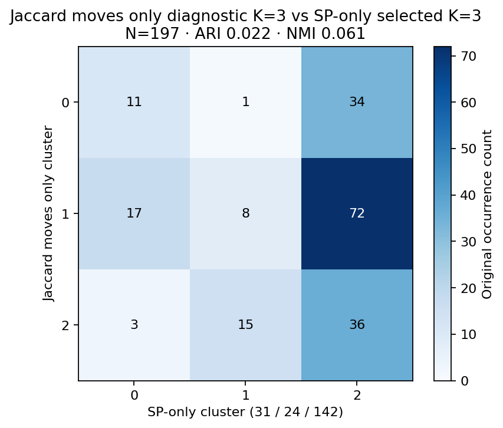

**Rows: Jaccard moves only K=3 (diagnostic). Columns: SP only K=3 (selected + diagnostic).**

| Row cluster | C0 | C1 | C2 | Row total |
|---|---|---|---|---|
| C0 | 11 | 1 | 34 | 46 |
| C1 | 17 | 8 | 72 | 97 |
| C2 | 3 | 15 | 36 | 54 |
| Column total | 31 | 24 | 142 | 197 |

Row-conditional memberships: C0 → 23.9% / 2.2% / 73.9%; C1 → 17.5% / 8.2% / 74.2%; C2 → 5.6% / 27.8% / 66.7%.
Column-conditional memberships (column clusters back to row clusters): C0 → 35.5% / 54.8% / 9.7%; C1 → 4.2% / 33.3% / 62.5%; C2 → 23.9% / 50.7% / 25.4%.

**Rows: Jaccard moves only K=2 (selected). Columns: SP only K=3 (selected + diagnostic).**

| Row cluster | C0 | C1 | C2 | Row total |
|---|---|---|---|---|
| C0 | 28 | 9 | 106 | 143 |
| C1 | 3 | 15 | 36 | 54 |
| Column total | 31 | 24 | 142 | 197 |

Row-conditional memberships: C0 → 19.6% / 6.3% / 74.1%; C1 → 5.6% / 27.8% / 66.7%.
Column-conditional memberships (column clusters back to row clusters): C0 → 90.3% / 9.7%; C1 → 37.5% / 62.5%; C2 → 74.6% / 25.4%.

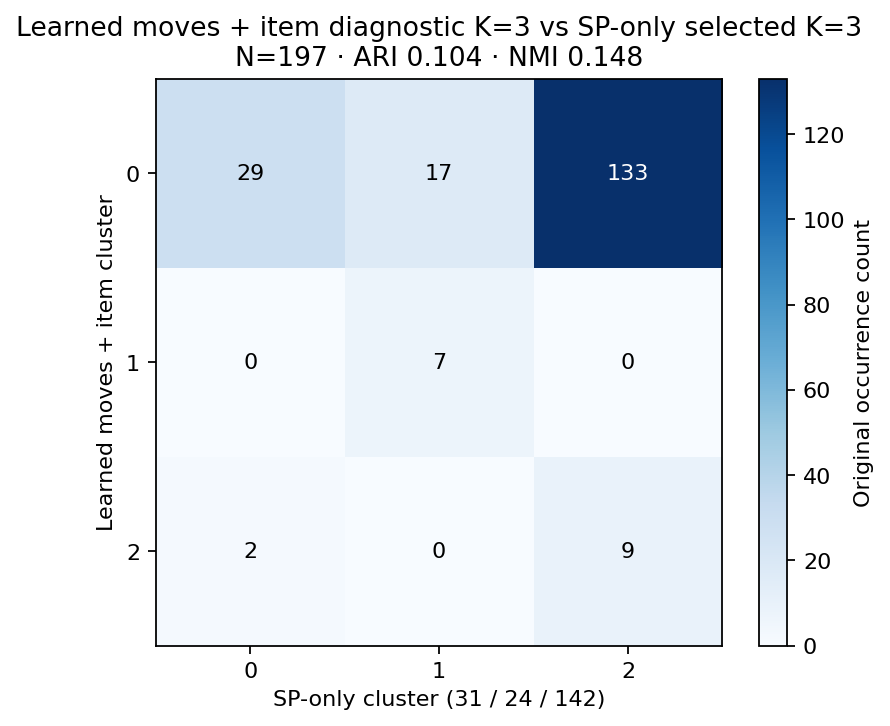

**Rows: Learned moves + item K=3 (diagnostic). Columns: SP only K=3 (selected + diagnostic).**

| Row cluster | C0 | C1 | C2 | Row total |
|---|---|---|---|---|
| C0 | 29 | 17 | 133 | 179 |
| C1 | 0 | 7 | 0 | 7 |
| C2 | 2 | 0 | 9 | 11 |
| Column total | 31 | 24 | 142 | 197 |

Row-conditional memberships: C0 → 16.2% / 9.5% / 74.3%; C1 → 0.0% / 100.0% / 0.0%; C2 → 18.2% / 0.0% / 81.8%.
Column-conditional memberships (column clusters back to row clusters): C0 → 93.5% / 0.0% / 6.5%; C1 → 70.8% / 29.2% / 0.0%; C2 → 93.7% / 0.0% / 6.3%.

**Rows: Learned moves + item K=1 (selected). Columns: SP only K=3 (selected + diagnostic).**

| Row cluster | C0 | C1 | C2 | Row total |
|---|---|---|---|---|
| C0 | 31 | 24 | 142 | 197 |
| Column total | 31 | 24 | 142 | 197 |

Row-conditional memberships: C0 → 15.7% / 12.2% / 72.1%.
Column-conditional memberships (column clusters back to row clusters): C0 → 100.0%; C1 → 100.0%; C2 → 100.0%.

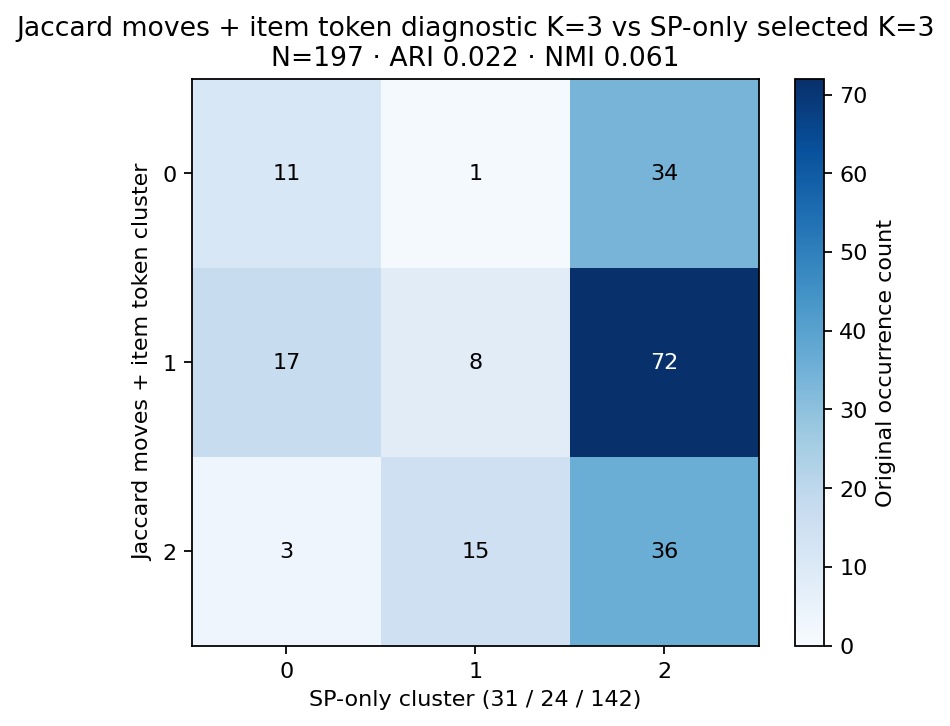

**Rows: Jaccard moves + item token K=3 (diagnostic). Columns: SP only K=3 (selected + diagnostic).**

| Row cluster | C0 | C1 | C2 | Row total |
|---|---|---|---|---|
| C0 | 11 | 1 | 34 | 46 |
| C1 | 17 | 8 | 72 | 97 |
| C2 | 3 | 15 | 36 | 54 |
| Column total | 31 | 24 | 142 | 197 |

Row-conditional memberships: C0 → 23.9% / 2.2% / 73.9%; C1 → 17.5% / 8.2% / 74.2%; C2 → 5.6% / 27.8% / 66.7%.
Column-conditional memberships (column clusters back to row clusters): C0 → 35.5% / 54.8% / 9.7%; C1 → 4.2% / 33.3% / 62.5%; C2 → 23.9% / 50.7% / 25.4%.

**Rows: Jaccard moves + item token K=2 (selected). Columns: SP only K=3 (selected + diagnostic).**

| Row cluster | C0 | C1 | C2 | Row total |
|---|---|---|---|---|
| C0 | 28 | 9 | 106 | 143 |
| C1 | 3 | 15 | 36 | 54 |
| Column total | 31 | 24 | 142 | 197 |

Row-conditional memberships: C0 → 19.6% / 6.3% / 74.1%; C1 → 5.6% / 27.8% / 66.7%.
Column-conditional memberships (column clusters back to row clusters): C0 → 90.3% / 9.7%; C1 → 37.5% / 62.5%; C2 → 74.6% / 25.4%.

### Learned versus exact overlap, and combined distances

Forced K=3 learned versus Jaccard moves-only agreement is **ARI 0.064, NMI 0.136**. Similar-looking moveset groups need not have similar SP composition.

**Rows: Learned moves only K=3 (diagnostic). Columns: Jaccard moves only K=3 (diagnostic).**

| Row cluster | C0 | C1 | C2 | Row total |
|---|---|---|---|---|
| C0 | 37 | 95 | 47 | 179 |
| C1 | 0 | 0 | 7 | 7 |
| C2 | 9 | 2 | 0 | 11 |
| Column total | 46 | 97 | 54 | 197 |

Row-conditional memberships: C0 → 20.7% / 53.1% / 26.3%; C1 → 0.0% / 0.0% / 100.0%; C2 → 81.8% / 18.2% / 0.0%.
Column-conditional memberships (column clusters back to row clusters): C0 → 80.4% / 0.0% / 19.6%; C1 → 97.9% / 0.0% / 2.1%; C2 → 87.0% / 13.0% / 0.0%.

**Rows: SP + learned moves K=3 (diagnostic). Columns: SP only K=3 (selected + diagnostic).**

| Row cluster | C0 | C1 | C2 | Row total |
|---|---|---|---|---|
| C0 | 31 | 3 | 0 | 34 |
| C1 | 0 | 7 | 0 | 7 |
| C2 | 0 | 14 | 142 | 156 |
| Column total | 31 | 24 | 142 | 197 |

Row-conditional memberships: C0 → 91.2% / 8.8% / 0.0%; C1 → 0.0% / 100.0% / 0.0%; C2 → 0.0% / 9.0% / 91.0%.
Column-conditional memberships (column clusters back to row clusters): C0 → 100.0% / 0.0% / 0.0%; C1 → 12.5% / 29.2% / 58.3%; C2 → 0.0% / 0.0% / 100.0%.

**Rows: SP + Jaccard moves K=3 (diagnostic). Columns: SP only K=3 (selected + diagnostic).**

| Row cluster | C0 | C1 | C2 | Row total |
|---|---|---|---|---|
| C0 | 29 | 3 | 80 | 112 |
| C1 | 1 | 3 | 62 | 66 |
| C2 | 1 | 18 | 0 | 19 |
| Column total | 31 | 24 | 142 | 197 |

Row-conditional memberships: C0 → 25.9% / 2.7% / 71.4%; C1 → 1.5% / 4.5% / 93.9%; C2 → 5.3% / 94.7% / 0.0%.
Column-conditional memberships (column clusters back to row clusters): C0 → 93.5% / 3.2% / 3.2%; C1 → 12.5% / 12.5% / 75.0%; C2 → 56.3% / 43.7% / 0.0%.

<details>
<summary>All pairwise comparison metrics, including selected and item-aware partitions</summary>

| Left | Right | ARI | NMI |
|---|---|---|---|
| SP + learned moves K=3 (diagnostic) | SP + Jaccard moves K=3 (diagnostic) | 0.069 | 0.201 |
| Jaccard moves + item token K=2 (selected) | SP + Jaccard moves K=3 (diagnostic) | 0.442 | 0.365 |
| Jaccard moves + item token K=2 (selected) | SP + learned moves K=3 (diagnostic) | 0.030 | 0.090 |
| Jaccard moves + item token K=2 (selected) | Jaccard moves + item token K=3 (diagnostic) | 0.561 | 0.720 |
| Jaccard moves + item token K=2 (selected) | SP only K=3 (selected + diagnostic) | 0.056 | 0.071 |
| Jaccard moves + item token K=3 (diagnostic) | SP + Jaccard moves K=3 (diagnostic) | 0.473 | 0.416 |
| Jaccard moves + item token K=3 (diagnostic) | SP + learned moves K=3 (diagnostic) | 0.019 | 0.067 |
| Jaccard moves + item token K=3 (diagnostic) | SP only K=3 (selected + diagnostic) | 0.022 | 0.061 |
| Learned moves + item K=1 (selected) | SP + Jaccard moves K=3 (diagnostic) | 0.000 | 0.000 |
| Learned moves + item K=1 (selected) | SP + learned moves K=3 (diagnostic) | 0.000 | 0.000 |
| Learned moves + item K=1 (selected) | Jaccard moves + item token K=2 (selected) | 0.000 | 0.000 |
| Learned moves + item K=1 (selected) | Jaccard moves + item token K=3 (diagnostic) | 0.000 | 0.000 |
| Learned moves + item K=1 (selected) | Learned moves + item K=3 (diagnostic) | 0.000 | 0.000 |
| Learned moves + item K=1 (selected) | SP only K=3 (selected + diagnostic) | 0.000 | 0.000 |
| Learned moves + item K=3 (diagnostic) | SP + Jaccard moves K=3 (diagnostic) | 0.083 | 0.148 |
| Learned moves + item K=3 (diagnostic) | SP + learned moves K=3 (diagnostic) | 0.203 | 0.315 |
| Learned moves + item K=3 (diagnostic) | Jaccard moves + item token K=2 (selected) | 0.047 | 0.135 |
| Learned moves + item K=3 (diagnostic) | Jaccard moves + item token K=3 (diagnostic) | 0.064 | 0.136 |
| Learned moves + item K=3 (diagnostic) | SP only K=3 (selected + diagnostic) | 0.104 | 0.148 |
| Jaccard moves only K=2 (selected) | SP + Jaccard moves K=3 (diagnostic) | 0.442 | 0.365 |
| Jaccard moves only K=2 (selected) | SP + learned moves K=3 (diagnostic) | 0.030 | 0.090 |
| Jaccard moves only K=2 (selected) | Jaccard moves + item token K=2 (selected) | 1.000 | 1.000 |
| Jaccard moves only K=2 (selected) | Jaccard moves + item token K=3 (diagnostic) | 0.561 | 0.720 |
| Jaccard moves only K=2 (selected) | Learned moves + item K=1 (selected) | 0.000 | 0.000 |
| Jaccard moves only K=2 (selected) | Learned moves + item K=3 (diagnostic) | 0.047 | 0.135 |
| Jaccard moves only K=2 (selected) | Jaccard moves only K=3 (diagnostic) | 0.561 | 0.720 |
| Jaccard moves only K=2 (selected) | SP only K=3 (selected + diagnostic) | 0.056 | 0.071 |
| Jaccard moves only K=3 (diagnostic) | SP + Jaccard moves K=3 (diagnostic) | 0.473 | 0.416 |
| Jaccard moves only K=3 (diagnostic) | SP + learned moves K=3 (diagnostic) | 0.019 | 0.067 |
| Jaccard moves only K=3 (diagnostic) | Jaccard moves + item token K=2 (selected) | 0.561 | 0.720 |
| Jaccard moves only K=3 (diagnostic) | Jaccard moves + item token K=3 (diagnostic) | 1.000 | 1.000 |
| Jaccard moves only K=3 (diagnostic) | Learned moves + item K=1 (selected) | 0.000 | 0.000 |
| Jaccard moves only K=3 (diagnostic) | Learned moves + item K=3 (diagnostic) | 0.064 | 0.136 |
| Jaccard moves only K=3 (diagnostic) | SP only K=3 (selected + diagnostic) | 0.022 | 0.061 |
| Learned moves only K=1 (selected) | SP + Jaccard moves K=3 (diagnostic) | 0.000 | 0.000 |
| Learned moves only K=1 (selected) | SP + learned moves K=3 (diagnostic) | 0.000 | 0.000 |
| Learned moves only K=1 (selected) | Jaccard moves + item token K=2 (selected) | 0.000 | 0.000 |
| Learned moves only K=1 (selected) | Jaccard moves + item token K=3 (diagnostic) | 0.000 | 0.000 |
| Learned moves only K=1 (selected) | Learned moves + item K=1 (selected) | 1.000 | 1.000 |
| Learned moves only K=1 (selected) | Learned moves + item K=3 (diagnostic) | 0.000 | 0.000 |
| Learned moves only K=1 (selected) | Jaccard moves only K=2 (selected) | 0.000 | 0.000 |
| Learned moves only K=1 (selected) | Jaccard moves only K=3 (diagnostic) | 0.000 | 0.000 |
| Learned moves only K=1 (selected) | Learned moves only K=3 (diagnostic) | 0.000 | 0.000 |
| Learned moves only K=1 (selected) | SP only K=3 (selected + diagnostic) | 0.000 | 0.000 |
| Learned moves only K=3 (diagnostic) | SP + Jaccard moves K=3 (diagnostic) | 0.083 | 0.148 |
| Learned moves only K=3 (diagnostic) | SP + learned moves K=3 (diagnostic) | 0.203 | 0.315 |
| Learned moves only K=3 (diagnostic) | Jaccard moves + item token K=2 (selected) | 0.047 | 0.135 |
| Learned moves only K=3 (diagnostic) | Jaccard moves + item token K=3 (diagnostic) | 0.064 | 0.136 |
| Learned moves only K=3 (diagnostic) | Learned moves + item K=1 (selected) | 0.000 | 0.000 |
| Learned moves only K=3 (diagnostic) | Learned moves + item K=3 (diagnostic) | 1.000 | 1.000 |
| Learned moves only K=3 (diagnostic) | Jaccard moves only K=2 (selected) | 0.047 | 0.135 |
| Learned moves only K=3 (diagnostic) | Jaccard moves only K=3 (diagnostic) | 0.064 | 0.136 |
| Learned moves only K=3 (diagnostic) | SP only K=3 (selected + diagnostic) | 0.104 | 0.148 |
| SP only K=3 (selected + diagnostic) | SP + Jaccard moves K=3 (diagnostic) | 0.177 | 0.336 |
| SP only K=3 (selected + diagnostic) | SP + learned moves K=3 (diagnostic) | 0.759 | 0.709 |

</details>

All pairwise occurrence-count contingency tables, sizes and proportions are in [partition-comparisons.json](assets/m353-moveset-diagnostics/partition-comparisons.json); the principal cross-tabs above show both directions explicitly.

## Do moveset groups separate original SP allocations?

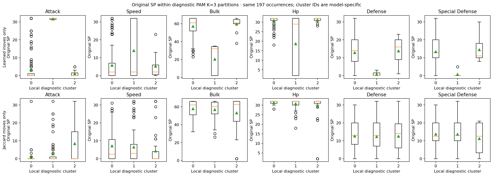

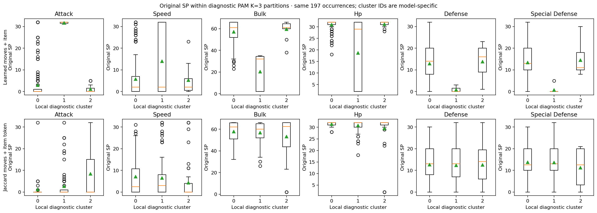

Each row uses its own model’s cluster IDs. Boxes span Q1–Q3, lines are medians, triangles are means, and circles are outliers. Bulk is HP + Defense + Special Defense. SP values are the original observations, not inferred allocations.

### Learned moves only K=1 (selected)

| Cluster | N / share | Attack median [Q1–Q3] | Speed median [Q1–Q3] | Bulk median [Q1–Q3] | HP / Def / SpD medians | SP ranges: Attack; Speed |
|---|---|---|---|---|---|---|
| 0 | 197 / 100.0% | 0 [0–1] | 2 [0–7] | 61 [50–66] | 32 / 14 / 13 | 0–32; 0–32 |

**C0** — Attack SP : counts `{'0': 135, '1': 14, '15': 3, '16': 1, '18': 1, '19': 1, '22': 1, '23': 1, '25': 4, '3': 3, '31': 2, '32': 10, '5': 15, '6': 2, '7': 1, '8': 2, '9': 1}`; Speed SP : counts `{'0': 74, '1': 13, '10': 1, '11': 4, '12': 3, '13': 4, '14': 2, '15': 2, '16': 2, '17': 1, '2': 19, '23': 8, '24': 2, '26': 2, '27': 2, '28': 2, '29': 1, '3': 8, '31': 2, '32': 5, '4': 9, '5': 13, '6': 5, '7': 10, '8': 3}`. Natures: Careful ×73; Impish ×64; Adamant ×28; Sassy ×13; Brave ×8. Items: Sitrus Berry ×136; Chople Berry ×26; Passho Berry ×13; Rocky Helmet ×7; Leftovers ×4.

### Learned moves only K=3 (diagnostic)

| Cluster | N / share | Attack median [Q1–Q3] | Speed median [Q1–Q3] | Bulk median [Q1–Q3] | HP / Def / SpD medians | SP ranges: Attack; Speed |
|---|---|---|---|---|---|---|
| 0 | 179 / 90.9% | 0 [0–1] | 2 [0–7] | 61 [52–66] | 32 / 14 / 13 | 0–32; 0–32 |
| 1 | 7 / 3.6% | 32 [31.5–32] | 2 [0–32] | 32 [2–34.5] | 29 / 0 / 0 | 31–32; 0–32 |
| 2 | 11 / 5.6% | 0 [0–1.5] | 2 [0.5–6] | 61 [60–64.5] | 32 / 16 / 11 | 0–5; 0–23 |

**C0** — Attack SP : counts `{'0': 127, '1': 14, '15': 3, '16': 1, '18': 1, '19': 1, '22': 1, '23': 1, '25': 4, '3': 2, '32': 5, '5': 13, '6': 2, '7': 1, '8': 2, '9': 1}`; Speed SP : counts `{'0': 68, '1': 12, '10': 1, '11': 4, '12': 3, '13': 3, '14': 2, '15': 2, '16': 2, '17': 1, '2': 16, '23': 7, '24': 2, '26': 2, '27': 2, '28': 2, '29': 1, '3': 8, '31': 2, '32': 2, '4': 9, '5': 12, '6': 3, '7': 10, '8': 3}`. Natures: Careful ×70; Impish ×58; Adamant ×24; Sassy ×12; Relaxed ×8. Items: Sitrus Berry ×127; Chople Berry ×25; Passho Berry ×13; Rocky Helmet ×6; Leftovers ×4.

**C1** — Attack SP : counts `{'31': 2, '32': 5}`; Speed SP : counts `{'0': 3, '2': 1, '32': 3}`. Natures: Brave ×4; Adamant ×3. Items: Life Orb ×4; White Herb ×2; Charcoal ×1.

**C2** — Attack SP : counts `{'0': 8, '3': 1, '5': 2}`; Speed SP : counts `{'0': 3, '1': 1, '13': 1, '2': 2, '23': 1, '5': 1, '6': 2}`. Natures: Impish ×6; Careful ×3; Adamant ×1; Sassy ×1. Items: Sitrus Berry ×9; Chople Berry ×1; Rocky Helmet ×1.

### Jaccard moves only K=2 (selected)

| Cluster | N / share | Attack median [Q1–Q3] | Speed median [Q1–Q3] | Bulk median [Q1–Q3] | HP / Def / SpD medians | SP ranges: Attack; Speed |
|---|---|---|---|---|---|---|
| 0 | 143 / 72.6% | 0 [0–0.5] | 3 [0–8] | 61 [52–65] | 32 / 13 / 13 | 0–32; 0–32 |
| 1 | 54 / 27.4% | 0 [0–15] | 0 [0–4] | 62.5 [43.75–66] | 32 / 14 / 12.5 | 0–32; 0–32 |

**C0** — Attack SP : counts `{'0': 107, '1': 9, '15': 1, '18': 1, '19': 1, '22': 1, '25': 3, '3': 3, '32': 2, '5': 11, '6': 2, '7': 1, '8': 1}`; Speed SP : counts `{'0': 43, '1': 11, '10': 1, '11': 2, '12': 3, '13': 3, '14': 2, '15': 2, '16': 2, '17': 1, '2': 13, '23': 7, '24': 2, '26': 2, '27': 2, '28': 2, '3': 8, '31': 2, '32': 2, '4': 5, '5': 13, '6': 4, '7': 8, '8': 3}`. Natures: Careful ×59; Impish ×49; Adamant ×15; Relaxed ×8; Sassy ×8. Items: Sitrus Berry ×104; Chople Berry ×17; Passho Berry ×10; Rocky Helmet ×6; Leftovers ×4.

**C1** — Attack SP : counts `{'0': 28, '1': 5, '15': 2, '16': 1, '23': 1, '25': 1, '31': 2, '32': 8, '5': 4, '8': 1, '9': 1}`; Speed SP : counts `{'0': 31, '1': 2, '11': 2, '13': 1, '2': 6, '23': 1, '29': 1, '32': 3, '4': 4, '6': 1, '7': 2}`. Natures: Impish ×15; Careful ×14; Adamant ×13; Brave ×5; Sassy ×5. Items: Sitrus Berry ×32; Chople Berry ×9; Life Orb ×4; Passho Berry ×3; White Herb ×2.

### Jaccard moves only K=3 (diagnostic)

| Cluster | N / share | Attack median [Q1–Q3] | Speed median [Q1–Q3] | Bulk median [Q1–Q3] | HP / Def / SpD medians | SP ranges: Attack; Speed |
|---|---|---|---|---|---|---|
| 0 | 46 / 23.4% | 0 [0–0] | 2.5 [0–10.75] | 62 [51–65.75] | 32 / 13 / 12.5 | 0–32; 0–31 |
| 1 | 97 / 49.2% | 0 [0–1] | 3 [0–8] | 60 [52–65] | 32 / 13 / 13 | 0–32; 0–32 |
| 2 | 54 / 27.4% | 0 [0–15] | 0 [0–4] | 62.5 [43.75–66] | 32 / 14 / 12.5 | 0–32; 0–32 |

**C0** — Attack SP : counts `{'0': 39, '1': 2, '3': 1, '32': 1, '5': 3}`; Speed SP : counts `{'0': 14, '1': 5, '12': 1, '13': 1, '16': 1, '17': 1, '2': 4, '23': 3, '24': 1, '26': 1, '27': 1, '28': 1, '3': 2, '31': 1, '4': 3, '5': 4, '6': 1, '7': 1}`. Natures: Careful ×19; Impish ×13; Relaxed ×6; Sassy ×5; Brave ×2. Items: Sitrus Berry ×29; Passho Berry ×7; Chople Berry ×7; Rocky Helmet ×2; Leftovers ×1.

**C1** — Attack SP : counts `{'0': 68, '1': 7, '15': 1, '18': 1, '19': 1, '22': 1, '25': 3, '3': 2, '32': 1, '5': 8, '6': 2, '7': 1, '8': 1}`; Speed SP : counts `{'0': 29, '1': 6, '10': 1, '11': 2, '12': 2, '13': 2, '14': 2, '15': 2, '16': 1, '2': 9, '23': 4, '24': 1, '26': 1, '27': 1, '28': 1, '3': 6, '31': 1, '32': 2, '4': 2, '5': 9, '6': 3, '7': 7, '8': 3}`. Natures: Careful ×40; Impish ×36; Adamant ×14; Sassy ×3; Relaxed ×2. Items: Sitrus Berry ×75; Chople Berry ×10; Rocky Helmet ×4; Passho Berry ×3; Leftovers ×3.

**C2** — Attack SP : counts `{'0': 28, '1': 5, '15': 2, '16': 1, '23': 1, '25': 1, '31': 2, '32': 8, '5': 4, '8': 1, '9': 1}`; Speed SP : counts `{'0': 31, '1': 2, '11': 2, '13': 1, '2': 6, '23': 1, '29': 1, '32': 3, '4': 4, '6': 1, '7': 2}`. Natures: Impish ×15; Careful ×14; Adamant ×13; Brave ×5; Sassy ×5. Items: Sitrus Berry ×32; Chople Berry ×9; Life Orb ×4; Passho Berry ×3; White Herb ×2.

### Learned moves + item K=1 (selected)

| Cluster | N / share | Attack median [Q1–Q3] | Speed median [Q1–Q3] | Bulk median [Q1–Q3] | HP / Def / SpD medians | SP ranges: Attack; Speed |
|---|---|---|---|---|---|---|
| 0 | 197 / 100.0% | 0 [0–1] | 2 [0–7] | 61 [50–66] | 32 / 14 / 13 | 0–32; 0–32 |

**C0** — Attack SP : counts `{'0': 135, '1': 14, '15': 3, '16': 1, '18': 1, '19': 1, '22': 1, '23': 1, '25': 4, '3': 3, '31': 2, '32': 10, '5': 15, '6': 2, '7': 1, '8': 2, '9': 1}`; Speed SP : counts `{'0': 74, '1': 13, '10': 1, '11': 4, '12': 3, '13': 4, '14': 2, '15': 2, '16': 2, '17': 1, '2': 19, '23': 8, '24': 2, '26': 2, '27': 2, '28': 2, '29': 1, '3': 8, '31': 2, '32': 5, '4': 9, '5': 13, '6': 5, '7': 10, '8': 3}`. Natures: Careful ×73; Impish ×64; Adamant ×28; Sassy ×13; Brave ×8. Items: Sitrus Berry ×136; Chople Berry ×26; Passho Berry ×13; Rocky Helmet ×7; Leftovers ×4.

### Learned moves + item K=3 (diagnostic)

| Cluster | N / share | Attack median [Q1–Q3] | Speed median [Q1–Q3] | Bulk median [Q1–Q3] | HP / Def / SpD medians | SP ranges: Attack; Speed |
|---|---|---|---|---|---|---|
| 0 | 179 / 90.9% | 0 [0–1] | 2 [0–7] | 61 [52–66] | 32 / 14 / 13 | 0–32; 0–32 |
| 1 | 7 / 3.6% | 32 [31.5–32] | 2 [0–32] | 32 [2–34.5] | 29 / 0 / 0 | 31–32; 0–32 |
| 2 | 11 / 5.6% | 0 [0–1.5] | 2 [0.5–6] | 61 [60–64.5] | 32 / 16 / 11 | 0–5; 0–23 |

**C0** — Attack SP : counts `{'0': 127, '1': 14, '15': 3, '16': 1, '18': 1, '19': 1, '22': 1, '23': 1, '25': 4, '3': 2, '32': 5, '5': 13, '6': 2, '7': 1, '8': 2, '9': 1}`; Speed SP : counts `{'0': 68, '1': 12, '10': 1, '11': 4, '12': 3, '13': 3, '14': 2, '15': 2, '16': 2, '17': 1, '2': 16, '23': 7, '24': 2, '26': 2, '27': 2, '28': 2, '29': 1, '3': 8, '31': 2, '32': 2, '4': 9, '5': 12, '6': 3, '7': 10, '8': 3}`. Natures: Careful ×70; Impish ×58; Adamant ×24; Sassy ×12; Relaxed ×8. Items: Sitrus Berry ×127; Chople Berry ×25; Passho Berry ×13; Rocky Helmet ×6; Leftovers ×4.

**C1** — Attack SP : counts `{'31': 2, '32': 5}`; Speed SP : counts `{'0': 3, '2': 1, '32': 3}`. Natures: Brave ×4; Adamant ×3. Items: Life Orb ×4; White Herb ×2; Charcoal ×1.

**C2** — Attack SP : counts `{'0': 8, '3': 1, '5': 2}`; Speed SP : counts `{'0': 3, '1': 1, '13': 1, '2': 2, '23': 1, '5': 1, '6': 2}`. Natures: Impish ×6; Careful ×3; Adamant ×1; Sassy ×1. Items: Sitrus Berry ×9; Chople Berry ×1; Rocky Helmet ×1.

### Jaccard moves + item token K=2 (selected)

| Cluster | N / share | Attack median [Q1–Q3] | Speed median [Q1–Q3] | Bulk median [Q1–Q3] | HP / Def / SpD medians | SP ranges: Attack; Speed |
|---|---|---|---|---|---|---|
| 0 | 143 / 72.6% | 0 [0–0.5] | 3 [0–8] | 61 [52–65] | 32 / 13 / 13 | 0–32; 0–32 |
| 1 | 54 / 27.4% | 0 [0–15] | 0 [0–4] | 62.5 [43.75–66] | 32 / 14 / 12.5 | 0–32; 0–32 |

**C0** — Attack SP : counts `{'0': 107, '1': 9, '15': 1, '18': 1, '19': 1, '22': 1, '25': 3, '3': 3, '32': 2, '5': 11, '6': 2, '7': 1, '8': 1}`; Speed SP : counts `{'0': 43, '1': 11, '10': 1, '11': 2, '12': 3, '13': 3, '14': 2, '15': 2, '16': 2, '17': 1, '2': 13, '23': 7, '24': 2, '26': 2, '27': 2, '28': 2, '3': 8, '31': 2, '32': 2, '4': 5, '5': 13, '6': 4, '7': 8, '8': 3}`. Natures: Careful ×59; Impish ×49; Adamant ×15; Relaxed ×8; Sassy ×8. Items: Sitrus Berry ×104; Chople Berry ×17; Passho Berry ×10; Rocky Helmet ×6; Leftovers ×4.

**C1** — Attack SP : counts `{'0': 28, '1': 5, '15': 2, '16': 1, '23': 1, '25': 1, '31': 2, '32': 8, '5': 4, '8': 1, '9': 1}`; Speed SP : counts `{'0': 31, '1': 2, '11': 2, '13': 1, '2': 6, '23': 1, '29': 1, '32': 3, '4': 4, '6': 1, '7': 2}`. Natures: Impish ×15; Careful ×14; Adamant ×13; Brave ×5; Sassy ×5. Items: Sitrus Berry ×32; Chople Berry ×9; Life Orb ×4; Passho Berry ×3; White Herb ×2.

### Jaccard moves + item token K=3 (diagnostic)

| Cluster | N / share | Attack median [Q1–Q3] | Speed median [Q1–Q3] | Bulk median [Q1–Q3] | HP / Def / SpD medians | SP ranges: Attack; Speed |
|---|---|---|---|---|---|---|
| 0 | 46 / 23.4% | 0 [0–0] | 2.5 [0–10.75] | 62 [51–65.75] | 32 / 13 / 12.5 | 0–32; 0–31 |
| 1 | 97 / 49.2% | 0 [0–1] | 3 [0–8] | 60 [52–65] | 32 / 13 / 13 | 0–32; 0–32 |
| 2 | 54 / 27.4% | 0 [0–15] | 0 [0–4] | 62.5 [43.75–66] | 32 / 14 / 12.5 | 0–32; 0–32 |

**C0** — Attack SP : counts `{'0': 39, '1': 2, '3': 1, '32': 1, '5': 3}`; Speed SP : counts `{'0': 14, '1': 5, '12': 1, '13': 1, '16': 1, '17': 1, '2': 4, '23': 3, '24': 1, '26': 1, '27': 1, '28': 1, '3': 2, '31': 1, '4': 3, '5': 4, '6': 1, '7': 1}`. Natures: Careful ×19; Impish ×13; Relaxed ×6; Sassy ×5; Brave ×2. Items: Sitrus Berry ×29; Passho Berry ×7; Chople Berry ×7; Rocky Helmet ×2; Leftovers ×1.

**C1** — Attack SP : counts `{'0': 68, '1': 7, '15': 1, '18': 1, '19': 1, '22': 1, '25': 3, '3': 2, '32': 1, '5': 8, '6': 2, '7': 1, '8': 1}`; Speed SP : counts `{'0': 29, '1': 6, '10': 1, '11': 2, '12': 2, '13': 2, '14': 2, '15': 2, '16': 1, '2': 9, '23': 4, '24': 1, '26': 1, '27': 1, '28': 1, '3': 6, '31': 1, '32': 2, '4': 2, '5': 9, '6': 3, '7': 7, '8': 3}`. Natures: Careful ×40; Impish ×36; Adamant ×14; Sassy ×3; Relaxed ×2. Items: Sitrus Berry ×75; Chople Berry ×10; Rocky Helmet ×4; Passho Berry ×3; Leftovers ×3.

**C2** — Attack SP : counts `{'0': 28, '1': 5, '15': 2, '16': 1, '23': 1, '25': 1, '31': 2, '32': 8, '5': 4, '8': 1, '9': 1}`; Speed SP : counts `{'0': 31, '1': 2, '11': 2, '13': 1, '2': 6, '23': 1, '29': 1, '32': 3, '4': 4, '6': 1, '7': 2}`. Natures: Impish ×15; Careful ×14; Adamant ×13; Brave ×5; Sassy ×5. Items: Sitrus Berry ×32; Chople Berry ×9; Life Orb ×4; Passho Berry ×3; White Herb ×2.

Full distributions for every SP coordinate and bulk, all nature/alignment and item counts, and original medoid builds are in [cluster-statistics.json](assets/m353-moveset-diagnostics/cluster-statistics.json). Tables report both central spread and full Attack/Speed frequencies so low/high-investment mixtures remain visible.

### Identical observed packages already hide different SP groups

The most common exact moveset—**Fake Out / Flare Blitz / Parting Shot / Throat Chop**—occurs 88 times: **17 higher-Speed, eight higher-Attack, and 63 lower-Speed defensive** builds. Fixing its item to **Sitrus Berry** still leaves **15 / 6 / 50** across those SP groups in 71 occurrences. These are identical predictor inputs with conflicting frozen SP labels, not an embedding artifact.

| Observed features | Distinct packages | Packages spanning SP groups | Occurrences in mixed packages | Best empirical lookup accuracy | Unavoidable conflicting-label errors |
|---|---|---|---|---|---|
| Moves only | 16 | 5 | 164 | 77.16% (152/197) | 45 |
| Moves + item | 37 | 10 | 152 | 77.66% (153/197) | 44 |

The lookup calculation assigns each exact feature package its most frequent frozen SP label and sums the resulting correct counts. It is an **optimistic in-sample ceiling on these 197 frozen labels**, not a trained classifier, cross-validation result, or bound on future battles. The frozen majority share is 142/197 = 72.08%; exact moves allow at most 77.16%, and adding item raises this only to 77.66%. Earlier M3.5.3 cross-validation used fold-refitted SP labels, so its accuracy has a different target and is not directly comparable. All package counts are exported in [feature-collisions.json](assets/m353-moveset-diagnostics/feature-collisions.json).

## Which moves characterize each cluster?

In SP-only clusters, moves and items are **external descriptions**: neither formed those clusters. Within moveset-based clusters, move enrichment is partly tautological; in item-aware clusters item enrichment is also partly tautological. The test of practical relevance is their agreement with external SP, not whether their defining moves look coherent.

For each canonical move, $f_z(m)=n_{z,m}/|C_z|$, species frequency $f(m)=n_m/197$, and $\operatorname{Lift}_z(m)=f_z(m)/f(m)$. Primary ranks sort occurrence count descending, then canonical move ID for ties. Lift never determines the main rank. Frequencies sum to **400%** over the full move vocabulary because each occurrence has four distinct moves; the displayed top 15 can sum to less. Items are separate package tokens and are not inserted into move tables.

Supplementary overrepresentation lists require **lift >1 and at least three occurrences within that cluster**, then sort lift descending, count descending and canonical ID. No entry is fabricated when fewer than 15 moves or five supported enrichments exist. Move-token entropy is $-\sum_m p_m\log_2 p_m$, where $p_m=n_{z,m}/(4|C_z|)$; complete-set entropy instead uses whole-moveset occurrence shares. Neither is a tactical diversity score.

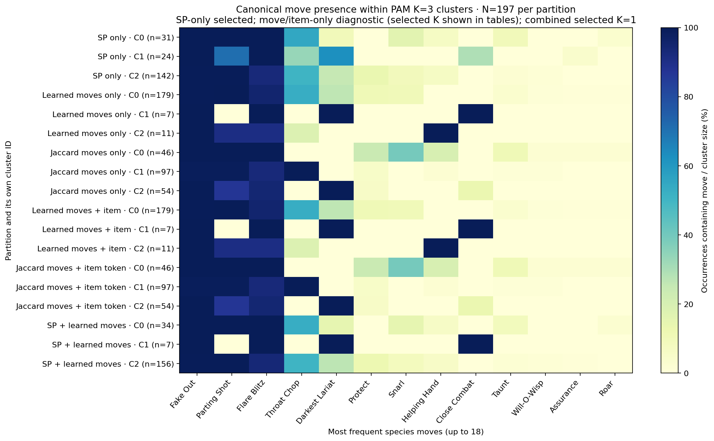

Color shows the percentage of that row’s occurrences containing a move. This common 0–100% scale makes external move differences in SP clusters comparable with the more expected concentrations in move-based groups.

A few useful external contrasts are visible before opening the full tables. Fake Out and Flare Blitz occur in every higher-Speed and higher-Attack SP build, so they do not distinguish those two groups. Close Combat occurs in seven of 24 higher-Attack builds and nowhere else: a specific minority signal with limited coverage. The remaining 17 higher-Attack observations retain Parting Shot and mostly share the same Throat Chop or Darkest Lariat combinations as other SP groups.

In forced learned moves-only K=3, Close Combat has lift 28.14 in the seven-member group, while Helping Hand has lift 17.91 in the 11-member group. In forced Jaccard K=3, Snarl occurs 18/46 (lift 4.28), Throat Chop 97/97 (lift 2.03), and Darkest Lariat 54/54 (lift 3.65) in their respective groups. Those clear move identities coexist with weak SP separation. Items are fully described in the exported distributions and package tables below.

<details>
<summary>SP only K=3 (selected + diagnostic) — full top-15 tables and complete-set summaries</summary>

### Cluster 0 · 31 occurrences (15.7%)

31 connected source groups; 6 distinct complete movesets; 10 distinct moveset/item packages. Largest exact moveset share **54.8%**; predominantly one set (>50%): **yes**. Move-token entropy 2.492 bits; complete-set entropy 1.967 bits.

Observed medoid: **Fake Out / Flare Blitz / Snarl / Parting Shot**, Sitrus Berry, Careful, Intimidate; SP 32 / 0 / 1 / 0 / 10 / 23. [Original publication](https://vgcmulticalc.com/teams/?reg=M-C&paste=D6JMDNWxQp).

Within-cluster dissimilarity: mean 0.917, median 0.833, 465 pairs. Versus all outside occurrences: mean 3.412, median 3.409, 5146 pairs. Distances use that model’s normalized units.

| Rank | Move | Occurrences | Cluster frequency (%) | Species-wide frequency (%) | Lift |
|---|---|---|---|---|---|
| 1 | Fake Out | 31 | 100.00 | 99.49 | 1.005 |
| 2 | Flare Blitz | 31 | 100.00 | 94.92 | 1.053 |
| 3 | Parting Shot | 31 | 100.00 | 95.94 | 1.042 |
| 4 | Throat Chop | 17 | 54.84 | 49.24 | 1.114 |
| 5 | Snarl | 5 | 16.13 | 9.14 | 1.765 |
| 6 | Taunt | 3 | 9.68 | 3.05 | 3.177 |
| 7 | Darkest Lariat | 3 | 9.68 | 27.41 | 0.353 |
| 8 | Helping Hand | 2 | 6.45 | 5.58 | 1.155 |
| 9 | Roar | 1 | 3.23 | 0.51 | 6.355 |

**Top complete four-move combinations:**

| Four-move set | Occurrences | Cluster share (%) |
|---|---|---|
| Fake Out / Flare Blitz / Parting Shot / Throat Chop | 17 | 54.8 |
| Fake Out / Flare Blitz / Snarl / Parting Shot | 5 | 16.1 |
| Fake Out / Taunt / Flare Blitz / Parting Shot | 3 | 9.7 |
| Fake Out / Flare Blitz / Parting Shot / Darkest Lariat | 3 | 9.7 |
| Fake Out / Helping Hand / Flare Blitz / Parting Shot | 2 | 6.5 |

**Most overrepresented moves (support ≥3):** Taunt: 3 occurrences, lift 3.177; Snarl: 5 occurrences, lift 1.765; Throat Chop: 17 occurrences, lift 1.114; Flare Blitz: 31 occurrences, lift 1.053; Parting Shot: 31 occurrences, lift 1.042.

### Cluster 1 · 24 occurrences (12.2%)

21 connected source groups; 4 distinct complete movesets; 10 distinct moveset/item packages. Largest exact moveset share **33.3%**; predominantly one set (>50%): **no**. Move-token entropy 2.504 bits; complete-set entropy 1.766 bits.

Observed medoid: **Fake Out / Flare Blitz / Parting Shot / Throat Chop**, Sitrus Berry, Adamant, Intimidate; SP 32 / 25 / 2 / 0 / 2 / 5. [Original publication](https://vgcmulticalc.com/teams/?reg=M-C&paste=8VylHRorew).

Within-cluster dissimilarity: mean 2.352, median 1.443, 276 pairs. Versus all outside occurrences: mean 5.081, median 4.923, 4152 pairs. Distances use that model’s normalized units.

| Rank | Move | Occurrences | Cluster frequency (%) | Species-wide frequency (%) | Lift |
|---|---|---|---|---|---|
| 1 | Fake Out | 24 | 100.00 | 99.49 | 1.005 |
| 2 | Flare Blitz | 24 | 100.00 | 94.92 | 1.053 |
| 3 | Parting Shot | 17 | 70.83 | 95.94 | 0.738 |
| 4 | Darkest Lariat | 15 | 62.50 | 27.41 | 2.280 |
| 5 | Throat Chop | 8 | 33.33 | 49.24 | 0.677 |
| 6 | Close Combat | 7 | 29.17 | 3.55 | 8.208 |
| 7 | Assurance | 1 | 4.17 | 0.51 | 8.208 |

**Top complete four-move combinations:**

| Four-move set | Occurrences | Cluster share (%) |
|---|---|---|
| Fake Out / Flare Blitz / Parting Shot / Darkest Lariat | 8 | 33.3 |
| Fake Out / Flare Blitz / Parting Shot / Throat Chop | 8 | 33.3 |
| Fake Out / Close Combat / Flare Blitz / Darkest Lariat | 7 | 29.2 |
| Fake Out / Assurance / Flare Blitz / Parting Shot | 1 | 4.2 |

**Most overrepresented moves (support ≥3):** Close Combat: 7 occurrences, lift 8.208; Darkest Lariat: 15 occurrences, lift 2.280; Flare Blitz: 24 occurrences, lift 1.053; Fake Out: 24 occurrences, lift 1.005.

### Cluster 2 · 142 occurrences (72.1%)

140 connected source groups; 13 distinct complete movesets; 31 distinct moveset/item packages. Largest exact moveset share **44.4%**; predominantly one set (>50%): **no**. Move-token entropy 2.569 bits; complete-set entropy 2.451 bits.

Observed medoid: **Fake Out / Flare Blitz / Parting Shot / Throat Chop**, Sitrus Berry, Impish, Intimidate; SP 31 / 0 / 14 / 0 / 19 / 2. [Original publication](https://vgcmulticalc.com/teams/?reg=M-C&paste=2xim9NU90C).

Within-cluster dissimilarity: mean 0.491, median 0.444, 10011 pairs. Versus all outside occurrences: mean 3.939, median 3.455, 7810 pairs. Distances use that model’s normalized units.

| Rank | Move | Occurrences | Cluster frequency (%) | Species-wide frequency (%) | Lift |
|---|---|---|---|---|---|
| 1 | Fake Out | 141 | 99.30 | 99.49 | 0.998 |
| 2 | Parting Shot | 141 | 99.30 | 95.94 | 1.035 |
| 3 | Flare Blitz | 132 | 92.96 | 94.92 | 0.979 |
| 4 | Throat Chop | 72 | 50.70 | 49.24 | 1.030 |
| 5 | Darkest Lariat | 36 | 25.35 | 27.41 | 0.925 |
| 6 | Protect | 19 | 13.38 | 9.64 | 1.387 |
| 7 | Snarl | 13 | 9.15 | 9.14 | 1.002 |
| 8 | Helping Hand | 9 | 6.34 | 5.58 | 1.135 |
| 9 | Taunt | 3 | 2.11 | 3.05 | 0.694 |
| 10 | Will-O-Wisp | 2 | 1.41 | 1.02 | 1.387 |

**Top complete four-move combinations:**

| Four-move set | Occurrences | Cluster share (%) |
|---|---|---|
| Fake Out / Flare Blitz / Parting Shot / Throat Chop | 63 | 44.4 |
| Fake Out / Flare Blitz / Parting Shot / Darkest Lariat | 33 | 23.2 |
| Fake Out / Flare Blitz / Snarl / Parting Shot | 13 | 9.2 |
| Protect / Fake Out / Flare Blitz / Parting Shot | 11 | 7.7 |
| Fake Out / Helping Hand / Flare Blitz / Parting Shot | 7 | 4.9 |

**Most overrepresented moves (support ≥3):** Protect: 19 occurrences, lift 1.387; Helping Hand: 9 occurrences, lift 1.135; Parting Shot: 141 occurrences, lift 1.035; Throat Chop: 72 occurrences, lift 1.030; Snarl: 13 occurrences, lift 1.002.

</details>

<details>
<summary>Learned moves only K=1 (selected) — full top-15 tables and complete-set summaries</summary>

### Cluster 0 · 197 occurrences (100.0%)

192 connected source groups; 16 distinct complete movesets; 37 distinct moveset/item packages. Largest exact moveset share **44.7%**; predominantly one set (>50%): **no**. Move-token entropy 2.623 bits; complete-set entropy 2.557 bits.

Observed medoid: **Fake Out / Flare Blitz / Parting Shot / Throat Chop**, Sitrus Berry, Impish, Intimidate; SP 32 / 0 / 20 / 0 / 14 / 0. [Original publication](https://vgcmulticalc.com/teams/?reg=M-C&paste=GdSyyEk4kr).

Within-cluster dissimilarity: mean 1.523, median 0.186, 19306 pairs. Versus all outside occurrences: undefined (no pairs). Distances use that model’s normalized units.

| Rank | Move | Occurrences | Cluster frequency (%) | Species-wide frequency (%) | Lift |
|---|---|---|---|---|---|
| 1 | Fake Out | 196 | 99.49 | 99.49 | 1.000 |
| 2 | Parting Shot | 189 | 95.94 | 95.94 | 1.000 |
| 3 | Flare Blitz | 187 | 94.92 | 94.92 | 1.000 |
| 4 | Throat Chop | 97 | 49.24 | 49.24 | 1.000 |
| 5 | Darkest Lariat | 54 | 27.41 | 27.41 | 1.000 |
| 6 | Protect | 19 | 9.64 | 9.64 | 1.000 |
| 7 | Snarl | 18 | 9.14 | 9.14 | 1.000 |
| 8 | Helping Hand | 11 | 5.58 | 5.58 | 1.000 |
| 9 | Close Combat | 7 | 3.55 | 3.55 | 1.000 |
| 10 | Taunt | 6 | 3.05 | 3.05 | 1.000 |
| 11 | Will-O-Wisp | 2 | 1.02 | 1.02 | 1.000 |
| 12 | Assurance | 1 | 0.51 | 0.51 | 1.000 |
| 13 | Roar | 1 | 0.51 | 0.51 | 1.000 |

**Top complete four-move combinations:**

| Four-move set | Occurrences | Cluster share (%) |
|---|---|---|
| Fake Out / Flare Blitz / Parting Shot / Throat Chop | 88 | 44.7 |
| Fake Out / Flare Blitz / Parting Shot / Darkest Lariat | 44 | 22.3 |
| Fake Out / Flare Blitz / Snarl / Parting Shot | 18 | 9.1 |
| Protect / Fake Out / Flare Blitz / Parting Shot | 11 | 5.6 |
| Fake Out / Helping Hand / Flare Blitz / Parting Shot | 9 | 4.6 |

**Most overrepresented moves (support ≥3):** none meet support.

</details>

<details>
<summary>Learned moves only K=3 (diagnostic) — full top-15 tables and complete-set summaries</summary>

### Cluster 0 · 179 occurrences (90.9%)

176 connected source groups; 12 distinct complete movesets; 30 distinct moveset/item packages. Largest exact moveset share **49.2%**; predominantly one set (>50%): **no**. Move-token entropy 2.517 bits; complete-set entropy 2.178 bits.

Observed medoid: **Fake Out / Flare Blitz / Parting Shot / Throat Chop**, Sitrus Berry, Impish, Intimidate; SP 32 / 0 / 20 / 0 / 14 / 0. [Original publication](https://vgcmulticalc.com/teams/?reg=M-C&paste=GdSyyEk4kr).

Within-cluster dissimilarity: mean 0.450, median 0.094, 15931 pairs. Versus all outside occurrences: mean 6.598, median 5.499, 3222 pairs. Distances use that model’s normalized units.

| Rank | Move | Occurrences | Cluster frequency (%) | Species-wide frequency (%) | Lift |
|---|---|---|---|---|---|
| 1 | Parting Shot | 179 | 100.00 | 95.94 | 1.042 |
| 2 | Fake Out | 178 | 99.44 | 99.49 | 0.999 |
| 3 | Flare Blitz | 170 | 94.97 | 94.92 | 1.001 |
| 4 | Throat Chop | 95 | 53.07 | 49.24 | 1.078 |
| 5 | Darkest Lariat | 47 | 26.26 | 27.41 | 0.958 |
| 6 | Protect | 19 | 10.61 | 9.64 | 1.101 |
| 7 | Snarl | 18 | 10.06 | 9.14 | 1.101 |
| 8 | Taunt | 6 | 3.35 | 3.05 | 1.101 |
| 9 | Will-O-Wisp | 2 | 1.12 | 1.02 | 1.101 |
| 10 | Assurance | 1 | 0.56 | 0.51 | 1.101 |
| 11 | Roar | 1 | 0.56 | 0.51 | 1.101 |

**Top complete four-move combinations:**

| Four-move set | Occurrences | Cluster share (%) |
|---|---|---|
| Fake Out / Flare Blitz / Parting Shot / Throat Chop | 88 | 49.2 |
| Fake Out / Flare Blitz / Parting Shot / Darkest Lariat | 44 | 24.6 |
| Fake Out / Flare Blitz / Snarl / Parting Shot | 18 | 10.1 |
| Protect / Fake Out / Flare Blitz / Parting Shot | 11 | 6.1 |
| Protect / Fake Out / Parting Shot / Throat Chop | 5 | 2.8 |

**Most overrepresented moves (support ≥3):** Protect: 19 occurrences, lift 1.101; Snarl: 18 occurrences, lift 1.101; Taunt: 6 occurrences, lift 1.101; Throat Chop: 95 occurrences, lift 1.078; Parting Shot: 179 occurrences, lift 1.042.

### Cluster 1 · 7 occurrences (3.6%)

5 connected source groups; 1 distinct complete movesets; 3 distinct moveset/item packages. Largest exact moveset share **100.0%**; predominantly one set (>50%): **yes**. Move-token entropy 2.000 bits; complete-set entropy -0.000 bits.

Observed medoid: **Fake Out / Close Combat / Flare Blitz / Darkest Lariat**, Life Orb, Adamant, Intimidate; SP 2 / 32 / 0 / 0 / 0 / 32. [Original publication](https://vgcmulticalc.com/teams/?reg=M-C&paste=oZmAjy7ZZ3).

Within-cluster dissimilarity: mean 0.000, median 0.000, 21 pairs. Versus all outside occurrences: mean 9.353, median 8.859, 1330 pairs. Distances use that model’s normalized units.

| Rank | Move | Occurrences | Cluster frequency (%) | Species-wide frequency (%) | Lift |
|---|---|---|---|---|---|
| 1 | Fake Out | 7 | 100.00 | 99.49 | 1.005 |
| 2 | Close Combat | 7 | 100.00 | 3.55 | 28.143 |
| 3 | Flare Blitz | 7 | 100.00 | 94.92 | 1.053 |
| 4 | Darkest Lariat | 7 | 100.00 | 27.41 | 3.648 |

**Top complete four-move combinations:**

| Four-move set | Occurrences | Cluster share (%) |
|---|---|---|
| Fake Out / Close Combat / Flare Blitz / Darkest Lariat | 7 | 100.0 |

**Most overrepresented moves (support ≥3):** Close Combat: 7 occurrences, lift 28.143; Darkest Lariat: 7 occurrences, lift 3.648; Flare Blitz: 7 occurrences, lift 1.053; Fake Out: 7 occurrences, lift 1.005.

### Cluster 2 · 11 occurrences (5.6%)

11 connected source groups; 3 distinct complete movesets; 4 distinct moveset/item packages. Largest exact moveset share **81.8%**; predominantly one set (>50%): **yes**. Move-token entropy 2.174 bits; complete-set entropy 0.866 bits.

Observed medoid: **Fake Out / Helping Hand / Flare Blitz / Parting Shot**, Sitrus Berry, Impish, Intimidate; SP 32 / 0 / 21 / 0 / 11 / 2. [Original publication](https://vgcmulticalc.com/teams/?reg=M-C&paste=6pbj4eBejD).

Within-cluster dissimilarity: mean 0.257, median 0.000, 55 pairs. Versus all outside occurrences: mean 5.249, median 4.379, 2046 pairs. Distances use that model’s normalized units.

| Rank | Move | Occurrences | Cluster frequency (%) | Species-wide frequency (%) | Lift |
|---|---|---|---|---|---|
| 1 | Fake Out | 11 | 100.00 | 99.49 | 1.005 |
| 2 | Helping Hand | 11 | 100.00 | 5.58 | 17.909 |
| 3 | Flare Blitz | 10 | 90.91 | 94.92 | 0.958 |
| 4 | Parting Shot | 10 | 90.91 | 95.94 | 0.948 |
| 5 | Throat Chop | 2 | 18.18 | 49.24 | 0.369 |

**Top complete four-move combinations:**

| Four-move set | Occurrences | Cluster share (%) |
|---|---|---|
| Fake Out / Helping Hand / Flare Blitz / Parting Shot | 9 | 81.8 |
| Fake Out / Helping Hand / Flare Blitz / Throat Chop | 1 | 9.1 |
| Fake Out / Helping Hand / Parting Shot / Throat Chop | 1 | 9.1 |

**Most overrepresented moves (support ≥3):** Helping Hand: 11 occurrences, lift 17.909; Fake Out: 11 occurrences, lift 1.005.

</details>

<details>
<summary>Jaccard moves only K=2 (selected) — full top-15 tables and complete-set summaries</summary>

### Cluster 0 · 143 occurrences (72.6%)

141 connected source groups; 13 distinct complete movesets; 26 distinct moveset/item packages. Largest exact moveset share **61.5%**; predominantly one set (>50%): **yes**. Move-token entropy 2.465 bits; complete-set entropy 2.032 bits.

Observed medoid: **Fake Out / Flare Blitz / Parting Shot / Throat Chop**, Sitrus Berry, Impish, Intimidate; SP 32 / 0 / 20 / 0 / 14 / 0. [Original publication](https://vgcmulticalc.com/teams/?reg=M-C&paste=GdSyyEk4kr).

Within-cluster dissimilarity: mean 0.620, median 1.000, 10153 pairs. Versus all outside occurrences: mean 1.157, median 1.000, 7722 pairs. Distances use that model’s normalized units.

| Rank | Move | Occurrences | Cluster frequency (%) | Species-wide frequency (%) | Lift |
|---|---|---|---|---|---|
| 1 | Fake Out | 142 | 99.30 | 99.49 | 0.998 |
| 2 | Parting Shot | 142 | 99.30 | 95.94 | 1.035 |
| 3 | Flare Blitz | 136 | 95.10 | 94.92 | 1.002 |
| 4 | Throat Chop | 97 | 67.83 | 49.24 | 1.378 |
| 5 | Snarl | 18 | 12.59 | 9.14 | 1.378 |
| 6 | Protect | 16 | 11.19 | 9.64 | 1.160 |
| 7 | Helping Hand | 11 | 7.69 | 5.58 | 1.378 |
| 8 | Taunt | 6 | 4.20 | 3.05 | 1.378 |
| 9 | Will-O-Wisp | 2 | 1.40 | 1.02 | 1.378 |
| 10 | Assurance | 1 | 0.70 | 0.51 | 1.378 |
| 11 | Roar | 1 | 0.70 | 0.51 | 1.378 |

**Top complete four-move combinations:**

| Four-move set | Occurrences | Cluster share (%) |
|---|---|---|
| Fake Out / Flare Blitz / Parting Shot / Throat Chop | 88 | 61.5 |
| Fake Out / Flare Blitz / Snarl / Parting Shot | 18 | 12.6 |
| Protect / Fake Out / Flare Blitz / Parting Shot | 11 | 7.7 |
| Fake Out / Helping Hand / Flare Blitz / Parting Shot | 9 | 6.3 |
| Protect / Fake Out / Parting Shot / Throat Chop | 5 | 3.5 |

**Most overrepresented moves (support ≥3):** Throat Chop: 97 occurrences, lift 1.378; Snarl: 18 occurrences, lift 1.378; Helping Hand: 11 occurrences, lift 1.378; Taunt: 6 occurrences, lift 1.378; Protect: 16 occurrences, lift 1.160.

### Cluster 1 · 54 occurrences (27.4%)

51 connected source groups; 3 distinct complete movesets; 11 distinct moveset/item packages. Largest exact moveset share **81.5%**; predominantly one set (>50%): **yes**. Move-token entropy 2.216 bits; complete-set entropy 0.854 bits.

Observed medoid: **Fake Out / Flare Blitz / Parting Shot / Darkest Lariat**, Sitrus Berry, Impish, Intimidate; SP 32 / 0 / 12 / 0 / 21 / 1. [Original publication](https://vgcmulticalc.com/teams/?reg=M-C&paste=nWb4K326b0).

Within-cluster dissimilarity: mean 0.332, median 0.000, 1431 pairs. Versus all outside occurrences: mean 1.157, median 1.000, 7722 pairs. Distances use that model’s normalized units.

| Rank | Move | Occurrences | Cluster frequency (%) | Species-wide frequency (%) | Lift |
|---|---|---|---|---|---|
| 1 | Fake Out | 54 | 100.00 | 99.49 | 1.005 |
| 2 | Darkest Lariat | 54 | 100.00 | 27.41 | 3.648 |
| 3 | Flare Blitz | 51 | 94.44 | 94.92 | 0.995 |
| 4 | Parting Shot | 47 | 87.04 | 95.94 | 0.907 |
| 5 | Close Combat | 7 | 12.96 | 3.55 | 3.648 |
| 6 | Protect | 3 | 5.56 | 9.64 | 0.576 |

**Top complete four-move combinations:**

| Four-move set | Occurrences | Cluster share (%) |
|---|---|---|
| Fake Out / Flare Blitz / Parting Shot / Darkest Lariat | 44 | 81.5 |
| Fake Out / Close Combat / Flare Blitz / Darkest Lariat | 7 | 13.0 |
| Protect / Fake Out / Parting Shot / Darkest Lariat | 3 | 5.6 |

**Most overrepresented moves (support ≥3):** Darkest Lariat: 54 occurrences, lift 3.648; Close Combat: 7 occurrences, lift 3.648; Fake Out: 54 occurrences, lift 1.005.

</details>

<details>
<summary>Jaccard moves only K=3 (diagnostic) — full top-15 tables and complete-set summaries</summary>

### Cluster 0 · 46 occurrences (23.4%)

46 connected source groups; 7 distinct complete movesets; 13 distinct moveset/item packages. Largest exact moveset share **39.1%**; predominantly one set (>50%): **no**. Move-token entropy 2.548 bits; complete-set entropy 2.192 bits.

Observed medoid: **Fake Out / Flare Blitz / Snarl / Parting Shot**, Sitrus Berry, Careful, Intimidate; SP 32 / 0 / 0 / 0 / 10 / 24. [Original publication](https://vgcmulticalc.com/teams/?reg=M-C&paste=ohN349OUmA).

Within-cluster dissimilarity: mean 0.755, median 1.000, 1035 pairs. Versus all outside occurrences: mean 1.073, median 1.000, 6946 pairs. Distances use that model’s normalized units.

| Rank | Move | Occurrences | Cluster frequency (%) | Species-wide frequency (%) | Lift |
|---|---|---|---|---|---|
| 1 | Fake Out | 46 | 100.00 | 99.49 | 1.005 |
| 2 | Flare Blitz | 46 | 100.00 | 94.92 | 1.053 |
| 3 | Parting Shot | 46 | 100.00 | 95.94 | 1.042 |
| 4 | Snarl | 18 | 39.13 | 9.14 | 4.283 |
| 5 | Protect | 11 | 23.91 | 9.64 | 2.479 |
| 6 | Helping Hand | 9 | 19.57 | 5.58 | 3.504 |
| 7 | Taunt | 5 | 10.87 | 3.05 | 3.569 |
| 8 | Will-O-Wisp | 1 | 2.17 | 1.02 | 2.141 |
| 9 | Assurance | 1 | 2.17 | 0.51 | 4.283 |
| 10 | Roar | 1 | 2.17 | 0.51 | 4.283 |

**Top complete four-move combinations:**

| Four-move set | Occurrences | Cluster share (%) |
|---|---|---|
| Fake Out / Flare Blitz / Snarl / Parting Shot | 18 | 39.1 |
| Protect / Fake Out / Flare Blitz / Parting Shot | 11 | 23.9 |
| Fake Out / Helping Hand / Flare Blitz / Parting Shot | 9 | 19.6 |
| Fake Out / Taunt / Flare Blitz / Parting Shot | 5 | 10.9 |
| Fake Out / Will-O-Wisp / Flare Blitz / Parting Shot | 1 | 2.2 |

**Most overrepresented moves (support ≥3):** Snarl: 18 occurrences, lift 4.283; Taunt: 5 occurrences, lift 3.569; Helping Hand: 9 occurrences, lift 3.504; Protect: 11 occurrences, lift 2.479; Flare Blitz: 46 occurrences, lift 1.053.

### Cluster 1 · 97 occurrences (49.2%)

95 connected source groups; 6 distinct complete movesets; 13 distinct moveset/item packages. Largest exact moveset share **90.7%**; predominantly one set (>50%): **yes**. Move-token entropy 2.150 bits; complete-set entropy 0.620 bits.

Observed medoid: **Fake Out / Flare Blitz / Parting Shot / Throat Chop**, Sitrus Berry, Impish, Intimidate; SP 32 / 0 / 20 / 0 / 14 / 0. [Original publication](https://vgcmulticalc.com/teams/?reg=M-C&paste=GdSyyEk4kr).

Within-cluster dissimilarity: mean 0.178, median 0.000, 4656 pairs. Versus all outside occurrences: mean 1.119, median 1.000, 9700 pairs. Distances use that model’s normalized units.

| Rank | Move | Occurrences | Cluster frequency (%) | Species-wide frequency (%) | Lift |
|---|---|---|---|---|---|
| 1 | Throat Chop | 97 | 100.00 | 49.24 | 2.031 |
| 2 | Fake Out | 96 | 98.97 | 99.49 | 0.995 |
| 3 | Parting Shot | 96 | 98.97 | 95.94 | 1.032 |
| 4 | Flare Blitz | 90 | 92.78 | 94.92 | 0.977 |
| 5 | Protect | 5 | 5.15 | 9.64 | 0.534 |
| 6 | Helping Hand | 2 | 2.06 | 5.58 | 0.369 |
| 7 | Will-O-Wisp | 1 | 1.03 | 1.02 | 1.015 |
| 8 | Taunt | 1 | 1.03 | 3.05 | 0.338 |

**Top complete four-move combinations:**

| Four-move set | Occurrences | Cluster share (%) |
|---|---|---|
| Fake Out / Flare Blitz / Parting Shot / Throat Chop | 88 | 90.7 |
| Protect / Fake Out / Parting Shot / Throat Chop | 5 | 5.2 |
| Fake Out / Will-O-Wisp / Parting Shot / Throat Chop | 1 | 1.0 |
| Fake Out / Helping Hand / Flare Blitz / Throat Chop | 1 | 1.0 |
| Fake Out / Helping Hand / Parting Shot / Throat Chop | 1 | 1.0 |

**Most overrepresented moves (support ≥3):** Throat Chop: 97 occurrences, lift 2.031; Parting Shot: 96 occurrences, lift 1.032.

### Cluster 2 · 54 occurrences (27.4%)

51 connected source groups; 3 distinct complete movesets; 11 distinct moveset/item packages. Largest exact moveset share **81.5%**; predominantly one set (>50%): **yes**. Move-token entropy 2.216 bits; complete-set entropy 0.854 bits.

Observed medoid: **Fake Out / Flare Blitz / Parting Shot / Darkest Lariat**, Sitrus Berry, Impish, Intimidate; SP 32 / 0 / 12 / 0 / 21 / 1. [Original publication](https://vgcmulticalc.com/teams/?reg=M-C&paste=nWb4K326b0).

Within-cluster dissimilarity: mean 0.332, median 0.000, 1431 pairs. Versus all outside occurrences: mean 1.157, median 1.000, 7722 pairs. Distances use that model’s normalized units.

| Rank | Move | Occurrences | Cluster frequency (%) | Species-wide frequency (%) | Lift |
|---|---|---|---|---|---|
| 1 | Fake Out | 54 | 100.00 | 99.49 | 1.005 |
| 2 | Darkest Lariat | 54 | 100.00 | 27.41 | 3.648 |
| 3 | Flare Blitz | 51 | 94.44 | 94.92 | 0.995 |
| 4 | Parting Shot | 47 | 87.04 | 95.94 | 0.907 |
| 5 | Close Combat | 7 | 12.96 | 3.55 | 3.648 |
| 6 | Protect | 3 | 5.56 | 9.64 | 0.576 |

**Top complete four-move combinations:**

| Four-move set | Occurrences | Cluster share (%) |
|---|---|---|
| Fake Out / Flare Blitz / Parting Shot / Darkest Lariat | 44 | 81.5 |
| Fake Out / Close Combat / Flare Blitz / Darkest Lariat | 7 | 13.0 |
| Protect / Fake Out / Parting Shot / Darkest Lariat | 3 | 5.6 |

**Most overrepresented moves (support ≥3):** Darkest Lariat: 54 occurrences, lift 3.648; Close Combat: 7 occurrences, lift 3.648; Fake Out: 54 occurrences, lift 1.005.

</details>

<details>
<summary>Learned moves + item K=1 (selected) — full top-15 tables and complete-set summaries</summary>

### Cluster 0 · 197 occurrences (100.0%)

192 connected source groups; 16 distinct complete movesets; 37 distinct moveset/item packages. Largest exact moveset share **44.7%**; predominantly one set (>50%): **no**. Move-token entropy 2.623 bits; complete-set entropy 2.557 bits.

Observed medoid: **Fake Out / Flare Blitz / Parting Shot / Throat Chop**, Sitrus Berry, Impish, Intimidate; SP 32 / 0 / 20 / 0 / 14 / 0. [Original publication](https://vgcmulticalc.com/teams/?reg=M-C&paste=GdSyyEk4kr).

Within-cluster dissimilarity: mean 1.774, median 0.651, 19306 pairs. Versus all outside occurrences: undefined (no pairs). Distances use that model’s normalized units.

| Rank | Move | Occurrences | Cluster frequency (%) | Species-wide frequency (%) | Lift |
|---|---|---|---|---|---|
| 1 | Fake Out | 196 | 99.49 | 99.49 | 1.000 |
| 2 | Parting Shot | 189 | 95.94 | 95.94 | 1.000 |
| 3 | Flare Blitz | 187 | 94.92 | 94.92 | 1.000 |
| 4 | Throat Chop | 97 | 49.24 | 49.24 | 1.000 |
| 5 | Darkest Lariat | 54 | 27.41 | 27.41 | 1.000 |
| 6 | Protect | 19 | 9.64 | 9.64 | 1.000 |
| 7 | Snarl | 18 | 9.14 | 9.14 | 1.000 |
| 8 | Helping Hand | 11 | 5.58 | 5.58 | 1.000 |
| 9 | Close Combat | 7 | 3.55 | 3.55 | 1.000 |
| 10 | Taunt | 6 | 3.05 | 3.05 | 1.000 |
| 11 | Will-O-Wisp | 2 | 1.02 | 1.02 | 1.000 |
| 12 | Assurance | 1 | 0.51 | 0.51 | 1.000 |
| 13 | Roar | 1 | 0.51 | 0.51 | 1.000 |

**Top complete four-move combinations:**

| Four-move set | Occurrences | Cluster share (%) |
|---|---|---|
| Fake Out / Flare Blitz / Parting Shot / Throat Chop | 88 | 44.7 |
| Fake Out / Flare Blitz / Parting Shot / Darkest Lariat | 44 | 22.3 |
| Fake Out / Flare Blitz / Snarl / Parting Shot | 18 | 9.1 |
| Protect / Fake Out / Flare Blitz / Parting Shot | 11 | 5.6 |
| Fake Out / Helping Hand / Flare Blitz / Parting Shot | 9 | 4.6 |

**Top move/item packages:**

| Moves | Item | Occurrences |
|---|---|---|
| Fake Out / Flare Blitz / Parting Shot / Throat Chop | Sitrus Berry | 71 |
| Fake Out / Flare Blitz / Parting Shot / Darkest Lariat | Sitrus Berry | 32 |
| Fake Out / Flare Blitz / Snarl / Parting Shot | Sitrus Berry | 11 |
| Fake Out / Helping Hand / Flare Blitz / Parting Shot | Sitrus Berry | 8 |
| Fake Out / Flare Blitz / Parting Shot / Throat Chop | Chople Berry | 8 |

**Most overrepresented moves (support ≥3):** none meet support.

</details>

<details>
<summary>Learned moves + item K=3 (diagnostic) — full top-15 tables and complete-set summaries</summary>

### Cluster 0 · 179 occurrences (90.9%)

176 connected source groups; 12 distinct complete movesets; 30 distinct moveset/item packages. Largest exact moveset share **49.2%**; predominantly one set (>50%): **no**. Move-token entropy 2.517 bits; complete-set entropy 2.178 bits.

Observed medoid: **Fake Out / Flare Blitz / Parting Shot / Throat Chop**, Sitrus Berry, Impish, Intimidate; SP 32 / 0 / 20 / 0 / 14 / 0. [Original publication](https://vgcmulticalc.com/teams/?reg=M-C&paste=GdSyyEk4kr).

Within-cluster dissimilarity: mean 0.686, median 0.500, 15931 pairs. Versus all outside occurrences: mean 6.916, median 5.849, 3222 pairs. Distances use that model’s normalized units.

| Rank | Move | Occurrences | Cluster frequency (%) | Species-wide frequency (%) | Lift |
|---|---|---|---|---|---|
| 1 | Parting Shot | 179 | 100.00 | 95.94 | 1.042 |
| 2 | Fake Out | 178 | 99.44 | 99.49 | 0.999 |
| 3 | Flare Blitz | 170 | 94.97 | 94.92 | 1.001 |
| 4 | Throat Chop | 95 | 53.07 | 49.24 | 1.078 |
| 5 | Darkest Lariat | 47 | 26.26 | 27.41 | 0.958 |
| 6 | Protect | 19 | 10.61 | 9.64 | 1.101 |
| 7 | Snarl | 18 | 10.06 | 9.14 | 1.101 |
| 8 | Taunt | 6 | 3.35 | 3.05 | 1.101 |
| 9 | Will-O-Wisp | 2 | 1.12 | 1.02 | 1.101 |
| 10 | Assurance | 1 | 0.56 | 0.51 | 1.101 |
| 11 | Roar | 1 | 0.56 | 0.51 | 1.101 |

**Top complete four-move combinations:**

| Four-move set | Occurrences | Cluster share (%) |
|---|---|---|
| Fake Out / Flare Blitz / Parting Shot / Throat Chop | 88 | 49.2 |
| Fake Out / Flare Blitz / Parting Shot / Darkest Lariat | 44 | 24.6 |
| Fake Out / Flare Blitz / Snarl / Parting Shot | 18 | 10.1 |
| Protect / Fake Out / Flare Blitz / Parting Shot | 11 | 6.1 |
| Protect / Fake Out / Parting Shot / Throat Chop | 5 | 2.8 |

**Top move/item packages:**

| Moves | Item | Occurrences |
|---|---|---|
| Fake Out / Flare Blitz / Parting Shot / Throat Chop | Sitrus Berry | 71 |
| Fake Out / Flare Blitz / Parting Shot / Darkest Lariat | Sitrus Berry | 32 |
| Fake Out / Flare Blitz / Snarl / Parting Shot | Sitrus Berry | 11 |
| Fake Out / Flare Blitz / Parting Shot / Throat Chop | Chople Berry | 8 |
| Fake Out / Flare Blitz / Parting Shot / Darkest Lariat | Chople Berry | 7 |

**Most overrepresented moves (support ≥3):** Protect: 19 occurrences, lift 1.101; Snarl: 18 occurrences, lift 1.101; Taunt: 6 occurrences, lift 1.101; Throat Chop: 95 occurrences, lift 1.078; Parting Shot: 179 occurrences, lift 1.042.

### Cluster 1 · 7 occurrences (3.6%)

5 connected source groups; 1 distinct complete movesets; 3 distinct moveset/item packages. Largest exact moveset share **100.0%**; predominantly one set (>50%): **yes**. Move-token entropy 2.000 bits; complete-set entropy -0.000 bits.

Observed medoid: **Fake Out / Close Combat / Flare Blitz / Darkest Lariat**, Life Orb, Adamant, Intimidate; SP 2 / 32 / 0 / 0 / 0 / 32. [Original publication](https://vgcmulticalc.com/teams/?reg=M-C&paste=oZmAjy7ZZ3).

Within-cluster dissimilarity: mean 0.333, median 0.500, 21 pairs. Versus all outside occurrences: mean 9.853, median 9.359, 1330 pairs. Distances use that model’s normalized units.

| Rank | Move | Occurrences | Cluster frequency (%) | Species-wide frequency (%) | Lift |
|---|---|---|---|---|---|
| 1 | Fake Out | 7 | 100.00 | 99.49 | 1.005 |
| 2 | Close Combat | 7 | 100.00 | 3.55 | 28.143 |
| 3 | Flare Blitz | 7 | 100.00 | 94.92 | 1.053 |
| 4 | Darkest Lariat | 7 | 100.00 | 27.41 | 3.648 |

**Top complete four-move combinations:**

| Four-move set | Occurrences | Cluster share (%) |
|---|---|---|
| Fake Out / Close Combat / Flare Blitz / Darkest Lariat | 7 | 100.0 |

**Top move/item packages:**

| Moves | Item | Occurrences |
|---|---|---|
| Fake Out / Close Combat / Flare Blitz / Darkest Lariat | Life Orb | 4 |
| Fake Out / Close Combat / Flare Blitz / Darkest Lariat | White Herb | 2 |
| Fake Out / Close Combat / Flare Blitz / Darkest Lariat | Charcoal | 1 |

**Most overrepresented moves (support ≥3):** Close Combat: 7 occurrences, lift 28.143; Darkest Lariat: 7 occurrences, lift 3.648; Flare Blitz: 7 occurrences, lift 1.053; Fake Out: 7 occurrences, lift 1.005.

### Cluster 2 · 11 occurrences (5.6%)

11 connected source groups; 3 distinct complete movesets; 4 distinct moveset/item packages. Largest exact moveset share **81.8%**; predominantly one set (>50%): **yes**. Move-token entropy 2.174 bits; complete-set entropy 0.866 bits.

Observed medoid: **Fake Out / Helping Hand / Flare Blitz / Parting Shot**, Sitrus Berry, Impish, Intimidate; SP 32 / 0 / 21 / 0 / 11 / 2. [Original publication](https://vgcmulticalc.com/teams/?reg=M-C&paste=6pbj4eBejD).

Within-cluster dissimilarity: mean 0.430, median 0.000, 55 pairs. Versus all outside occurrences: mean 5.463, median 4.868, 2046 pairs. Distances use that model’s normalized units.

| Rank | Move | Occurrences | Cluster frequency (%) | Species-wide frequency (%) | Lift |
|---|---|---|---|---|---|
| 1 | Fake Out | 11 | 100.00 | 99.49 | 1.005 |
| 2 | Helping Hand | 11 | 100.00 | 5.58 | 17.909 |
| 3 | Flare Blitz | 10 | 90.91 | 94.92 | 0.958 |
| 4 | Parting Shot | 10 | 90.91 | 95.94 | 0.948 |
| 5 | Throat Chop | 2 | 18.18 | 49.24 | 0.369 |

**Top complete four-move combinations:**

| Four-move set | Occurrences | Cluster share (%) |
|---|---|---|
| Fake Out / Helping Hand / Flare Blitz / Parting Shot | 9 | 81.8 |
| Fake Out / Helping Hand / Flare Blitz / Throat Chop | 1 | 9.1 |
| Fake Out / Helping Hand / Parting Shot / Throat Chop | 1 | 9.1 |

**Top move/item packages:**

| Moves | Item | Occurrences |
|---|---|---|
| Fake Out / Helping Hand / Flare Blitz / Parting Shot | Sitrus Berry | 8 |
| Fake Out / Helping Hand / Flare Blitz / Parting Shot | Rocky Helmet | 1 |
| Fake Out / Helping Hand / Flare Blitz / Throat Chop | Chople Berry | 1 |
| Fake Out / Helping Hand / Parting Shot / Throat Chop | Sitrus Berry | 1 |

**Most overrepresented moves (support ≥3):** Helping Hand: 11 occurrences, lift 17.909; Fake Out: 11 occurrences, lift 1.005.

</details>

<details>
<summary>Jaccard moves + item token K=2 (selected) — full top-15 tables and complete-set summaries</summary>

### Cluster 0 · 143 occurrences (72.6%)

141 connected source groups; 13 distinct complete movesets; 26 distinct moveset/item packages. Largest exact moveset share **61.5%**; predominantly one set (>50%): **yes**. Move-token entropy 2.465 bits; complete-set entropy 2.032 bits.

Observed medoid: **Fake Out / Flare Blitz / Parting Shot / Throat Chop**, Sitrus Berry, Impish, Intimidate; SP 32 / 0 / 20 / 0 / 14 / 0. [Original publication](https://vgcmulticalc.com/teams/?reg=M-C&paste=GdSyyEk4kr).

Within-cluster dissimilarity: mean 0.572, median 0.583, 10153 pairs. Versus all outside occurrences: mean 0.887, median 1.000, 7722 pairs. Distances use that model’s normalized units.

| Rank | Move | Occurrences | Cluster frequency (%) | Species-wide frequency (%) | Lift |
|---|---|---|---|---|---|
| 1 | Fake Out | 142 | 99.30 | 99.49 | 0.998 |
| 2 | Parting Shot | 142 | 99.30 | 95.94 | 1.035 |
| 3 | Flare Blitz | 136 | 95.10 | 94.92 | 1.002 |
| 4 | Throat Chop | 97 | 67.83 | 49.24 | 1.378 |
| 5 | Snarl | 18 | 12.59 | 9.14 | 1.378 |
| 6 | Protect | 16 | 11.19 | 9.64 | 1.160 |
| 7 | Helping Hand | 11 | 7.69 | 5.58 | 1.378 |
| 8 | Taunt | 6 | 4.20 | 3.05 | 1.378 |
| 9 | Will-O-Wisp | 2 | 1.40 | 1.02 | 1.378 |
| 10 | Assurance | 1 | 0.70 | 0.51 | 1.378 |
| 11 | Roar | 1 | 0.70 | 0.51 | 1.378 |

**Top complete four-move combinations:**

| Four-move set | Occurrences | Cluster share (%) |
|---|---|---|
| Fake Out / Flare Blitz / Parting Shot / Throat Chop | 88 | 61.5 |
| Fake Out / Flare Blitz / Snarl / Parting Shot | 18 | 12.6 |
| Protect / Fake Out / Flare Blitz / Parting Shot | 11 | 7.7 |
| Fake Out / Helping Hand / Flare Blitz / Parting Shot | 9 | 6.3 |
| Protect / Fake Out / Parting Shot / Throat Chop | 5 | 3.5 |

**Top move/item packages:**

| Moves | Item | Occurrences |
|---|---|---|
| Fake Out / Flare Blitz / Parting Shot / Throat Chop | Sitrus Berry | 71 |
| Fake Out / Flare Blitz / Snarl / Parting Shot | Sitrus Berry | 11 |
| Fake Out / Helping Hand / Flare Blitz / Parting Shot | Sitrus Berry | 8 |
| Fake Out / Flare Blitz / Parting Shot / Throat Chop | Chople Berry | 8 |
| Protect / Fake Out / Flare Blitz / Parting Shot | Passho Berry | 6 |

**Most overrepresented moves (support ≥3):** Throat Chop: 97 occurrences, lift 1.378; Snarl: 18 occurrences, lift 1.378; Helping Hand: 11 occurrences, lift 1.378; Taunt: 6 occurrences, lift 1.378; Protect: 16 occurrences, lift 1.160.

### Cluster 1 · 54 occurrences (27.4%)

51 connected source groups; 3 distinct complete movesets; 11 distinct moveset/item packages. Largest exact moveset share **81.5%**; predominantly one set (>50%): **yes**. Move-token entropy 2.216 bits; complete-set entropy 0.854 bits.

Observed medoid: **Fake Out / Flare Blitz / Parting Shot / Darkest Lariat**, Sitrus Berry, Impish, Intimidate; SP 32 / 0 / 12 / 0 / 21 / 1. [Original publication](https://vgcmulticalc.com/teams/?reg=M-C&paste=nWb4K326b0).

Within-cluster dissimilarity: mean 0.503, median 0.583, 1431 pairs. Versus all outside occurrences: mean 0.887, median 1.000, 7722 pairs. Distances use that model’s normalized units.

| Rank | Move | Occurrences | Cluster frequency (%) | Species-wide frequency (%) | Lift |
|---|---|---|---|---|---|
| 1 | Fake Out | 54 | 100.00 | 99.49 | 1.005 |
| 2 | Darkest Lariat | 54 | 100.00 | 27.41 | 3.648 |
| 3 | Flare Blitz | 51 | 94.44 | 94.92 | 0.995 |
| 4 | Parting Shot | 47 | 87.04 | 95.94 | 0.907 |
| 5 | Close Combat | 7 | 12.96 | 3.55 | 3.648 |
| 6 | Protect | 3 | 5.56 | 9.64 | 0.576 |

**Top complete four-move combinations:**

| Four-move set | Occurrences | Cluster share (%) |
|---|---|---|
| Fake Out / Flare Blitz / Parting Shot / Darkest Lariat | 44 | 81.5 |
| Fake Out / Close Combat / Flare Blitz / Darkest Lariat | 7 | 13.0 |
| Protect / Fake Out / Parting Shot / Darkest Lariat | 3 | 5.6 |

**Top move/item packages:**

| Moves | Item | Occurrences |
|---|---|---|
| Fake Out / Flare Blitz / Parting Shot / Darkest Lariat | Sitrus Berry | 32 |
| Fake Out / Flare Blitz / Parting Shot / Darkest Lariat | Chople Berry | 7 |
| Fake Out / Close Combat / Flare Blitz / Darkest Lariat | Life Orb | 4 |
| Protect / Fake Out / Parting Shot / Darkest Lariat | Chople Berry | 2 |
| Fake Out / Close Combat / Flare Blitz / Darkest Lariat | White Herb | 2 |

**Most overrepresented moves (support ≥3):** Darkest Lariat: 54 occurrences, lift 3.648; Close Combat: 7 occurrences, lift 3.648; Fake Out: 54 occurrences, lift 1.005.

</details>

<details>
<summary>Jaccard moves + item token K=3 (diagnostic) — full top-15 tables and complete-set summaries</summary>

### Cluster 0 · 46 occurrences (23.4%)

46 connected source groups; 7 distinct complete movesets; 13 distinct moveset/item packages. Largest exact moveset share **39.1%**; predominantly one set (>50%): **no**. Move-token entropy 2.548 bits; complete-set entropy 2.192 bits.

Observed medoid: **Fake Out / Flare Blitz / Snarl / Parting Shot**, Sitrus Berry, Careful, Intimidate; SP 32 / 0 / 0 / 0 / 10 / 24. [Original publication](https://vgcmulticalc.com/teams/?reg=M-C&paste=ohN349OUmA).

Within-cluster dissimilarity: mean 0.697, median 0.583, 1035 pairs. Versus all outside occurrences: mean 0.839, median 1.000, 6946 pairs. Distances use that model’s normalized units.

| Rank | Move | Occurrences | Cluster frequency (%) | Species-wide frequency (%) | Lift |
|---|---|---|---|---|---|
| 1 | Fake Out | 46 | 100.00 | 99.49 | 1.005 |
| 2 | Flare Blitz | 46 | 100.00 | 94.92 | 1.053 |
| 3 | Parting Shot | 46 | 100.00 | 95.94 | 1.042 |
| 4 | Snarl | 18 | 39.13 | 9.14 | 4.283 |
| 5 | Protect | 11 | 23.91 | 9.64 | 2.479 |
| 6 | Helping Hand | 9 | 19.57 | 5.58 | 3.504 |
| 7 | Taunt | 5 | 10.87 | 3.05 | 3.569 |
| 8 | Will-O-Wisp | 1 | 2.17 | 1.02 | 2.141 |
| 9 | Assurance | 1 | 2.17 | 0.51 | 4.283 |
| 10 | Roar | 1 | 2.17 | 0.51 | 4.283 |

**Top complete four-move combinations:**

| Four-move set | Occurrences | Cluster share (%) |
|---|---|---|
| Fake Out / Flare Blitz / Snarl / Parting Shot | 18 | 39.1 |
| Protect / Fake Out / Flare Blitz / Parting Shot | 11 | 23.9 |
| Fake Out / Helping Hand / Flare Blitz / Parting Shot | 9 | 19.6 |
| Fake Out / Taunt / Flare Blitz / Parting Shot | 5 | 10.9 |
| Fake Out / Will-O-Wisp / Flare Blitz / Parting Shot | 1 | 2.2 |

**Top move/item packages:**

| Moves | Item | Occurrences |
|---|---|---|
| Fake Out / Flare Blitz / Snarl / Parting Shot | Sitrus Berry | 11 |
| Fake Out / Helping Hand / Flare Blitz / Parting Shot | Sitrus Berry | 8 |
| Protect / Fake Out / Flare Blitz / Parting Shot | Passho Berry | 6 |
| Fake Out / Taunt / Flare Blitz / Parting Shot | Sitrus Berry | 5 |
| Fake Out / Flare Blitz / Snarl / Parting Shot | Chople Berry | 5 |

**Most overrepresented moves (support ≥3):** Snarl: 18 occurrences, lift 4.283; Taunt: 5 occurrences, lift 3.569; Helping Hand: 9 occurrences, lift 3.504; Protect: 11 occurrences, lift 2.479; Flare Blitz: 46 occurrences, lift 1.053.

### Cluster 1 · 97 occurrences (49.2%)

95 connected source groups; 6 distinct complete movesets; 13 distinct moveset/item packages. Largest exact moveset share **90.7%**; predominantly one set (>50%): **yes**. Move-token entropy 2.150 bits; complete-set entropy 0.620 bits.

Observed medoid: **Fake Out / Flare Blitz / Parting Shot / Throat Chop**, Sitrus Berry, Impish, Intimidate; SP 32 / 0 / 20 / 0 / 14 / 0. [Original publication](https://vgcmulticalc.com/teams/?reg=M-C&paste=GdSyyEk4kr).

Within-cluster dissimilarity: mean 0.314, median 0.000, 4656 pairs. Versus all outside occurrences: mean 0.854, median 1.000, 9700 pairs. Distances use that model’s normalized units.

| Rank | Move | Occurrences | Cluster frequency (%) | Species-wide frequency (%) | Lift |
|---|---|---|---|---|---|
| 1 | Throat Chop | 97 | 100.00 | 49.24 | 2.031 |
| 2 | Fake Out | 96 | 98.97 | 99.49 | 0.995 |
| 3 | Parting Shot | 96 | 98.97 | 95.94 | 1.032 |
| 4 | Flare Blitz | 90 | 92.78 | 94.92 | 0.977 |
| 5 | Protect | 5 | 5.15 | 9.64 | 0.534 |
| 6 | Helping Hand | 2 | 2.06 | 5.58 | 0.369 |
| 7 | Will-O-Wisp | 1 | 1.03 | 1.02 | 1.015 |
| 8 | Taunt | 1 | 1.03 | 3.05 | 0.338 |

**Top complete four-move combinations:**

| Four-move set | Occurrences | Cluster share (%) |
|---|---|---|
| Fake Out / Flare Blitz / Parting Shot / Throat Chop | 88 | 90.7 |
| Protect / Fake Out / Parting Shot / Throat Chop | 5 | 5.2 |
| Fake Out / Will-O-Wisp / Parting Shot / Throat Chop | 1 | 1.0 |
| Fake Out / Helping Hand / Flare Blitz / Throat Chop | 1 | 1.0 |
| Fake Out / Helping Hand / Parting Shot / Throat Chop | 1 | 1.0 |

**Top move/item packages:**

| Moves | Item | Occurrences |
|---|---|---|
| Fake Out / Flare Blitz / Parting Shot / Throat Chop | Sitrus Berry | 71 |
| Fake Out / Flare Blitz / Parting Shot / Throat Chop | Chople Berry | 8 |
| Fake Out / Flare Blitz / Parting Shot / Throat Chop | Rocky Helmet | 4 |
| Fake Out / Flare Blitz / Parting Shot / Throat Chop | Leftovers | 3 |
| Protect / Fake Out / Parting Shot / Throat Chop | Sitrus Berry | 2 |

**Most overrepresented moves (support ≥3):** Throat Chop: 97 occurrences, lift 2.031; Parting Shot: 96 occurrences, lift 1.032.

### Cluster 2 · 54 occurrences (27.4%)

51 connected source groups; 3 distinct complete movesets; 11 distinct moveset/item packages. Largest exact moveset share **81.5%**; predominantly one set (>50%): **yes**. Move-token entropy 2.216 bits; complete-set entropy 0.854 bits.

Observed medoid: **Fake Out / Flare Blitz / Parting Shot / Darkest Lariat**, Sitrus Berry, Impish, Intimidate; SP 32 / 0 / 12 / 0 / 21 / 1. [Original publication](https://vgcmulticalc.com/teams/?reg=M-C&paste=nWb4K326b0).

Within-cluster dissimilarity: mean 0.503, median 0.583, 1431 pairs. Versus all outside occurrences: mean 0.887, median 1.000, 7722 pairs. Distances use that model’s normalized units.

| Rank | Move | Occurrences | Cluster frequency (%) | Species-wide frequency (%) | Lift |
|---|---|---|---|---|---|
| 1 | Fake Out | 54 | 100.00 | 99.49 | 1.005 |
| 2 | Darkest Lariat | 54 | 100.00 | 27.41 | 3.648 |
| 3 | Flare Blitz | 51 | 94.44 | 94.92 | 0.995 |
| 4 | Parting Shot | 47 | 87.04 | 95.94 | 0.907 |
| 5 | Close Combat | 7 | 12.96 | 3.55 | 3.648 |
| 6 | Protect | 3 | 5.56 | 9.64 | 0.576 |

**Top complete four-move combinations:**

| Four-move set | Occurrences | Cluster share (%) |
|---|---|---|
| Fake Out / Flare Blitz / Parting Shot / Darkest Lariat | 44 | 81.5 |
| Fake Out / Close Combat / Flare Blitz / Darkest Lariat | 7 | 13.0 |
| Protect / Fake Out / Parting Shot / Darkest Lariat | 3 | 5.6 |

**Top move/item packages:**

| Moves | Item | Occurrences |
|---|---|---|
| Fake Out / Flare Blitz / Parting Shot / Darkest Lariat | Sitrus Berry | 32 |
| Fake Out / Flare Blitz / Parting Shot / Darkest Lariat | Chople Berry | 7 |
| Fake Out / Close Combat / Flare Blitz / Darkest Lariat | Life Orb | 4 |
| Protect / Fake Out / Parting Shot / Darkest Lariat | Chople Berry | 2 |
| Fake Out / Close Combat / Flare Blitz / Darkest Lariat | White Herb | 2 |

**Most overrepresented moves (support ≥3):** Darkest Lariat: 54 occurrences, lift 3.648; Close Combat: 7 occurrences, lift 3.648; Fake Out: 54 occurrences, lift 1.005.

</details>

<details>
<summary>SP + learned moves K=3 (diagnostic) — full top-15 tables and complete-set summaries</summary>

### Cluster 0 · 34 occurrences (17.3%)

34 connected source groups; 6 distinct complete movesets; 12 distinct moveset/item packages. Largest exact moveset share **52.9%**; predominantly one set (>50%): **yes**. Move-token entropy 2.500 bits; complete-set entropy 1.998 bits.

Observed medoid: **Fake Out / Flare Blitz / Parting Shot / Throat Chop**, Sitrus Berry, Careful, Intimidate; SP 30 / 0 / 1 / 0 / 12 / 23. [Original publication](https://vgcmulticalc.com/teams/?reg=M-C&paste=HQoNzE4W1y).

Within-cluster dissimilarity: mean 2.261, median 1.575, 561 pairs. Versus all outside occurrences: mean 4.787, median 4.326, 5542 pairs. Distances use that model’s normalized units.

| Rank | Move | Occurrences | Cluster frequency (%) | Species-wide frequency (%) | Lift |
|---|---|---|---|---|---|
| 1 | Fake Out | 34 | 100.00 | 99.49 | 1.005 |
| 2 | Flare Blitz | 34 | 100.00 | 94.92 | 1.053 |
| 3 | Parting Shot | 34 | 100.00 | 95.94 | 1.042 |
| 4 | Throat Chop | 18 | 52.94 | 49.24 | 1.075 |
| 5 | Snarl | 5 | 14.71 | 9.14 | 1.609 |
| 6 | Darkest Lariat | 5 | 14.71 | 27.41 | 0.536 |
| 7 | Taunt | 3 | 8.82 | 3.05 | 2.897 |
| 8 | Helping Hand | 2 | 5.88 | 5.58 | 1.053 |
| 9 | Roar | 1 | 2.94 | 0.51 | 5.794 |

**Top complete four-move combinations:**

| Four-move set | Occurrences | Cluster share (%) |
|---|---|---|
| Fake Out / Flare Blitz / Parting Shot / Throat Chop | 18 | 52.9 |
| Fake Out / Flare Blitz / Snarl / Parting Shot | 5 | 14.7 |
| Fake Out / Flare Blitz / Parting Shot / Darkest Lariat | 5 | 14.7 |
| Fake Out / Taunt / Flare Blitz / Parting Shot | 3 | 8.8 |
| Fake Out / Helping Hand / Flare Blitz / Parting Shot | 2 | 5.9 |

**Most overrepresented moves (support ≥3):** Taunt: 3 occurrences, lift 2.897; Snarl: 5 occurrences, lift 1.609; Throat Chop: 18 occurrences, lift 1.075; Flare Blitz: 34 occurrences, lift 1.053; Parting Shot: 34 occurrences, lift 1.042.

### Cluster 1 · 7 occurrences (3.6%)

5 connected source groups; 1 distinct complete movesets; 3 distinct moveset/item packages. Largest exact moveset share **100.0%**; predominantly one set (>50%): **yes**. Move-token entropy 2.000 bits; complete-set entropy -0.000 bits.

Observed medoid: **Fake Out / Close Combat / Flare Blitz / Darkest Lariat**, Charcoal, Brave, Intimidate; SP 32 / 32 / 0 / 0 / 0 / 2. [Original publication](https://vgcmulticalc.com/teams/?reg=M-C&paste=4julGQafEn).

Within-cluster dissimilarity: mean 3.716, median 5.782, 21 pairs. Versus all outside occurrences: mean 17.034, median 15.820, 1330 pairs. Distances use that model’s normalized units.

| Rank | Move | Occurrences | Cluster frequency (%) | Species-wide frequency (%) | Lift |
|---|---|---|---|---|---|
| 1 | Fake Out | 7 | 100.00 | 99.49 | 1.005 |
| 2 | Close Combat | 7 | 100.00 | 3.55 | 28.143 |
| 3 | Flare Blitz | 7 | 100.00 | 94.92 | 1.053 |
| 4 | Darkest Lariat | 7 | 100.00 | 27.41 | 3.648 |

**Top complete four-move combinations:**

| Four-move set | Occurrences | Cluster share (%) |
|---|---|---|
| Fake Out / Close Combat / Flare Blitz / Darkest Lariat | 7 | 100.0 |

**Most overrepresented moves (support ≥3):** Close Combat: 7 occurrences, lift 28.143; Darkest Lariat: 7 occurrences, lift 3.648; Flare Blitz: 7 occurrences, lift 1.053; Fake Out: 7 occurrences, lift 1.005.

### Cluster 2 · 156 occurrences (79.2%)

153 connected source groups; 14 distinct complete movesets; 32 distinct moveset/item packages. Largest exact moveset share **44.9%**; predominantly one set (>50%): **no**. Move-token entropy 2.564 bits; complete-set entropy 2.418 bits.

Observed medoid: **Fake Out / Flare Blitz / Parting Shot / Throat Chop**, Sitrus Berry, Impish, Intimidate; SP 31 / 0 / 14 / 0 / 19 / 2. [Original publication](https://vgcmulticalc.com/teams/?reg=M-C&paste=2xim9NU90C).

Within-cluster dissimilarity: mean 1.928, median 1.296, 12090 pairs. Versus all outside occurrences: mean 6.521, median 4.647, 6396 pairs. Distances use that model’s normalized units.

| Rank | Move | Occurrences | Cluster frequency (%) | Species-wide frequency (%) | Lift |
|---|---|---|---|---|---|
| 1 | Fake Out | 155 | 99.36 | 99.49 | 0.999 |
| 2 | Parting Shot | 155 | 99.36 | 95.94 | 1.036 |
| 3 | Flare Blitz | 146 | 93.59 | 94.92 | 0.986 |
| 4 | Throat Chop | 79 | 50.64 | 49.24 | 1.028 |
| 5 | Darkest Lariat | 42 | 26.92 | 27.41 | 0.982 |
| 6 | Protect | 19 | 12.18 | 9.64 | 1.263 |
| 7 | Snarl | 13 | 8.33 | 9.14 | 0.912 |
| 8 | Helping Hand | 9 | 5.77 | 5.58 | 1.033 |
| 9 | Taunt | 3 | 1.92 | 3.05 | 0.631 |
| 10 | Will-O-Wisp | 2 | 1.28 | 1.02 | 1.263 |
| 11 | Assurance | 1 | 0.64 | 0.51 | 1.263 |

**Top complete four-move combinations:**

| Four-move set | Occurrences | Cluster share (%) |
|---|---|---|
| Fake Out / Flare Blitz / Parting Shot / Throat Chop | 70 | 44.9 |
| Fake Out / Flare Blitz / Parting Shot / Darkest Lariat | 39 | 25.0 |
| Fake Out / Flare Blitz / Snarl / Parting Shot | 13 | 8.3 |
| Protect / Fake Out / Flare Blitz / Parting Shot | 11 | 7.1 |
| Fake Out / Helping Hand / Flare Blitz / Parting Shot | 7 | 4.5 |

**Most overrepresented moves (support ≥3):** Protect: 19 occurrences, lift 1.263; Parting Shot: 155 occurrences, lift 1.036; Helping Hand: 9 occurrences, lift 1.033; Throat Chop: 79 occurrences, lift 1.028.

</details>

<details>
<summary>SP + Jaccard moves K=3 (diagnostic) — full top-15 tables and complete-set summaries</summary>

### Cluster 0 · 112 occurrences (56.9%)

110 connected source groups; 11 distinct complete movesets; 18 distinct moveset/item packages. Largest exact moveset share **74.1%**; predominantly one set (>50%): **yes**. Move-token entropy 2.356 bits; complete-set entropy 1.497 bits.

Observed medoid: **Fake Out / Flare Blitz / Parting Shot / Throat Chop**, Sitrus Berry, Careful, Intimidate; SP 32 / 0 / 16 / 0 / 10 / 8. [Original publication](https://vgcmulticalc.com/teams/?reg=M-C&paste=HKE9SEhYNV).

Within-cluster dissimilarity: mean 1.986, median 1.517, 6216 pairs. Versus all outside occurrences: mean 3.377, median 2.270, 9520 pairs. Distances use that model’s normalized units.

| Rank | Move | Occurrences | Cluster frequency (%) | Species-wide frequency (%) | Lift |
|---|---|---|---|---|---|
| 1 | Fake Out | 111 | 99.11 | 99.49 | 0.996 |
| 2 | Parting Shot | 111 | 99.11 | 95.94 | 1.033 |
| 3 | Flare Blitz | 107 | 95.54 | 94.92 | 1.006 |
| 4 | Throat Chop | 90 | 80.36 | 49.24 | 1.632 |
| 5 | Snarl | 13 | 11.61 | 9.14 | 1.270 |
| 6 | Helping Hand | 6 | 5.36 | 5.58 | 0.959 |
| 7 | Taunt | 4 | 3.57 | 3.05 | 1.173 |
| 8 | Protect | 3 | 2.68 | 9.64 | 0.278 |
| 9 | Will-O-Wisp | 1 | 0.89 | 1.02 | 0.879 |
| 10 | Roar | 1 | 0.89 | 0.51 | 1.759 |
| 11 | Darkest Lariat | 1 | 0.89 | 27.41 | 0.033 |

**Top complete four-move combinations:**

| Four-move set | Occurrences | Cluster share (%) |
|---|---|---|
| Fake Out / Flare Blitz / Parting Shot / Throat Chop | 83 | 74.1 |
| Fake Out / Flare Blitz / Snarl / Parting Shot | 13 | 11.6 |
| Fake Out / Helping Hand / Flare Blitz / Parting Shot | 4 | 3.6 |
| Protect / Fake Out / Parting Shot / Throat Chop | 3 | 2.7 |
| Fake Out / Taunt / Flare Blitz / Parting Shot | 3 | 2.7 |

**Most overrepresented moves (support ≥3):** Throat Chop: 90 occurrences, lift 1.632; Snarl: 13 occurrences, lift 1.270; Taunt: 4 occurrences, lift 1.173; Parting Shot: 111 occurrences, lift 1.033; Flare Blitz: 107 occurrences, lift 1.006.

### Cluster 1 · 66 occurrences (33.5%)

65 connected source groups; 8 distinct complete movesets; 20 distinct moveset/item packages. Largest exact moveset share **56.1%**; predominantly one set (>50%): **yes**. Move-token entropy 2.500 bits; complete-set entropy 2.063 bits.

Observed medoid: **Fake Out / Flare Blitz / Parting Shot / Darkest Lariat**, Sitrus Berry, Careful, Intimidate; SP 32 / 0 / 14 / 0 / 20 / 0. [Original publication](https://vgcmulticalc.com/teams/?reg=M-C&paste=0tw5eqYEnE).

Within-cluster dissimilarity: mean 1.170, median 1.196, 2145 pairs. Versus all outside occurrences: mean 3.056, median 2.039, 8646 pairs. Distances use that model’s normalized units.

| Rank | Move | Occurrences | Cluster frequency (%) | Species-wide frequency (%) | Lift |
|---|---|---|---|---|---|
| 1 | Fake Out | 66 | 100.00 | 99.49 | 1.005 |
| 2 | Parting Shot | 66 | 100.00 | 95.94 | 1.042 |
| 3 | Flare Blitz | 61 | 92.42 | 94.92 | 0.974 |
| 4 | Darkest Lariat | 40 | 60.61 | 27.41 | 2.211 |
| 5 | Protect | 16 | 24.24 | 9.64 | 2.514 |
| 6 | Helping Hand | 5 | 7.58 | 5.58 | 1.357 |
| 7 | Snarl | 5 | 7.58 | 9.14 | 0.829 |
| 8 | Taunt | 2 | 3.03 | 3.05 | 0.995 |
| 9 | Throat Chop | 2 | 3.03 | 49.24 | 0.062 |
| 10 | Will-O-Wisp | 1 | 1.52 | 1.02 | 1.492 |

**Top complete four-move combinations:**

| Four-move set | Occurrences | Cluster share (%) |
|---|---|---|
| Fake Out / Flare Blitz / Parting Shot / Darkest Lariat | 37 | 56.1 |
| Protect / Fake Out / Flare Blitz / Parting Shot | 11 | 16.7 |
| Fake Out / Helping Hand / Flare Blitz / Parting Shot | 5 | 7.6 |
| Fake Out / Flare Blitz / Snarl / Parting Shot | 5 | 7.6 |
| Protect / Fake Out / Parting Shot / Darkest Lariat | 3 | 4.5 |

**Most overrepresented moves (support ≥3):** Protect: 16 occurrences, lift 2.514; Darkest Lariat: 40 occurrences, lift 2.211; Helping Hand: 5 occurrences, lift 1.357; Parting Shot: 66 occurrences, lift 1.042; Fake Out: 66 occurrences, lift 1.005.

### Cluster 2 · 19 occurrences (9.6%)

17 connected source groups; 4 distinct complete movesets; 10 distinct moveset/item packages. Largest exact moveset share **36.8%**; predominantly one set (>50%): **no**. Move-token entropy 2.514 bits; complete-set entropy 1.786 bits.

Observed medoid: **Fake Out / Flare Blitz / Parting Shot / Darkest Lariat**, Expert Belt, Adamant, Intimidate; SP 23 / 32 / 0 / 0 / 0 / 11. [Original publication](https://vgcmulticalc.com/teams/?reg=M-C&paste=YbCDgITjje).

Within-cluster dissimilarity: mean 3.456, median 2.358, 171 pairs. Versus all outside occurrences: mean 6.905, median 6.600, 3382 pairs. Distances use that model’s normalized units.

| Rank | Move | Occurrences | Cluster frequency (%) | Species-wide frequency (%) | Lift |
|---|---|---|---|---|---|
| 1 | Fake Out | 19 | 100.00 | 99.49 | 1.005 |
| 2 | Flare Blitz | 19 | 100.00 | 94.92 | 1.053 |
| 3 | Darkest Lariat | 13 | 68.42 | 27.41 | 2.496 |
| 4 | Parting Shot | 12 | 63.16 | 95.94 | 0.658 |
| 5 | Close Combat | 7 | 36.84 | 3.55 | 10.368 |
| 6 | Throat Chop | 5 | 26.32 | 49.24 | 0.534 |
| 7 | Assurance | 1 | 5.26 | 0.51 | 10.368 |

**Top complete four-move combinations:**

| Four-move set | Occurrences | Cluster share (%) |
|---|---|---|
| Fake Out / Close Combat / Flare Blitz / Darkest Lariat | 7 | 36.8 |
| Fake Out / Flare Blitz / Parting Shot / Darkest Lariat | 6 | 31.6 |
| Fake Out / Flare Blitz / Parting Shot / Throat Chop | 5 | 26.3 |
| Fake Out / Assurance / Flare Blitz / Parting Shot | 1 | 5.3 |

**Most overrepresented moves (support ≥3):** Close Combat: 7 occurrences, lift 10.368; Darkest Lariat: 13 occurrences, lift 2.496; Flare Blitz: 19 occurrences, lift 1.053; Fake Out: 19 occurrences, lift 1.005.

</details>

## Interpretation and implications

The learned 179-member group contains 17 higher-Attack SP builds alongside 29 higher-Speed and 133 defensive builds; only seven of all 24 higher-Attack occurrences form its isolated Close Combat group. The selected Jaccard Darkest Lariat group contains 3 / 15 / 36 SP memberships. Its Attack median is only 0, even though 15 members belong to the higher-Attack SP group. Calling the whole group offensive would hide its majority low-Attack membership.

The figures and full count tables above separate three questions: recurring observed move/item packages, agreement with SP-defined investment groups, and success at predicting a held-out SP group. These are not interchangeable. A dominant common set can contain several Speed investments; a minority high-Attack package can be clear while broader Attack investment remains distributed across other sets. Item-aware groupings can become more homogeneous in held item by construction without acquiring correspondingly clearer SP separation.

This is a descriptive full-population diagnostic, not a new cross-validated predictor evaluation. It can help explain disappointing no-SP reviews when moveset clusters mix SP groups, but cannot diagnose each human judgment or establish the true SP of reviewed no-SP records. Human notes and annotations are not used as labels or rewritten. No new prior, prediction rule, embedding hyperparameter, SP coefficient, team-context model, or battle integration is introduced.

## Reproduction and limits

Run fingerprint: **`c8c02aa30bee9495675c`**. The input is the completed M3.5.1 cache only; no database collection, scraping, external knowledge retrieval, OCR or replay is needed. New matrices and intermediate resample fits stay under `.cache/research/m353-moveset-diagnostics/c8c02aa30bee9495675c/`. The atomic manifest records source hashes, progress, successful/failed stages and the exact resume command. Existing source results and no-SP predictor/review files are hash-checked before and after execution.

```sh
.venv/bin/python -m experiments.moveset_diagnostics.run
.venv/bin/python -m pytest -q tests/test_moveset_diagnostics.py tests/test_git_artifact_policy.py
```

See [implementation and cache notes](../experiments/moveset_diagnostics/README.md). Tracked lightweight exports: [occurrence assignments](assets/m353-moveset-diagnostics/assignments.csv), [all pairwise metrics and overlaps](assets/m353-moveset-diagnostics/partition-comparisons.json), [cluster counts and SP distributions](assets/m353-moveset-diagnostics/cluster-statistics.json), and [configuration, stability and source provenance](assets/m353-moveset-diagnostics/provenance.json). Large pairwise matrices and fitted intermediates remain local.

Verification completed: **51 portable tests passed** across the diagnostic, existing no-SP, and artifact-policy suites. Tests cover occurrence joins and weighting, all exported move/set counts and ranks, frequencies/lift, ARI/NMI and overlap margins, item tokens, restored embeddings, source protection and annotation persistence. A same-command resume reused all **11 completed stages**, with no new fitting. GitHub’s renderer recognized all 11 figures and 27 top-15 tables inside collapsible sections; figure labels and SP distributions were visually inspected. Protected source, predictor and annotation file hashes were unchanged. These checks do not establish tactical roles or human acceptance.

There are only three stability resamples, one selectively published source/regulation population, correlated repeated occurrences, and no tactical ground-truth labels. Stability is conditional on these methods and source groups; frequencies are published-sample shares, not usage probabilities in all Champions battles. Global association captures co-occurrence rather than interchangeable function. Average pooling, normalization, categorical weight and K-selection thresholds remain modeling assumptions. No new mechanics or learnset claims are made. **Stop at these diagnostics; the predictor and human review remain unchanged.**
