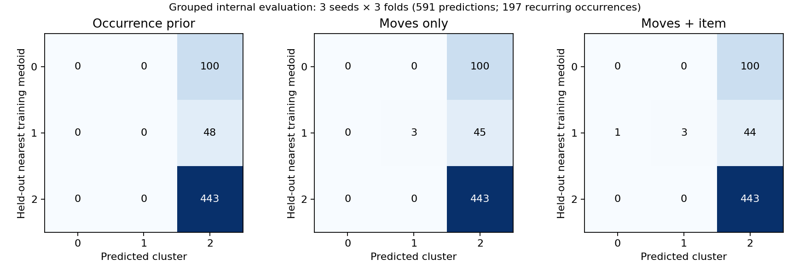
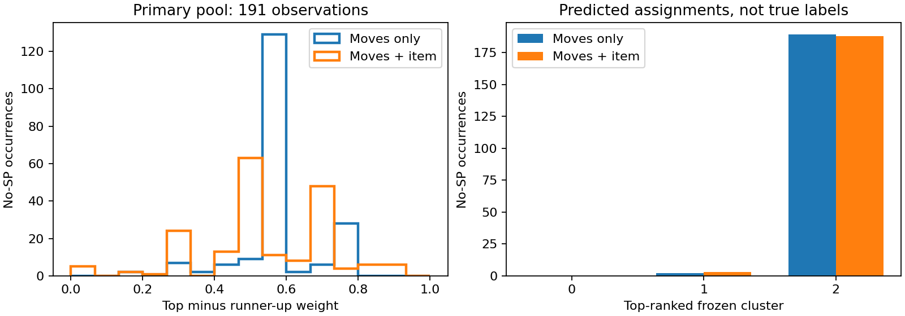

# M3.5.3 — Predicting build neighborhoods when SP is missing

*Pokémon Champions Assistant · 24 October 2026 · offline exploratory study*

This milestone asks whether published **moves and held items**, without training points, can identify neighborhoods of Incineroar builds. It freezes the [M3.5.1 SP-only K=3 partition](M3.5.1_Build_Clustering.md), evaluates a transparent count-based predictor, and applies it to real publications lacking SP. A local interface lets a human inspect those predictions alongside the original teammates.

**Human review is pending.** No application record has a verified SP label, and model weights are not calibrated opponent probabilities. Nothing is integrated into battle inference or replay.

## What the source audit actually found

The existing read-only VGC M-C Doubles scope contains **1,083 publications and 6,498 member occurrences**. The earlier complete-build adapter's count is reproduced: **3,392 complete and 3,106 excluded**. Exclusion does not mean “missing SP” in every case.

| Direct SP audit, all species | Member occurrences |
|---|---:|
| Complete valid SP vectors | 3,406 |
| No SP supplied | 3,090 |
| Partial SP | 2 |
| Invalid or conflicting SP | 0 |

At team level, 566 publications have valid SP for all six members, 515 lack SP for all six, and 2 are mixed or partial. The recollection of roughly half with SP and half without was accurate for this source snapshot.

Within the 3,106 adapter exclusions, overlapping reasons are: **form ability incompatibility: 17**, **missing or conflicting item: 2**, **missing or conflicting nature: 21**, **missing sp: 3090**, **partial sp: 2**, **unresolved species form: 10**, **unsupported stat calculation: 4**. Reason counts overlap and must not be added. Separately, native-ability compatibility conflicts occur in 20 all-species records, including records considered complete by the earlier adapter. Completeness and compatibility are separate tests. No exclusions in this snapshot have missing/conflicting moves, missing/conflicting ability, invalid SP, form/item incompatibility, or other adapter-conflict reasons.

Incineroar has **197 complete-SP** occurrences and **202 with SP missing**; all 202 have a canonical identity, four uncontested moves and no known non-SP compatibility conflict. Two application records lack nature; they remain eligible because nature is not a predictor. All observed items, abilities, natures, teammate details, and original IDs are retained. Missing SP stays null—never zero-filled.

### Separating training and application sources

Groups connect publication IDs, URLs, source keys, identical raw-record hashes, exact complete teams, and exact six-member **observable teams with SP omitted**. The last check detects republished teams with the same species, moves, items, abilities and natures despite SP missing in one export. Grouping runs across all selected publications, so indirect overlaps can also be flagged. Equal individual builds alone do not connect sources.

**11 application records overlap training sources and are excluded from the primary pool; 191 remain.** Direct overlap fields: {'observable_team_signature': 11}. All 202 records and their flags remain available in the interface and complete local output. No detected overlap is weaker than proof of independence; related sources can still evade these checks. These remain out-of-sample records for application, without an external labeled test set.

## The frozen neighborhoods

The saved SP-only model has **31 / 24 / 142** occurrences. This is not the learned combined-distance diagnostic partition of 34 / 7 / 156. Input hashes, occurrence order, all 197 configurations, unchanged SP parameters, saved pairwise distances, assignment counts and medoid identities are checked before use. Application records never alter these labels or medoids.

| Frozen cluster | Occurrences / share | Attack median [Q1–Q3] | Speed median [Q1–Q3] | Bulk median |
|---|---:|---|---|---:|
| 0 · Higher-Speed investment | 31 (15.7%) | 0 [0–0] | 23 [16–27] | 43 |
| 1 · Higher-Attack investment | 24 (12.2%) | 28 [21.25–32] | 1 [0–8] | 34.5 |
| 2 · Lower-Speed defensive investment | 142 (72.1%) | 0 [0–0] | 1 [0–4] | 64 |

Bulk means HP + Defense + Special Defense SP. Medoid SP order below is HP / Attack / Defense / Special Attack / Special Defense / Speed:

- Cluster 0: **32 / 0 / 1 / 0 / 10 / 23**, careful, Sitrus Berry; [original medoid source](https://vgcmulticalc.com/teams/?reg=M-C&paste=D6JMDNWxQp).
- Cluster 1: **32 / 25 / 2 / 0 / 2 / 5**, adamant, Sitrus Berry; [original medoid source](https://vgcmulticalc.com/teams/?reg=M-C&paste=8VylHRorew).
- Cluster 2: **31 / 0 / 14 / 0 / 19 / 2**, impish, Sitrus Berry; [original medoid source](https://vgcmulticalc.com/teams/?reg=M-C&paste=2xim9NU90C).


The 24-member group is higher-Attack: its Attack values span 15–32, with median 28 and IQR 10.75. Ten observations have Attack 32; the rest are distributed over 15, 16, 18, 19, 22, 23, 25 and 31. Speed is variable: 11 have zero, while three have 32. This is broader than the seven-member complete-moveset package highlighted by the combined model. Descriptive names are provisional, not true tactical roles.

The interface exposes every SP coordinate's median and quartiles, full Attack/Speed frequency tables, bulk and defensive allocation patterns, common moves, complete sets, item/nature counts, medoids and representative source builds.

## A predictor whose evidence can be inspected

The model uses the occurrence-weighted prior $P(Z=z)=n_z/197$. Repeated publications retain their votes. It uses only the complete four-move set and optional original item; nature, ability, teammates and SP are excluded from prediction features.

For a query moveset, take all subsets of size 1, 2, 3 and 4. For each subset $S$, count training occurrences containing it, both overall ($n_S$) and in cluster $z$ ($n_{z,S}$). Shrink toward the species prior $p_z$:

$$
q_z(S)=\frac{n_{z,S}+5p_z}{n_S+5}.
$$

Average within each subset size, then mix sizes with fixed weights 0.1 / 0.2 / 0.3 / 0.4. This is a coherent mixture of normalized categorical conditional estimates: equivalently, a latent projection chooses a subset size and then a uniformly selected query subset. **Overlapping subset likelihoods are never multiplied or summed as independent evidence.** The mixture is a modeling choice, not an estimated generative likelihood for complete movesets.

With known item $I$, an item-only cluster distribution is first shrunk toward $p_z$. Each joint subset/item distribution is then shrunk toward that item distribution:

$$
q_z(I)=\frac{n_{z,I}+5p_z}{n_I+5},\qquad
q_z(S,I)=\frac{n_{z,S,I}+5q_z(I)}{n_{S,I}+5}.
$$

The same fixed mixture combines these joint estimates. This avoids a conditional-independence claim about moves and items. Missing or entirely unseen items add no evidence and preserve moves-only scores. Fully unseen moves return prior-like moves-only weights. Raw subset and joint counts are shown, along with novelty indicators. Positive smoothing keeps every cluster weight nonnegative and normalized, without making the estimates calibrated.

## Internal evaluation before unlabeled application

Three deterministic seeds each define three source-grouped folds. Every fold refits K=3 PAM using only training SP and the frozen SP settings, then trains the predictor on those fold labels. True held-out SP assigns evaluation labels by nearest **training** medoid; the predictor receives only moves and optional item.

Fold medoids are matched to the frozen reference medoids by a minimum-distance permutation solely to keep column names consistent. The full-data medoids are not predictor inputs or held-out labeling centers. Consequently, evaluation labels can differ from the original frozen assignments; the pooled held-out label counts are [100, 48, 443]. Renaming columns cannot change accuracy, Brier score or log loss. Full train/test IDs, groups, scales, medoids, permutations and predictions are saved for inspection.

| Method | Top-1 accuracy | Recall C0 / C1 / C2 | Multiclass Brier | Negative log-likelihood |
|---|---:|---|---:|---:|
| Hard majority | 0.750 | 0.000 / 0.000 / 1.000 | 0.501 | 8.649 |
| Occurrence prior | 0.750 | 0.000 / 0.000 / 1.000 | 0.411 | 0.743 |
| Moves only | 0.755 | 0.000 / 0.062 / 1.000 | 0.390 | 0.703 |
| Moves + item | 0.755 | 0.000 / 0.062 / 1.000 | 0.395 | 0.725 |

Brier is the mean sum of three squared probability errors; lower is better. Log loss also favors lower values. Hard-majority log loss uses a $10^{-15}$ numerical floor for zero weights; the smoothed occurrence prior is the useful probabilistic baseline. These pooled summaries contain **591 predictions of 197 recurring observations**, not 591 independent examples.

| Split seed | Prior accuracy | Moves accuracy | Moves + item accuracy | Moves C1 recall | Moves + item C1 recall |
|---|---:|---:|---:|---:|---:|
| 353 | 0.751 | 0.756 | 0.756 | 0.062 | 0.062 |
| 354 | 0.751 | 0.751 | 0.751 | 0.000 | 0.000 |
| 355 | 0.746 | 0.756 | 0.756 | 0.125 | 0.125 |



Rows are held-out nearest-medoid labels; columns are predictions. The larger defensive group makes majority accuracy easy to achieve, so minority recall and proper scores matter. Moves-only C1 recall is **0.062**, versus **0** for the majority baseline; item-conditioned recall is **0.062**. Minority recovery remains poor: almost all held-out higher-Attack cases are missed, and no higher-Speed cases are recovered. The improvement over majority accuracy is only about half a percentage point; moves-only proper scores improve modestly, while item conditioning does not improve them further. These results assess recovery of model-defined neighborhoods, not tactical ground truth. Small folds and changing fold partitions limit precision; the three seeds are variation checks, not independent replications or hyperparameter optimization.

## Applying the model where true SP is unavailable

The primary pool contains 191 records. Moves-only top-cluster counts are **[0, 2, 189]**; item-conditioned counts are **[0, 3, 188]**. Item evidence changes the top cluster in **1** cases. There are **8 unseen complete sets**, **0 records with unseen moves**, and **63 weak/prior-like moves-only predictions** under the documented support/shift heuristic. These are model diagnostics, not observed classification errors.



A larger top-versus-runner-up margin means this model prefers one neighborhood more strongly. It does not measure calibration or establish actual SP. The assignment bars show what the model outputs, not the population's true archetype frequencies.

Representative highest-margin moves-only cases for each predicted cluster that actually occurs:

- [Published case](https://vgcmulticalc.com/teams/?reg=M-C&paste=g2wn1HsbrL): Fake Out / Close Combat / Flare Blitz / Darkest Lariat; White Herb. Moves-only weights **0.074 / 0.532 / 0.394**; exact moveset support 7. Full occurrence ID is retained in the [evidence summary](assets/m353/evidence-summary.json).
- [Published case](https://vgcmulticalc.com/teams/?reg=M-C&paste=8VZpgrdHnU): Protect / Fake Out / Flare Blitz / Parting Shot; Sitrus Berry. Moves-only weights **0.076 / 0.053 / 0.871**; exact moveset support 11. Full occurrence ID is retained in the [evidence summary](assets/m353/evidence-summary.json).

Every eligible record is retained, including low-margin predictions and overlap cases. Failure modes include common movesets that mostly reproduce the majority prior, item correlations with selectively published builds, and unusual combinations with little direct support. Team context may challenge a prediction, but is not yet modeled. No medoid is substituted for an opponent's missing SP.

## Review 10–20 cases locally

From the repository root, using the existing environment and completed caches:

```sh
.venv/bin/python -m experiments.no_sp_archetypes.review
```

Open **http://127.0.0.1:8353**. The standalone page contains the cluster reference, one target, all five original teammates with available moves/items/ability/nature and source links, both prediction variants, all cluster weights, margins, supporting counts, novelty and overlap flags. It is separate from replay.

The curated initial queue contains **20 cases**, selected only from the primary pool with distinct moveset/item patterns. Its fixed category order offers up to three high-margin predictions per cluster, ambiguous boundaries, rare/unseen sets, and substantial item changes, then fills from distinct ambiguity-ordered cases. Actual available category counts are retained rather than forced: **{'additional distinct moveset/item': 191, 'ambiguous boundary': 191, 'high-margin cluster 0': 0, 'high-margin cluster 1': 0, 'high-margin cluster 2': 189, 'item changes weights (L1 ≥ 0.1)': 110, 'novel or rare moveset': 13}**. Queue predicted-cluster counts are **{'1': 1, '2': 19}**. Category labels can overlap; this is a contrast-seeking review sample, not a representative accuracy sample. All eligible records remain accessible through the population selector.

Choose reasonable / another cluster / ambiguous / insufficient information / source issue, optionally select a preferred cluster and write notes. **Save review** appends a durable revision; **Save & next** advances. Navigation supports previous/next, review-status and predicted-cluster filters, margin/uncertainty/item-change sorting, direct index/ID jump, progress, and resume after reopening.

Annotations and queue state are stored in **`.cache/research/m353/reviews.sqlite3`**, keyed by model fingerprint. They remain separate from immutable predictions and source records. Saves preserve the original observation ID, suggested weights, assessment, preferred cluster, notes and server timestamp. The API exports latest reviews via **`/api/export.json`** and **`/api/export.csv`**; the page provides download links. Old revisions remain in SQLite. A new model fingerprint starts its own review/session view rather than relabeling old reviews. No human assessments have been supplied by this experiment.

## Reproduction, limits and stopping point

Model fingerprint: **`cd20fc295b0e5cb16e15`**. The run directory is `.cache/research/m353/cd20fc295b0e5cb16e15/`; its manifest records input/implementation identities, hashes, stage status and exact resume command. Audit, frozen reference, evaluation, application and review payloads are separate atomic stages. Reuse compatible stages; no source scraping, external retrieval, OCR or video processing is involved.

```sh
.venv/bin/python -m experiments.no_sp_archetypes.study
.venv/bin/python -m pytest -q tests/test_no_sp_archetypes.py tests/test_git_artifact_policy.py
```

Numerical reproduction requires the existing published-team database and preserved M3.5.1 run; neither is bundled as a large Git artifact. [Code and dependency notes](../experiments/no_sp_archetypes/README.md) describe paths and launch options. The tracked [compact evidence summary](assets/m353/evidence-summary.json) records audit totals, cluster distributions, source hashes, configuration, evaluation results, queue IDs and representative cases. Full source joins, per-fold predictions and every application record stay local.

Verification completed: **31 portable M3.5.3 tests and 2 artifact-policy tests passed**. The 31 tests also passed from an isolated copy of the staged files, without unrelated working-tree changes. A local Chrome check exercised five-teammate rendering, both weight displays, durable save, export, filters, navigation and resume using a separate test annotation database. GitHub's renderer recognized both display equations, three figures and four tables. A second study run reused all six completed stages without new fitting. These engineering checks do not constitute human review or scientific acceptance.

This milestone validates source selection, reproducible scoring, internal grouped evaluation and the review workflow. It does not establish unknown true SP, independent source identity, calibration, strategy quality, Champions move legality, or human acceptance. The data are selectively published, occurrence-correlated, and small for the minority neighborhood. Future team-conditioned models and live integration are outside scope. **Stop here for human interpretation; review conclusions remain pending.**
