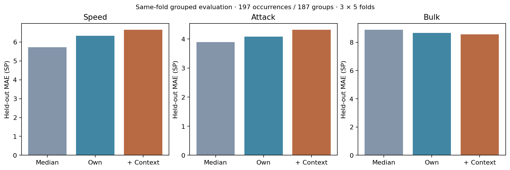
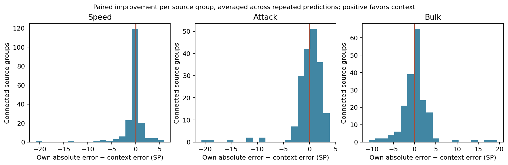
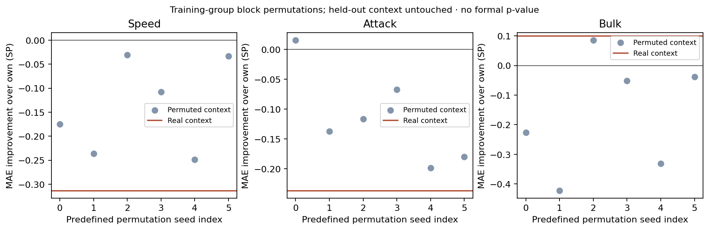
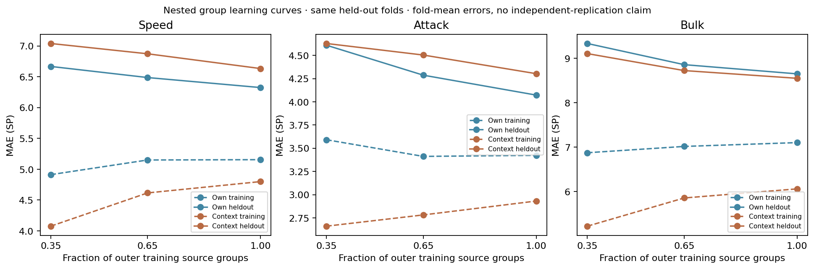
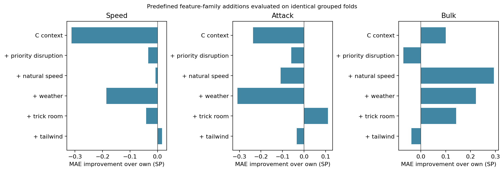

# M3.5.4 — Team speed-control context and hidden SP prediction

*25 October 2026 · controlled offline experiment · no battle or review integration*

The previous [moveset diagnostics](M3.5.3_Incineroar_Moveset_Clustering_Diagnostics.md) showed that identical Incineroar moves and items can conceal different SP investments. This experiment asks whether the other five published teammates supply useful incremental information. **Overfitting is the primary concern:** a more flexible model must survive grouped held-out comparisons, unrelated-context controls, smaller training samples and fixed feature ablations.

**Result:** adding all context worsens Speed and Attack prediction. Bulk improves by only about 0.100 SP versus own-only, reverses direction in one split seed, and exceeds the strongest of six negative controls by only about 0.014 SP. Training errors improve much more than held-out errors. The evidence does not justify promoting this model to inference.

## Population and pre-specified design

The primary sample remains **197 complete Incineroar occurrences**, with no deduplication and no missing-SP application records added. The original M3.5.1 identities comprise **192 connected groups**. The stronger M3.5.3 links—publication, source URL/key, raw-record hash, exact team and exact observable team with SP omitted—merge these into **187 groups**: 179 singleton groups, six pairs and two triples. Both group identities and all publication provenance are preserved. Connected groups are the best available isolation units, not proof of 187 independent data-generating teams.

The [local design specification](../experiments/team_speed_context/preregistered.json) was recorded before examining target/context relationships or model performance; it is not a public statistical preregistration. It fixes three seeds (354–356), five source-grouped folds per seed, Ridge alpha 10, base-Speed threshold 100, six permutation seeds, learning fractions 0.35/0.65/1, five ablation families and three separately tested interaction candidates. No outer-fold result selects hyperparameters or changes feature definitions.

Targets are **Speed SP**, **Attack SP**, and **bulk SP = HP + Defense + Special Defense**, modeled independently. No SP cluster defines a target. The target’s SP, calculated stats, nature and cluster label, plus all teammates’ SP and calculated stats, are excluded from features. Only target moves/item and five teammates’ canonical observable fields enter feature extraction.

| Outer seed | Training groups range | Held-out groups range | Training occurrences range | Held-out occurrences range |
|---|---|---|---|---|
| 354 | 149–150 | 37–38 | 154–160 | 37–43 |
| 355 | 149–150 | 37–38 | 157–159 | 38–40 |
| 356 | 149–150 | 37–38 | 156–159 | 38–41 |

## Features describe options, not an exclusive team mode

Each feature is nonexclusive. Tailwind and Trick Room may coexist; a roster can also contain weather and naturally fast options. An observed capability does not show which four Pokémon were brought, which Mega was selected, whether weather or Tailwind activated, or which matchup-specific Speed benchmark a player intended.

| Feature | Definition | Positive occurrences | Positive groups | Missing | A priori |
|---|---|---|---|---|---|
| tailwind_count | Number of teammates explicitly carrying Tailwind | 79 | 73 | 0 | yes |
| trick_room_count | Number of teammates explicitly carrying Trick Room | 51 | 49 | 0 | yes |
| sun_setter_option | Compatible Drought option; conditional Mega options remain conditional | 21 | 19 | 5 | yes |
| rain_setter_option | Compatible Drizzle option; conditional Mega options remain conditional | 26 | 26 | 3 | yes |
| chlorophyll_option | Compatible observed Chlorophyll option, never a species-legal guess | 5 | 5 | 3 | yes |
| swift_swim_option | Compatible observed Swift Swim option, never a species-legal guess | 8 | 8 | 3 | yes |
| sun_pair_option | Drought option and observed Chlorophyll on distinct compatible teammate roles | 5 | 5 | 3 | yes |
| rain_pair_option | Drizzle option and observed Swift Swim on distinct compatible teammate roles | 7 | 7 | 3 | yes |
| natural_fast_count | Number of teammates with pinned native/pre-Mega base Speed >=100 | 179 | 169 | 3 | yes |
| priority_support_option | Observed specified priority-support move or supported Prankster + eligible Status move | 187 | 177 | 1 | yes |
| taunt_count | Number of teammates explicitly carrying Taunt | 2 | 2 | 0 | yes |
| taunt_tailwind | Predefined own-field × teammate-context conjunction | 2 | 2 | 0 | yes |
| close_combat_trick_room | Predefined own-field × teammate-context conjunction | 4 | 4 | 0 | yes |
| named_item_trick_room | Predefined own-field × teammate-context conjunction | 3 | 3 | 0 | yes |

The [full dictionary](assets/m354/feature-definitions.json) records fields, frequencies, missing groups, assumptions and the frozen design. A count is unknown if any unresolved teammate could alter it; a presence can be confirmed by one supported positive despite other unknowns. CSV blank fields mean unknown, never observed absence.

Weather is split into setter option, observed dependent ability, and compatible pair. Drought/Drizzle and Chlorophyll/Swift Swim use the existing pinned Champions reference. A known required stone and fixed Mega ability can establish a **conditional Mega option**, without selecting it; two roles both requiring Mega are left unresolved. Unknown original abilities stay unknown. A native ability domain can rule out an ability, but no unobserved legal alternative is asserted present. Manual Sunny Day/Rain Dance without a supported ability enabler remains unresolved in this narrow definition.

Natural Speed uses pinned native/pre-Mega base Speed ≥100, not trained Speed or assumed Mega stats. Priority support is the specified Fake Out/Helping Hand/Follow Me/Rage Powder set, or compatible observed Prankster with a qualifying observed Status move. This is a limited capability indicator, not comprehensive priority coverage. Taunt is a separate disruption count. Existing corrected priority metadata and cached Showdown references are reused; these are not new official mechanics or activation measurements. No sources were scraped or refreshed.

## Models and leakage controls

- **A — species baseline:** training median for each target.
- **B — own observations:** Ridge with binary move vocabulary and one-hot original item.
- **C — context:** the same Ridge plus the 11 team features and explicit missingness indicators.
- **Family ablations:** add only Tailwind, Trick Room, weather, natural Speed, or priority/disruption to B.
- **D candidates:** Taunt × Tailwind, Close Combat × Trick Room, and Life Orb/White Herb × Trick Room, each separately on top of C only with at least 10 positive and 10 negative independent training groups. These named items are a hypothesis proxy, not proof of an offensive role.

For each target, Ridge minimizes $\|y-\mathbf{1}b-Xw\|_2^2+10\|w\|_2^2$ with an unpenalized intercept. The three response columns have separate coefficients and no cross-target penalty. Every vocabulary, median imputation, missingness column, mean, scale and coefficient uses training observations only. Alpha is fixed, so no inner tuning is needed. Unknown training columns use a documented zero fallback plus missing indicators. Predictions clip to legal marginal ranges (0–32, bulk 0–66) and are never assembled into a joint build or prior.

Five-fold splits are deterministic permutations of source-group IDs, without target stratification. All models share every train/test split. Repeated CV produces **591 held-out predictions per target from the same 197 observations**, not 591 independent examples. Training receipts include every input ID, vocabulary, imputation/scaling value and coefficient; permutation receipts include donor-group maps. Full receipts remain local.

## Held-out performance and paired changes

| Model | Speed MAE | Attack MAE | Bulk MAE | Median absolute errors: Speed / Attack / Bulk |
|---|---|---|---|---|
| A · Training median | 5.724 | 3.893 | 8.888 | 2.000 / 0.000 / 5.000 |
| B · Own moves/item | 6.335 | 4.080 | 8.661 | 4.234 / 2.651 / 7.220 |
| C · Own + team context | 6.648 | 4.316 | 8.561 | 4.582 / 2.206 / 6.079 |

| Target | C improvement over B (positive better) | C improvement over A | B training MAE | C training MAE | C held-out MAE |
|---|---|---|---|---|---|
| speed | -0.313 | -0.923 | 5.155 | 4.799 | 6.648 |
| attack | -0.236 | -0.423 | 3.424 | 2.932 | 4.316 |
| bulk | 0.100 | 0.327 | 7.102 | 6.059 | 8.561 |

MAE and median absolute error are in SP units; smaller is better. Training errors are means over training folds, while held-out MAE pools matched predictions. B/C optimize squared loss, so the median baseline can be especially strong on concentrated targets. Beating B alone is insufficient when A is better. Unlike M3.5.1 target-masked neighborhoods, these models receive none of the target’s other SP coordinates, so those earlier error levels are not directly comparable.



| Split seed | B MAE: Speed / Attack / Bulk | C MAE: Speed / Attack / Bulk | B − C |
|---|---|---|---|
| 354 | 6.199 / 4.126 / 8.633 | 6.357 / 4.112 / 8.165 | -0.157 / 0.014 / 0.468 |
| 355 | 6.289 / 4.074 / 8.603 | 6.732 / 4.531 / 8.790 | -0.442 / -0.457 / -0.187 |
| 356 | 6.515 / 4.040 / 8.747 | 6.855 / 4.306 / 8.728 | -0.339 / -0.266 / 0.019 |

| Equal-weight source-group metric | Speed | Attack | Bulk |
|---|---|---|---|
| A · Training median | 5.608 | 3.558 | 8.510 |
| B · Own moves/item | 6.228 | 4.056 | 8.523 |
| C · Own + team context | 6.583 | 4.251 | 8.317 |



| Target | Groups helped | Groups hurt | Ties | Median group improvement (SP) |
|---|---|---|---|---|
| speed | 84 | 99 | 4 | -0.056 |
| attack | 106 | 75 | 6 | 0.284 |
| bulk | 104 | 82 | 1 | 0.304 |

Group ties use a numerical tolerance of 1e-10 SP. More groups can improve while overall MAE worsens if the harmed groups have larger errors, as with Attack.

Each group’s histogram value averages its paired B-minus-C absolute errors across observations and repeated splits. Positive means context helped that group. The complete paired CSV includes true SP, all three predictions/errors, source group, seed and fold. Group improvements and per-capability subgroup results are exported without treating tiny groups as precise estimates.

| Uncommon observed subgroup | Original N / groups | A MAE | B MAE | C MAE |
|---|---|---|---|---|
| high_attack | 24 / 20 | 6.639 / 26.042 / 27.542 | 9.353 / 15.092 / 18.435 | 10.203 / 15.607 / 18.596 |
| higher_speed | 42 / 40 | 19.008 / 5.119 / 21.167 | 14.668 / 3.696 / 15.422 | 14.799 / 5.490 / 15.938 |

These evaluation-only subgroups use pre-specified Attack ≥15 and Speed ≥11 SP. They do not enter any training label or feature.

## Can arbitrary teammate context do as well?

Within each outer training fold, the six fixed controls permute complete context-vector blocks between different source-group labels within equal block-size strata. Own moves, item, target values and group IDs stay fixed. Donors come only from the training fold; every vector stays coherent and the test context is untouched. This preserves occurrence multiplicity. Singleton permutation strata cannot exchange a block and are counted explicitly: 36 group/control instances across the experiment. Random permutation fixed points can also retain their own context; donor maps are saved.

| Target | Real improvement over B | Permuted improvement range | Permuted median | Real exceeds every control? |
|---|---|---|---|---|
| speed | -0.313 | -0.249 to -0.031 | -0.142 | no |
| attack | -0.236 | -0.198 to 0.016 | -0.127 | no |
| bulk | 0.100 | -0.422 to 0.086 | -0.139 | yes |



The controls diagnose how much apparent incremental improvement this model can obtain from unrelated contexts. They are a modest fixed sensitivity exercise, not a formal randomization-test p-value: folds, records and source groups are reused, and exchangeability is not established.

## Training size, ablations and interactions



| Training group fraction | Model | Actual training groups | Training MAE | Held-out MAE |
|---|---|---|---|---|
| 0.35 | B · Own moves/item | 53–53 | 4.912 / 3.591 / 6.874 | 6.667 / 4.609 / 9.336 |
| 0.35 | C · Own + team context | 53–53 | 4.077 / 2.661 / 5.218 | 7.040 / 4.628 / 9.108 |
| 0.65 | B · Own moves/item | 97–98 | 5.150 / 3.412 / 7.016 | 6.487 / 4.286 / 8.859 |
| 0.65 | C · Own + team context | 97–98 | 4.616 / 2.782 / 5.854 | 6.873 / 4.503 / 8.726 |
| 1.0 | B · Own moves/item | 149–150 | 5.155 / 3.424 / 7.102 | 6.325 / 4.072 / 8.652 |
| 1.0 | C · Own + team context | 149–150 | 4.799 / 2.932 / 6.059 | 6.633 / 4.303 / 8.551 |

Subsets are nested, chosen by deterministic source-group ranks without targets. All related observations enter together, and the original outer test fold stays fixed. Each fraction refits preprocessing and coefficients. The curves average fold errors equally; they are not independent learning experiments. Fixed alpha also has different relative strength at different training sizes.

| Added family | Held-out MAE: Speed / Attack / Bulk | Improvement over B |
|---|---|---|
| B + tailwind | 6.318 / 4.114 / 8.699 | 0.017 / -0.034 / -0.038 |
| B + trick room | 6.376 / 3.969 / 8.519 | -0.041 / 0.111 / 0.142 |
| B + weather | 6.520 / 4.389 / 8.439 | -0.186 / -0.310 / 0.222 |
| B + natural speed | 6.342 / 4.188 / 8.367 | -0.008 / -0.108 / 0.294 |
| B + priority disruption | 6.369 / 4.140 / 8.732 | -0.034 / -0.060 / -0.071 |
| C · Own + team context | 6.648 / 4.316 / 8.561 | -0.313 / -0.236 / 0.100 |



| Interaction candidate | Positive original groups | Folds passing training-only support gate |
|---|---|---|
| taunt_tailwind | 2 | 0 |
| close_combat_trick_room | 4 | 0 |
| named_item_trick_room | 3 | 0 |

In the predefined family ablations, natural-Speed counts give the largest observed bulk improvement (+0.294 SP), followed by weather (+0.222) and Trick Room (+0.142). These are comparisons on the same held-out sample, not an independent selection set: choosing the best family now would require new validation. Tailwind alone barely changes Speed error (+0.017 SP improvement), and the full context model does worse. Weather pair positives have only five and seven source groups, teammate Taunt only two, and priority support is present in 187/197 observations. Sparse or nearly constant features constrain what can be learned.

Unsupported interactions are descriptive only; omitting a coefficient is not evidence of a zero biological effect. No all-pairs interaction search or favorable-result selection is performed. Standardized contextual coefficients are exported for checking fold instability, not causal interpretation.

## Tactical hypotheses checked against actual records

### A · Close Combat/Flare Blitz + named item + Trick Room option

**3 occurrences from 3 connected groups.**
Speed / Attack / Bulk medians: **0.000 / 31.000 / 35.000**; Q1 **0.000 / 31.000 / 34.500**, Q3 **0.000 / 31.500 / 35.000**. Other 194 occurrences have medians **2.000 / 0.000 / 61.000**.

- [Original published team](https://vgcmulticalc.com/teams/?reg=M-C&paste=TbiuOnMPIn): Ling's Gardevoir Charizard-Y Team. Incineroar: Fake Out / Close Combat / Flare Blitz / Darkest Lariat; Life Orb, Brave. **Speed / Attack / Bulk SP 0.000 / 32.000 / 34.000**; calculated unmodified Speed **72**. Observed moves / supported ability options: Mega Gardevoir (Trick Room); Female Indeedee (Trick Room); Mega Charizard Y (Drought [conditional Mega option]); Torkoal (Drought).

- [Original published team](https://vgcmulticalc.com/teams/?reg=M-C&paste=kNsV1n1jWv): johnnychiou36's Ranked Season M-6 Top 128 Team. Incineroar: Fake Out / Close Combat / Flare Blitz / Darkest Lariat; White Herb, Brave. **Speed / Attack / Bulk SP 0.000 / 31.000 / 35.000**; calculated unmodified Speed **72**. Observed moves / supported ability options: Armarouge (Trick Room); Female Indeedee (Trick Room); Hatterene (Trick Room); Torkoal (Drought).

- [Original published team](https://vgcmulticalc.com/teams/?reg=M-C&paste=rseHUq19Ff): Panda's Hatterene Trick Room Team. Incineroar: Fake Out / Close Combat / Flare Blitz / Darkest Lariat; White Herb, Brave. **Speed / Attack / Bulk SP 0.000 / 31.000 / 35.000**; calculated unmodified Speed **72**. Observed moves / supported ability options: Female Indeedee (Trick Room); Farigiraf (Trick Room); Hatterene (Trick Room); Mega Charizard Y (Drought [conditional Mega option]); Torkoal (Drought).

The named item filter is Life Orb or White Herb, following the pre-specified hypothesis. Published Trick Room access does not imply that Incineroar always uses it, always moves slowly, or is brought alongside its setter.

### B · Taunt + teammate Tailwind

**2 occurrences from 2 connected groups.**
Speed / Attack / Bulk medians: **22.000 / 0.000 / 44.000**; Q1 **19.000 / 0.000 / 41.000**, Q3 **25.000 / 0.000 / 47.000**. Other 195 occurrences have medians **2.000 / 0.000 / 61.000**.

- [Original published team](https://vgcmulticalc.com/teams/?reg=M-C&paste=IU4unbHiWi): LenVGC's Recreation of Peppe's Frankfurt Regional 2027 Top 8 Team. Incineroar: Fake Out / Taunt / Flare Blitz / Parting Shot; Sitrus Berry, Impish. **Speed / Attack / Bulk SP 28.000 / 0.000 / 38.000**; calculated unmodified Speed **108**. Observed moves / supported ability options: Mega Dragonite (Tailwind).

- [Original published team](https://vgcmulticalc.com/teams/?reg=M-C&paste=1tBbprISfx): DidiVGC's VR September Challenge #2 Champion Team. Incineroar: Fake Out / Taunt / Flare Blitz / Parting Shot; Sitrus Berry, Impish. **Speed / Attack / Bulk SP 16.000 / 0.000 / 50.000**; calculated unmodified Speed **96**. Observed moves / supported ability options: Mega Dragonite (Tailwind).

This subgroup is too small for a special predictive rule. The calculated Speed values are descriptive record facts; no opponent benchmark or intent is identified from roster data alone. Taunt plus Tailwind does not logically require positive Speed SP, and no activation or bring choice was observed.

### C · More than one structural option

**17 occurrences from 17 connected groups.**
Speed / Attack / Bulk medians: **4.000 / 5.000 / 52.000**; Q1 **2.000 / 0.000 / 44.000**, Q3 **11.000 / 9.000 / 59.000**. Other 180 occurrences have medians **2.000 / 0.000 / 61.000**.

Here the descriptive selection requires at least two of teammate Tailwind, Trick Room, supported sun pair or rain pair. Naturally fast and priority options may coexist too; these are not exclusive strategy labels.

- [Original published team](https://vgcmulticalc.com/teams/?reg=M-C&paste=ohN349OUmA): spacesnak3's Baltimore Regional 2027 Top 64 Team. Incineroar: Fake Out / Flare Blitz / Snarl / Parting Shot; Sitrus Berry, Careful. **Speed / Attack / Bulk SP 24.000 / 0.000 / 42.000**; calculated unmodified Speed **104**. Observed moves / supported ability options: Noivern (Tailwind); Mega Charizard Y (Drought [conditional Mega option]); Venusaur (Chlorophyll).

- [Original published team](https://vgcmulticalc.com/teams/?reg=M-C&paste=GdSyyEk4kr): FedeCampoVGC's Charizard-Y Garchomp-Z Team. Incineroar: Fake Out / Flare Blitz / Parting Shot / Throat Chop; Sitrus Berry, Impish. **Speed / Attack / Bulk SP 0.000 / 0.000 / 66.000**; calculated unmodified Speed **80**. Observed moves / supported ability options: Malamar (Trick Room); Mega Charizard Y (Drought [conditional Mega option]); Venusaur (Chlorophyll).

- [Original published team](https://vgcmulticalc.com/teams/?reg=M-C&paste=QLv5O17AQB): drexrg's Gardevoir Salamence Team. Incineroar: Fake Out / Flare Blitz / Parting Shot / Throat Chop; Sitrus Berry, Impish. **Speed / Attack / Bulk SP 7.000 / 0.000 / 59.000**; calculated unmodified Speed **87**. Observed moves / supported ability options: Mega Gardevoir (Trick Room); Mega Salamence (Tailwind).

All selected IDs, source groups, raw target values and representative full observable teammate details are in [case-studies.json](assets/m354/case-studies.json). These cases interpret associations after the controlled evaluation; they do not choose features or validate tactical intent.

## Interpretation and recommendation

- **Speed:** C changes MAE versus B by -0.313 SP (positive is improvement), beats the training median: no, exceeds every permutation control: no, and improves in 0/3 split seeds.
- **Attack:** C changes MAE versus B by -0.236 SP (positive is improvement), beats the training median: no, exceeds every permutation control: no, and improves in 1/3 split seeds.
- **Bulk:** C changes MAE versus B by +0.100 SP (positive is improvement), beats the training median: yes, exceeds every permutation control: yes, and improves in 2/3 split seeds.

No target clears all of the descriptive checks above. The evidence does not support promoting this context model to hidden-SP inference. Keep team mechanisms as descriptive review context; obtain independent complete-SP examples before investing in a more complex team-conditioned model. Extra capacity would currently risk explaining this small published sample rather than generalizing.

## Limits, artifacts and reproducibility

Repeated builds and entire teams remain occurrence-weighted; grouping reduces leakage but cannot remove unknown source relationships. Tournament publications are selected, and missing-SP teams may follow a different distribution. Capability features can be redundant, conditional on optional Mega use, or used only in certain matchups. Association may reflect player/source/metagame confounding rather than causal effects. Small positive subgroups and correlated weather indicators make coefficients unstable. A fixed-alpha linear model and this limited feature dictionary may miss real nonlinear information; this is not a proof that all team context is uninformative. The models cannot recover matchup-specific Speed goals or actual battle modes from a roster.

Fingerprint **`0289f9e1f3c4d3be9671`**. Atomic stages and full fold receipts live under `.cache/research/m354/0289f9e1f3c4d3be9671/`; its manifest records source/design/implementation hashes, progress, errors and the exact resume command. Resume compatible stages, preserving successful folds. The 197 original joins and target values are cached separately from predictor inputs. No clustering, embedding, existing predictor, review annotation, feasibility solver, empirical probability, evidence or replay file is changed.

```sh
.venv/bin/python -m experiments.team_speed_context.run
.venv/bin/python -m pytest -q tests/test_team_speed_context.py tests/test_no_sp_archetypes.py tests/test_moveset_diagnostics.py tests/test_git_artifact_policy.py
```

Tracked exports: [paired predictions/errors](assets/m354/paired-predictions.csv), [observable feature values](assets/m354/feature-values.csv), [feature definitions and design](assets/m354/feature-definitions.json), [evaluation/controls/curves](assets/m354/evaluation.json), [case studies](assets/m354/case-studies.json), and [source/model provenance](assets/m354/provenance.json). Blank feature CSV cells mean unknown. Large preprocessing receipts, training predictions and control intermediates stay local. [Implementation notes](../experiments/team_speed_context/README.md) explain launch/resume and the exact scope of mechanics evidence.

Verification: **74 portable tests passed** across the new experiment, existing no-SP predictor/review, moveset diagnostics and artifact-policy suites. Checks cover training-only encodings/imputation/scaling, source-group and permutation donor isolation, nonexclusive mechanisms, unknown values, conditional Mega handling, deterministic evaluation, and exported paired errors/counts. All 15 fold outputs reproduced exactly in a repeated run with complete dependency fingerprints; a resume reuses all **18 completed stages**. Existing protected source, solver, predictor and human-annotation hashes remain unchanged. These are engineering/reproducibility checks, not evidence of causal mechanisms or battle-inference acceptance.

This milestone stops at the offline experiment. No synthetic joint build, full-SP prior, latent team-mode model, new clustering system or battle integration is created.
