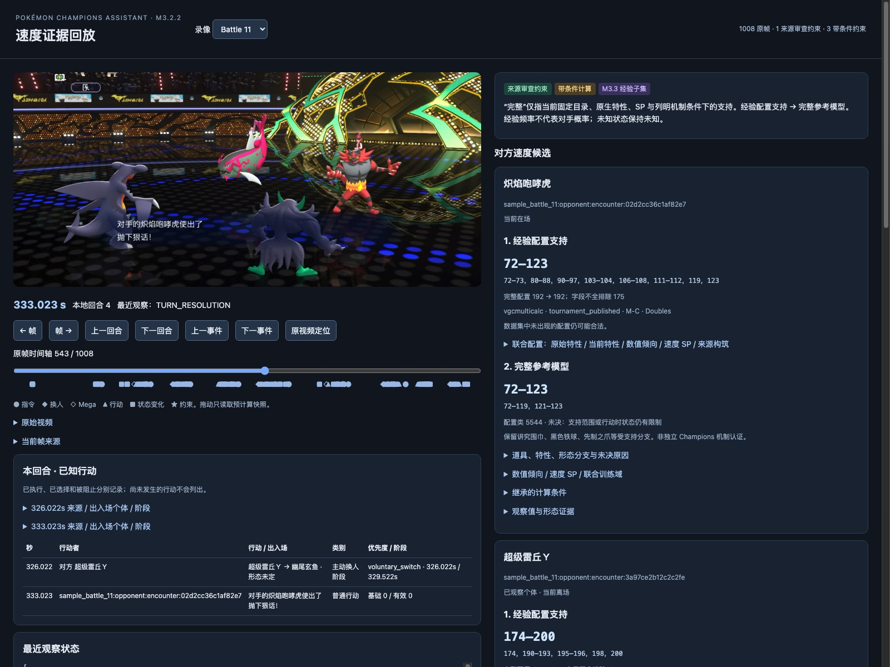
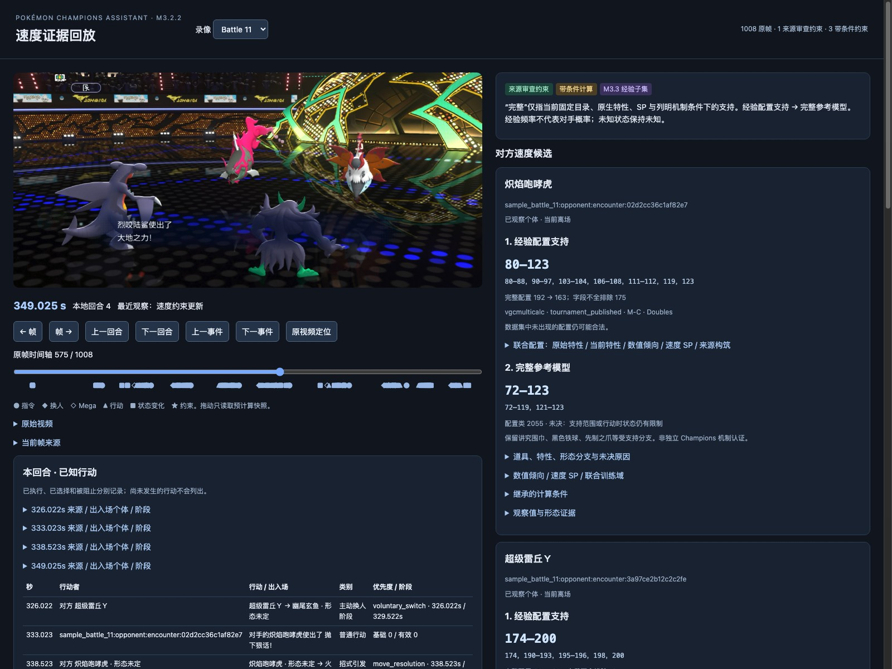

> Archived research snapshot. Evidence-linked, time-causal Speed inference case study. Historical source counts predate the occurrence-preserving M3.4.4/M3.5.1 selection. Original: `docs/m3.2.2-battle11-speed-report.md`. Original files are preserved. Relative links are adjusted; cached numerical diagnostics are described as optional local artifacts. No independent acceptance is asserted.

# Battle 11: reconstructing action order and narrowing Speed support

## Summary

M3.2.2 now presents an evidence-linked, time-causal replay of Battle 11: OCR/event reconstruction, source-reviewed corrections, selected and prevented actions, and deterministic filtering of opponent Speed configurations. This is a mid-project demonstration, not an automatic recognition accuracy claim. The display has two support layers: **observed builds** and the **full reference model**.

The example below shows Incineroar's observed support narrowing from 192 to 163 configurations and full reference support from 5,544 to 2,055 classes. Unknown alternatives remain explicit. The admitted order constraints are preserved. A corrected original-to-Mega ability mapping restores complete published builds that were previously rejected.

## What the replay does

The replay links cached source frames and OCR/event evidence to a chronological timeline. It distinguishes executed moves from selected moves and prevented actions, preserves Pokémon identities and revealed information across switches, and tracks transformations using the form known at that timestamp. Manual source review is explicit in the curated [Battle 11 comparisons](../../../tests/fixtures/battle_evidence/battle11-speed-review.json) and [transition annotations](../../../tests/fixtures/battle_evidence/replay-transitions-reviewed.json).

Speed comparisons are admitted only when their evidence is available. Higher-priority moves, switches, Mega transformations and pivots have separate ordering semantics. An early action is not automatically evidence of a higher Speed stat. Saved snapshots expose what was known then, rather than applying final-battle knowledge to earlier frames.

## Battle 11 example

### Opening: selection, flinch and priority

Earth Power is visibly selected at 141.023 s; selection does not prove execution or a confirmed target. Raichunite Y is revealed at 148.525 s and Mega Raichu Y is confirmed at 158.027 s. The form change is conservatively applied at that confirmation, the upper bound of its evidence interval.

Fake Out executes at 160.527 s with priority +3. Grimmsnarl's Prankster Light Screen at 166.512 s has priority +1. Neither ordering directly compares ordinary Speed with priority-zero actions. Garchomp's flinch message at 172.028 s marks its prevented selected-action position under the reviewed timing interpretation; Volcarona uses Tailwind at 174.530 s. Tailwind's new effect is not retroactively applied to the earlier action positions.

The opening comparison is conditional on that flinch-position interpretation and the reviewed action-time modifiers. With the known Garchomp Speed 154, it reduces Volcarona from **5,544 to 3,966 full classes**, and **33 to 29 complete observed configurations** (48 incomplete records excluded). Its full unmodified Speed union remains **[108–152] ∪ [154–163] ∪ [165–167]**: item alternatives, including Iron Ball, prevent a single unconditional bound. Ties remain possible where admitted by the model.

### Turn 4: a pivot supplies the second comparison

The two actual browser captures show the same comparison before and after its second action becomes observable. The slider positions are one-based displayed positions, not video frame numbers; their zero-based slider indices are 542 and 574.

### Figure 1: 543 / 1008 — 333.023 s



Incineroar announces Parting Shot. Mega Raichu Y has already left at 326.022 s and Basculegion arrived at 329.522 s. Incineroar remains active. Only the opening reviewed comparison is admitted; the later Earth Power observation is still unavailable. This first announcement alone cannot establish the relative order of the two priority-zero moves. The replay does not display the future pivot arrival.

Observed Incineroar support: **192 → 192** complete member configurations; 175 incomplete records excluded. Unmodified Speed: **[72–73] ∪ [80–88] ∪ [90–97] ∪ [103–104] ∪ [106–108] ∪ [111–112] ∪ 119 ∪ 123**.

Full reference support: **5,544 joint configuration classes**, Speed **[72–119] ∪ [121–123]**. These figures illustrate time-causal withholding of future evidence. Neither snapshot identifies an exact opponent build.
### Figure 2: 575 / 1008 — 349.025 s



Garchomp announces Earth Power. Incineroar departed through Parting Shot at 338.523 s and Volcarona arrived at 344.525 s. Incineroar is now benched, but its persistent identity retains the newly admitted order constraint. Parting Shot preceded Earth Power; both have priority zero. Under the reviewed opponent Tailwind and action-time continuity assumptions, this filters joint configurations. Choice Scarf and unresolved Quick Claw alternatives still matter; the full Speed union does not shrink.

Observed Incineroar support: **192 → 163** complete member configurations; 175 incomplete records excluded. Unmodified Speed: **[80–88] ∪ [90–97] ∪ [103–104] ∪ [106–108] ∪ [111–112] ∪ 119 ∪ 123**.

Full reference support: **2,055 joint configuration classes**, Speed **[72–119] ∪ [121–123]**. These figures illustrate configuration elimination even when marginal Speed bounds remain unchanged. Neither snapshot identifies an exact opponent build.

### Later evidence and form-aware ordering

Garchomp's Mega Garchomp Z confirmation at 418.003 s changes its reference unmodified Speed from 154 to 203. Power Gem at 433.523 s preceding Soak at 440.508 s conditionally reduces Basculegion from **8,316 to 8,232 full classes** and **117 to 82 observed configurations**. The subsequent reviewed voluntary-switch order (494.517–501.018 s) reduces these further to **7,566** and **62**. Switch ordering is evaluated in its own phase; Parting Shot's replacement remains part of move resolution and is not an independent voluntary-switch comparison. No new inference was introduced for this report.

## Speed support interpretation

| Layer | Meaning | Practical limit |
| --- | --- | --- |
| Observed builds / 经验配置支持 | Complete joint configurations actually present in the selected published-team corpus and compatible with admitted evidence | A finite descriptive sample, not all possible builds or a probability distribution |
| Full reference model / 完整参考模型 | Supported legal Speed/order configuration hypotheses under the maintained rules and declared conditions | Conditional on reference coverage; unsupported branches remain unresolved |

Counts refer to joint configurations, not just distinct Speed values. Nature/alignment, SP allocation, ability and item remain correlated. Missing build fields are not invented; incomplete entries are excluded from exact observed support. Speed ranges here are unmodified stats, not temporary effective action Speed. Discrete gaps are preserved. A full-model union can stay unchanged while thousands of joint classes disappear.

The full model retains Choice Scarf, Iron Ball and Quick Claw alternatives where legal. Unknown activation and unsupported ability-order handling prevent claims of complete identification. A published move list supplies possible/revealed membership only where justified; it does not establish the opponent's exact equipped slots.

## Mega Raichu Y: actual observed-build audit

The replay uses **vgcmulticalc / tournament_published / M-C / Doubles**, with 995 distinct observed team designs and 1083 publications. Its observation unit is a distinct observed-team-configuration member (`published-team-identity-v1`, `observed-configuration-v3`), not an independent battle encounter.

For canonical form `pokeapi:form:10530`, the scoped corpus contains **80 member records: 68 complete and 12 incomplete**. All 68 complete records are **Timid-like: +Speed / −Attack**; none is Modest-like (+Special Attack / −Attack). These represent 51 distinct Pokémon build IDs. The incomplete records also label Timid, but cannot supply exact complete build support.

Of the complete records, **65 record Lightning Rod**, a legal original Raichu ability; **3 record No Guard**, a post-Mega ability assertion. The earlier adapter incorrectly required the source ability to be native to the current Mega form and rejected the 65 Lightning Rod records. That legality bug is corrected generically using the existing Champions KnowledgeBase: validate original abilities against the pre-Mega form, preserve the source row and joint identity, then apply the canonical active Mega ability after confirmation. No Guard is not added to base Raichu, and Lightning Rod is not added to Mega Raichu Y.

**All 68 complete member records now survive**, representing **51 distinct joint Pokémon build IDs**. **No complete Mega Raichu Y records remain excluded** by the remaining checks; 12 incomplete records still cannot supply exact build support. All 68 retain Timid-like (+Speed / −Attack) alignment and Raichunite Y. Their unmodified observed Speed values are **[174, 190, 191, 192, 193, 195, 196, 198, 200]**. The compact audit preserves source abilities, nature, Speed SP, build IDs, team signatures and publication links.

After confirmation at **158.027 s**, every eligible record maps to active **No Guard**; the 65 Lightning Rod records retain Lightning Rod as their original ability. The 3 source No Guard records do not identify their original ability: it remains unknown between legal base abilities. Before confirmation, Mega forms are excluded from current active-form alternatives; original Lightning Rod/Static configurations use base-form stats and abilities. A source post-Mega assertion alone is not used to guess a pre-Mega ability. At identical training (+Speed, Speed SP 24), Raichu Speed is **169** before Mega and **191** afterward.

The confirmed Mega Raichu Y support remains **68 → 68 throughout the rest of Battle 11**: no admitted Speed comparison further narrows it. Thus speed-boosting support is present in **every complete eligible record**; no Modest-like complete record appears. The full reference Speed union remains **[135–185] ∪ [187–196] ∪ [198–200]**, and No Guard's order handler remains outside the audited subset. See [the compact audit](../../../docs/assets/m322-battle11-ability-v2/raichu-audit.json) for the recomputed counts and source provenance. Historical figures and the previous three-record audit are preserved separately; they document the superseded eligibility bug.

## Known limitations

The sequence combines automatic OCR/event output with curated source-grounded comparisons. Deterministic replay success does not measure recognition accuracy or comprehensive semantic coverage. The opening flinch interpretation, Tailwind continuity, relevant stat stages/status and absence of unobserved order changes remain explicit comparison assumptions. Historical banners alone do not certify their continuity at every later action.

Mega confirmation intervals are conservative. Two late Battle 11 voluntary recalls have confirmed command-phase evidence but unresolved local segment IDs. Other uncaptured or deferred actions are not silently converted into inequalities. Unsupported ability handling and item activation branches remain unresolved. Champions Fake Out +3, Follow Me +2 and Rage Powder +2 are covered by corrected catalog regressions; historical source assertions and other-generation data remain preserved.

## Reproduction and measured cost

Run from the repository root with the existing environment and cached Battle 11 evidence. No video decoding, OCR, or team database rebuild is required. The tested local URL is **http://127.0.0.1:8767/scripts/templates/speed_replay.html?battle=11**. If this server is already running, reuse it.

```sh
.venv/bin/python scripts/serve_visual_review.py --port 8767
```

In another terminal, package/reuse the scoped replay and capture the rendered page, then generate this report:

```sh
.venv/bin/python scripts/build_reviewed_speed_replay.py --battle 11 --reviews tests/fixtures/battle_evidence/battle11-speed-review.json
node scripts/capture_battle11_report.cjs 'http://127.0.0.1:8767/scripts/templates/speed_replay.html?battle=11' docs/assets/m322-battle11-ability-v2
.venv/bin/python scripts/build_battle11_speed_report.py --figures docs/assets/m322-battle11-ability-v2
```

These corrected figures use a new directory; previous captures are retained. The capture command reuses matching, hash-verified figures. To take fresh captures without replacing them:

```sh
figure_dir=$(mktemp -d .cache/m322-battle11-figures.XXXXXX)
node scripts/capture_battle11_report.cjs 'http://127.0.0.1:8767/scripts/templates/speed_replay.html?battle=11' "$figure_dir"
.venv/bin/python scripts/build_battle11_speed_report.py --figures "$figure_dir" --output .cache/m322-battle11-reproduced.md
```

Screenshots were obtained with **Chrome/155.0.8059.86**, viewport **1600 × 1200**, device scale 1, via Chrome DevTools Protocol. The script dispatches the existing slider input at indices 542/574, waits for the original source image to decode and two animation frames, and captures the unedited viewport as JPEG quality 90. The source image, timeline, and complete Incineroar card with both layers are visible. [Capture receipt](../../../docs/assets/m322-battle11-ability-v2/capture.json) records replay/code/image hashes, exact timestamps, source PTS, displayed positions and browser state. These are actual rendered captures, without compositing.

The refreshed Battle 11 package took **6.364 s**, including **2.318 s** of solver work; **0 OCR calls and 0 video decodes**. The retained Stage A Python lookup benchmark measured **0.194 ms/query over 2,000 queries**; this is not browser latency. Packaging cost is a single local measurement, not a throughput guarantee.

### Validation of the Mega ability correction

Focused regression results and browser measurements for this correction are recorded in the [targeted repair report](../../../reports/M3.3-M3.2.2-mega-ability-mapping.md). Tests cover Lightning Rod/Static → No Guard, preserved joint identity and training, pre-/post-Mega stats, independent exclusion reasons, another Mega species, 68 restored member records, and causal rewind/forward state. Recognition accuracy and independent human acceptance were not measured.

Receipts remain under `.cache/m322/mega-ability-repair-v1/`. The same frozen published-team data and Stage A evidence were reused. Full video recognition and the published-team database were not rebuilt. The full reference/order constraints remain unchanged; earlier current-form alternatives and empirical eligibility are corrected.

```sh
.venv/bin/python -m pytest -q tests/test_speed_replay_projection.py tests/test_speed_replay.py tests/test_speed_replay_extension.py tests/test_champions_priorities.py tests/test_battle11_speed_report.py tests/test_mega_empirical_abilities.py
review_dir=$(mktemp -d .cache/m322-battle11-review.XXXXXX)
rmdir "$review_dir"
node scripts/verify_speed_replay.cjs 'http://127.0.0.1:8767/scripts/templates/speed_replay.html?battle=11' "$review_dir"
```

Current replay: `.cache/battles/sample_battle_11/m322-reviewed-speed/2bc9db5271b034c6/replay.json`. Its sealed sibling manifest preserves inputs, outputs and resume identity. Report generation checks those output hashes, capture code, figure hashes and two-layer schema. Existing historical packages and validation figures remain intact. Semantic acceptance is conditional as described above; no new inference milestone is claimed.
