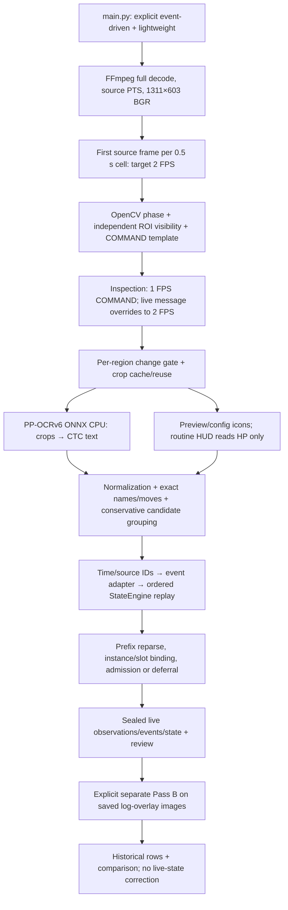

# Current executable recognition pipeline — frozen Battles 13–15

Audit date: 2026-10-26 (Asia/Shanghai). **Code and frozen executable evidence are primary; this document does not update algorithms or predictions.** “Current” below means the explicit event-driven branch used by these benchmarks, not every callable recognizer in the repository.

## Evidence and scope

Base commit `78b5b001a09b4aed47af2c2c0d0b3b4ca9eca5d8` had pre-existing uncommitted changes. Compared current bytes to **all 93 source hashes in each of the three production manifests: 93/93 match for B13, B14 and B15**. Thus the recognition/parser/state code audited here matches the frozen implementation; the separately authorized review HTML/asset fix does not change those predictions. The commit alone is not the complete version identity.

Primary artifacts: [frozen plan](/Users/yyi/Pokemon-Champions-Assistant/.cache/fresh-video-benchmark-20261026-v1/plan.json); [B13 production manifest](/Users/yyi/Pokemon-Champions-Assistant/.cache/battles/sample_battle_13/event-driven/fresh-heldout-20261026-v1/manifest.json) · [B14 production manifest](/Users/yyi/Pokemon-Champions-Assistant/.cache/battles/sample_battle_14/event-driven/fresh-heldout-20261026-v1/manifest.json) · [B15 production manifest](/Users/yyi/Pokemon-Champions-Assistant/.cache/battles/sample_battle_15/event-driven/fresh-heldout-20261026-v1/manifest.json); [B13 command/execution](/Users/yyi/Pokemon-Champions-Assistant/.cache/battles/sample_battle_13/evaluation/fresh-heldout-20261026-v1/execution.json) · [B14 command/execution](/Users/yyi/Pokemon-Champions-Assistant/.cache/battles/sample_battle_14/evaluation/fresh-heldout-20261026-v1/execution.json) · [B15 command/execution](/Users/yyi/Pokemon-Champions-Assistant/.cache/battles/sample_battle_15/evaluation/fresh-heldout-20261026-v1/execution.json). Each manifest also pins frozen `source/` bytes, model/icon hashes, decoder command, config and counters. `observations.json` preserves decisions, source PTS, raw OCR, reuse receipts and candidates; `replay.json` preserves effective policy/mechanics/initial state and each application receipt. No videos, OCR, or replay were rerun for this audit.

Actual recorded commands differ only by video number:

```sh
.venv/bin/python -u main.py --video tests/fixtures/sample_battle_13.mp4 --profile event-driven --run-id fresh-heldout-20261026-v1
# Identical options for sample_battle_14.mp4 and sample_battle_15.mp4.
```

The monitoring wrapper was `scripts/run_production_evaluation.py --battle sample_battle_N --run-id fresh-heldout-20261026-v1`. Later, `scripts/summarize_fresh_video_benchmark.py --plan .cache/fresh-video-benchmark-20261026-v1/plan.json --stage logs` called the existing log extractor with a separate report directory; it did not feed logs into live state.

Model: `PP-OCRv6_medium_rec`, pinned local revision `50c7eacafc52fa7bcf4194e8cd08e46f8558504b`; `inference.onnx` SHA-256 `9c09abf0957f7968c7586464b7397b84ad2387a0497a351af40e9acc71b673ba`. All three model-manifest hashes are `7c1f3b30657e6cede5903f3bb6097ba8a4b8cc2eb851047bfc4dbb6ad87900a2`; icon-index hash `dc514bed109f9cd96b455575cd0fb8645e241fe49eb67646e533236b46adf103`. Recorded engine fields in message observations say `PP-OCRv6_medium_rec-onnx-cpu`. CPU-only session construction is source-verified; actual thread scheduling/provider profiling was not independently recorded. Installed versions: ONNX Runtime1.23.2, NumPy2.2.6, OpenCV-headless distribution5.0.0.93, imageio-ffmpeg0.6.0. These distribution versions do not separately prove which installed OpenCV binary owns `cv2`.

## Executed flow



## Defaults versus effective settings

“Same/source-bound” means an executed call has no parameter override and its implementation hash matches the frozen run; it is not a separately measured tuning value. Runtime counts are given B13 / B14 / B15. Conditional branches remain conditional even if their defaults exist.

| Parameter | Defined default / rule | Effective B13–15 evidence | Phase / condition / override | Executable source |
| --- | --- | --- | --- | --- |
| Entry/profile | CLI `standard`; API `event_driven=False` | Explicit `--profile event-driven`; mode `lightweight` | Whole run; `--identity-mode development` is optional | [main.py:24](/Users/yyi/Pokemon-Champions-Assistant/main.py:24) |
| Limits / imported predictions | `end=None`, `max_frames=None`; cache inputs absent | All three unlimited, cold, no resume/frame/recognition/reconstruction inputs | CLI `--end-seconds`, `--max-frames`, `--resume`, `--frame-cache`, `--recognition-cache`, `--reconstruct-from` exist but were not used | [recognition/fast_video.py:196](/Users/yyi/Pokemon-Champions-Assistant/recognition/fast_video.py:196) |
| Decode/output | FFmpeg `-threads 2`, `-an`, VFR BGR24, `scale=1311:603` | Same serialized decoder command; source PTS/time base retained | Full source decoded; no keyframe-only sampling | [recognition/fast_video.py:38](/Users/yyi/Pokemon-Champions-Assistant/recognition/fast_video.py:38) |
| Sampling | Literal `*2` half-second cell selector | 2 FPS target; first source frame in each cell | No event-driven `--sample-fps`; `--interval` is not passed to this branch | [recognition/fast_video.py:49](/Users/yyi/Pokemon-Champions-Assistant/recognition/fast_video.py:49) |
| Inspection | EventInspection literals 1 / 2 FPS | 1 FPS while COMMAND active without a live message; otherwise 2 FPS | `phase` and `changed` arguments do not choose rates in EventInspection | [recognition/event_schedule.py:58](/Users/yyi/Pokemon-Champions-Assistant/recognition/event_schedule.py:58) |
| COMMAND detection / hysteresis | Template score ≥0.60; loss tolerance 2.0s | Code-bound; `command_loss_seconds=2.0` in all manifests | Two screen ROIs; glyph mask saturation <90/value >155; state persists through ≤2s label loss | [recognition/event_schedule.py:34](/Users/yyi/Pokemon-Champions-Assistant/recognition/event_schedule.py:34) |
| Serialized inherited rates/boost | `stable_fps=1`, `active_fps=2`, hold 1.5s | Recorded, but these three fields are not read by EventInspection | They control legacy AdaptiveInspection, not these runs | [recognition/fast_profile.py:40](/Users/yyi/Pokemon-Champions-Assistant/recognition/fast_profile.py:40) |
| Region selection | General 0.015; active HUD override 0.008 | Same code and config; region delta normalized by visible signal | New/changed visible regions selected; unchanged skipped; one unreliable retry | [recognition/fast_video.py:386](/Users/yyi/Pokemon-Champions-Assistant/recognition/fast_video.py:386) |
| OCR read reuse | RegionGate 0.004; reliable confidence ≥0.90 | Same; bounds/read options key; unchanged read may reuse old Observation | Separate from outer region gate and exact pixel cache | [recognition/fast_video.py:119](/Users/yyi/Pokemon-Champions-Assistant/recognition/fast_video.py:119) |
| Icon reuse | RegionGate 0.01 | Same when preview/configuration icon reads occur | Not routine active-HUD species recognition; `--no-icons` disables this channel (not used) | [recognition/fast_video.py:136](/Users/yyi/Pokemon-Champions-Assistant/recognition/fast_video.py:136) |
| Unknown fallback | 3.0s | 37 / 25 / 35 recorded fallback checkpoints | Adds insufficient-coverage metadata; does not force a whole-screen OCR call | [recognition/fast_video.py:459](/Users/yyi/Pokemon-Champions-Assistant/recognition/fast_video.py:459) |
| OCR engine | CachedOCR explicitly creates PP-OCRv6 medium ONNX CPU | Manifest hash and saved OCR engine fields agree; no Tesseract selection | `--ocr` and `--language` are accepted globally but ignored by event-driven dispatch | [recognition/fast_video.py:93](/Users/yyi/Pokemon-Champions-Assistant/recognition/fast_video.py:93) |
| Model/batching/threads | Batch 1; ORT CPU provider; intra-op 4, inter-op 1 | Source-bound constructor values; no separate actual-thread/provider profile persisted | Lazy load on first crop miss; no GPU/CoreML path requested | [recognition/onnx_ocr.py:19](/Users/yyi/Pokemon-Champions-Assistant/recognition/onnx_ocr.py:19) |
| OCR input / decoding | BGR float32 NCHW, height 48; width 320…3200; `/127.5-1` | Same; CTC argmax, collapse adjacent repeats/remove blank, mean selected scores | Aspect-resized crop plus zero padding; no text detector model in this path | [recognition/onnx_ocr.py:61](/Users/yyi/Pokemon-Champions-Assistant/recognition/onnx_ocr.py:61) |
| OCR value acceptance | 0.75 | Value withheld below threshold; raw text/confidence retained | Confidence is model output, not calibrated recognition accuracy | [recognition/onnx_ocr.py:82](/Users/yyi/Pokemon-Champions-Assistant/recognition/onnx_ocr.py:82) |
| Numeric/italic preprocessing | Flags exist in read signature | Both passed for own HP, but ONNX read has no branch using either | No numeric Tesseract whitelist or italic deskew is performed here | [recognition/identity_modes.py:23](/Users/yyi/Pokemon-Champions-Assistant/recognition/identity_modes.py:23); [recognition/onnx_ocr.py:82](/Users/yyi/Pokemon-Champions-Assistant/recognition/onnx_ocr.py:82) |
| Live-message ROI / rows | Normalized `(0.22,0.685,0.64,0.797)`; rows y=411…443, 444…478 | Same calibrated 1311×603 layout | Glyph geometry precedes two per-row, non-multiline OCR reads | [recognition/ui_regions.py:41](/Users/yyi/Pokemon-Champions-Assistant/recognition/ui_regions.py:41) |
| Message geometry | S<100, gray>120, top-hat>25; ≥2 aligned strokes, span≥38px, left anchor<45px, gap≤40px | SelectionConfig feature defaults, source-bound | Top-hat 13×9; contour height 4…45% ROI, width 1…30, area≥3; actual coherent characters h≥9/w≥2 | [recognition/message_selection.py:40](/Users/yyi/Pokemon-Champions-Assistant/recognition/message_selection.py:40) |
| Message/flash/overlay gate | Coherent rows; not log; not uniform flash | Same independent region gate | Flash fraction(gray>240)>0.97 and std<8; partial message geometry is retained without new OCR | [recognition/fast_profile.py:102](/Users/yyi/Pokemon-Champions-Assistant/recognition/fast_profile.py:102) |
| HUD visible-card heuristic | Name panel color>0.30; HP-color fraction>0.15 OR dark-empty fraction>0.40 | Same; false card candidates remain possible on overlays | HP colors: saturation>100/value>90, hue<85 or >175; dark value<70 | [recognition/fast_profile.py:87](/Users/yyi/Pokemon-Champions-Assistant/recognition/fast_profile.py:87) |
| Active HUD contents | Event-driven calls `read_hp` | Own current/max; opponent percentage; species empty, icon null | Own offsets 0/0.168; opponent 0/0.166; full HUD identity function is not called | [recognition/identity_modes.py:23](/Users/yyi/Pokemon-Champions-Assistant/recognition/identity_modes.py:23) |
| Trainer acquisition | Preview phase confidence≥0.90; max 3 attempts/side; ≥2s apart | Same; 2 / 2 / 4 successful reading-request counters | Accepted name ≥0.95; normalized length≤2 needs two distinct strong frames; longer name one, without strong competing name | [recognition/event_schedule.py:118](/Users/yyi/Pokemon-Champions-Assistant/recognition/event_schedule.py:118); [recognition/trainers.py:75](/Users/yyi/Pokemon-Champions-Assistant/recognition/trainers.py:75) |
| Roster acquisition | Stop each side after 6 resolved rows | Own config + opponent preview, independently per video | No B13 team profile supplied to B14/B15; preview rows do not imply selected party or slot | [recognition/event_schedule.py:201](/Users/yyi/Pokemon-Champions-Assistant/recognition/event_schedule.py:201) |
| Template icons | Correlation minimum 0.80, margin 0.10, max height 64; color_sensitive=False | Default template matcher plus silhouette comparison | Coarse 5 scales 0.50/0.62/0.74/0.86/0.98; top-12 refinement 0.35…1 step0.025, max height128; silhouette minimum0.86/margin0.10 | [recognition/icons.py:38](/Users/yyi/Pokemon-Champions-Assistant/recognition/icons.py:38); [recognition/sprite_shape.py:49](/Users/yyi/Pokemon-Champions-Assistant/recognition/sprite_shape.py:49) |
| Popup/detail consensus | Native and 2× cubic OCR; exact dictionary, each confidence≥0.90, ≥2 config IDs | Same; observed detail candidates 24 / 27 / 29; popup candidates 40 / 33 / 44 | Correlated readings of one source, not independent ground truth | [recognition/visual_evidence.py:47](/Users/yyi/Pokemon-Champions-Assistant/recognition/visual_evidence.py:47); [recognition/visual_evidence.py:118](/Users/yyi/Pokemon-Champions-Assistant/recognition/visual_evidence.py:118) |
| Field indicator | Label confidence≥0.90 plus 7-label allowlist | Same; literal counter retained without verified remaining-turn meaning | Field ROI `(0.204,0.043,0.424,0.095)`; presence does not establish activation time | [recognition/fast_video.py:417](/Users/yyi/Pokemon-Champions-Assistant/recognition/fast_video.py:417) |
| Message occurrence emission | Confidence≥0.90; recognized type; canonical move for move execution | Same; supported complete readings emit immutable candidate IDs | Maximum gap1.1s; text similarity≥0.57 or exact row overlap; semantic change forces new occurrence | [recognition/message_occurrences.py:24](/Users/yyi/Pokemon-Champions-Assistant/recognition/message_occurrences.py:24) |
| Send-out identity | Complete `!`/`！` ending and confidence≥0.95; exact whole name or unique approved-title + exact name | Same `message_identity_v1` in all initial states | Unknown nickname stays unknown; no fuzzy/title guessing | [recognition/identity_modes.py:7](/Users/yyi/Pokemon-Champions-Assistant/recognition/identity_modes.py:7); [knowledge/message_names.py:21](/Users/yyi/Pokemon-Champions-Assistant/knowledge/message_names.py:21) |
| Event admission | Candidate OCR minimum0.75; provenance and supported/uncertain parsing required | Serialized `conservative-candidate-v1` policy in all replays | Only actor/target variant unresolved and sequence-associated target uncertainties are normally allowed | [tracking/state_engine.py:19](/Users/yyi/Pokemon-Champions-Assistant/tracking/state_engine.py:19) |
| Mechanics profile | `champions-evidence-only-v1`; unverified Champion rules flags | Same serialized profile; no `move_grounding` opt-in | Protect divisor/cap unknown; simulator reference profile not selected | [tracking/mechanic_rules.py:7](/Users/yyi/Pokemon-Champions-Assistant/tracking/mechanic_rules.py:7) |
| W / independent entry verification | Code paths exist | 0 W checkpoints; lightweight does not create EntryVerifier | COMMAND-label scheduling is distinct from W native-controls detection; inspect_command runs without correction | [recognition/fast_video.py:295](/Users/yyi/Pokemon-Champions-Assistant/recognition/fast_video.py:295); [recognition/fast_video.py:467](/Users/yyi/Pokemon-Champions-Assistant/recognition/fast_video.py:467) |
| Historical-log Pass B | Explicit separate `compare` after live seal; page gate0.004 | All three completed, 0 detected saved log views, 0 entries, empty OCR counters | No log OCR/row assembly positive case measured in this benchmark | [scripts/compare_battle_log.py:23](/Users/yyi/Pokemon-Champions-Assistant/scripts/compare_battle_log.py:23) |

No general event-driven threshold/config-file override exists in `main.py`; the class constructor options are not equivalent to CLI controls. Changing the model provider/batch or hardcoded decoder rate would require a different entry point or source change, not an undocumented switch.

Important fixed crops: own HP current `(0.177+o,0.915,0.213+o,0.955)`, maximum `(0.220+o,0.925,0.243+o,0.955)`; opponent HP `(0.681+o,0.113,0.727+o,0.154)`. Normalized coordinates are rounded against 1311×603. Own left/right offsets are 0/0.168; opponent 0/0.166. HP parsing accepts exact current/max pairs with `0≤current≤max`, max>0, or percentages≤100; it does not infer exact opponent HP. [recognition/parsers.py:6](/Users/yyi/Pokemon-Champions-Assistant/recognition/parsers.py:6).

## Stage-by-stage behavior and scheduling

**1. Decode and sampling.** [recognition/fast_video.py:38](/Users/yyi/Pokemon-Champions-Assistant/recognition/fast_video.py:38) uses bundled FFmpeg through `imageio_ffmpeg`; source `showinfo` counts all decoded frames before selection. The half-second-cell expression selects by source timestamp, not average container FPS; `showinfo` supplies selected PTS/time base and seek origin. FFmpeg handles the source rotation through its normal decoding path. Recorded display resolution is2622×1206, encoded1206×2622; recognition always receives1311×603. Selected frames are not uniformly spaced native frames on these VFR sources. This is offline pull-based decoding, not a validated live capture/latency system.

**2. Phase and independent region visibility.** [recognition/fast_profile.py:102](/Users/yyi/Pokemon-Champions-Assistant/recognition/fast_profile.py:102) calls [recognition/phases.py:48](/Users/yyi/Pokemon-Champions-Assistant/recognition/phases.py:48) and [recognition/__init__.py:38](/Users/yyi/Pokemon-Champions-Assistant/recognition/__init__.py:38): fixed panel ROIs, HSV color fractions, contours, card/menu geometry and a small battle-HUD fallback distinguish configuration, preview, battle screen, move/party/target menus, animation/message, and unknown. There is no learned screen classifier or 3D Pokémon detector. Phase confidence is heuristic. Crucially, the executed `fast_profile.inspect` then detects live-message rows, HUDs, banners and field indicators independently; it is not the globally overlay-vetoing `ui_regions.inspect_ui`. Only recognized team layouts with phase confidence≥0.9 explicitly suppress apparent active HUD cards. Thus some menu/animation false HUD candidates remain possible. Ability-banner candidates require dark-blue fraction>0.12 and exactly two detected lines; detail candidates use a purple-panel fraction>0.48 plus selected-panel corroboration before OCR. [recognition/visual_evidence.py:75](/Users/yyi/Pokemon-Champions-Assistant/recognition/visual_evidence.py:75).

**3. Two clocks, then two reuse gates.** Every materialized 2 FPS frame receives cheap inspection and COMMAND detection. A detected COMMAND label activates 1 FPS detailed inspection; ≤2s temporary label loss retains that state. A locally qualified live message bypasses the reduced rate immediately. Outside COMMAND, detailed inspection is 2 FPS even when the phase is unknown. `next_time` is the next global 1s/0.5s deadline; the recorded `inspection_fps` describes the scheduler rate selected for subsequent work, not a measured per-frame processing speed.

Only detailed inspections save PNGs and full observation rows; skipped materialized frames retain cheap `monitor/*.json` receipts, not full OCR/screenshot outputs. Selected inspection does **not** imply OCR: absent regions are reset/skipped; unchanged regions are skipped or reuse old message readings; partial message visibility keeps uncertainty without a new read. Outer region signatures are128×24 grayscale/text masks. Delta is sum absolute difference divided by sum pixelwise maximum. New regions and changed crops qualify; unchanged unreliable crops get at most one retry. A second `CachedOCR.read` gate independently reuses observations for nearly unchanged bounds/options; a final SHA-256 crop key reuses exact model predictions. Original source/timestamp reuse receipts remain recorded. [recognition/fast_profile.py:22](/Users/yyi/Pokemon-Champions-Assistant/recognition/fast_profile.py:22); [recognition/fast_video.py:375](/Users/yyi/Pokemon-Champions-Assistant/recognition/fast_video.py:375).

Cache identities include pixels/shape, OCR model and implementation/provider/batch, or icon source/profile. Each run owns `reads/`, `icons/`, `observations/`, `frames/`, `monitor/`, atomic checkpoints and a manifest. Shared weights/icons are immutable assets, not previous recognition results. External compatible same-battle cache/reconstruction options exist but are absent from all three run identities. Checkpoints save every ten inspection rows and preserve success on later failure; no resumes occurred here. [recognition/fast_video.py:224](/Users/yyi/Pokemon-Champions-Assistant/recognition/fast_video.py:224); [recognition/fast_video.py:303](/Users/yyi/Pokemon-Champions-Assistant/recognition/fast_video.py:303).

**4. OCR and text normalization.** [recognition/onnx_ocr.py:61](/Users/yyi/Pokemon-Champions-Assistant/recognition/onnx_ocr.py:61) operates on explicit geometry crops; native BGR channels are rescaled to height48 and normalized to[-1,1], without converting the neural OCR input to the outer gate's grayscale mask. CTC collapses repeats/removes blank. `read` optionally segments multiline crops using bright-pixel row profiles (gray>190, minimum5px runs,2px padding), but ordinary live messages already have two fixed visual row boxes and use `multiline=False`. It removes whitespace between adjacent Chinese characters; message confidence is character-count-weighted across row confidence. Values below0.75 are null while raw OCR is retained; different downstream stages apply stronger gates. `numeric` and `italic` flags do not add preprocessing in this ONNX adapter.

Dictionary normalization is NFKC+casefold+alphanumeric filtering; display-name `alias_key` instead preserves punctuation while removing whitespace. Occurrence keys normalize whitespace/case and selected punctuation separately. Do not conflate OCR text, dictionary-corrected labels and exact raw-text accuracy. [knowledge/__init__.py:12](/Users/yyi/Pokemon-Champions-Assistant/knowledge/__init__.py:12); [battle_events/aliases.py:9](/Users/yyi/Pokemon-Champions-Assistant/battle_events/aliases.py:9); [recognition/message_occurrences.py:9](/Users/yyi/Pokemon-Champions-Assistant/recognition/message_occurrences.py:9).

**5. Identification is channel-specific.** Preview/configuration recognition uses existing `Recognizer` methods, pinned `KnowledgeBase`, localized names/forms, and masked multiscale template/silhouette icons. Template matching searches the complete available visual library; no party-order-to-species inference is made. Conflicting independent text/icon identities remain conflicts; text-conditioned ranking is not independent form evidence. [recognition/event_schedule.py:201](/Users/yyi/Pokemon-Champions-Assistant/recognition/event_schedule.py:201); [recognition/identity.py:6](/Users/yyi/Pokemon-Champions-Assistant/recognition/identity.py:6). Generic entity fuzzy matching is bounded: normalized length≥3, one edit, similarity≥0.65 and margin≥0.12; unsupported high-confidence noncanonical strings are withheld. Availability/context bonuses rank candidates (+0.04 availability/observed roster, +0.12 verified roster, up to+0.06 history, +0.15 verified field); these are deterministic ranking constants, not probability priors. They do not describe ordinary event-parser name matching. [recognition/entities.py:40](/Users/yyi/Pokemon-Champions-Assistant/recognition/entities.py:40).

Live send-outs instead use whole literal display names or unambiguous approved title prefixes plus exact canonical names. A complete message ending and confidence≥0.95 are required for species identity; unknown names may produce occupied/unidentified or unplaced encounters. Routine HUD snapshots in this branch contain only HP; `IdentitySchedule.recognize` and `fast_profile.recognize_cards` are not called for routine active HUDs. `--identity-mode development` only adds bounded independent verification; it does not silently replace Battle State. No full shared-team configuration was transferred from B13 into the other runs.

Executed move identity comes from “使出了” grammar and [recognition/move_resolution.py:7](/Users/yyi/Pokemon-Champions-Assistant/recognition/move_resolution.py:7): unique exact dictionary match, or optional two corroborating OCR config IDs at≥0.9 with source hashes. Fuzzy close names (up to5, cutoff0.5) are hypotheses only. This acquisition path supplied **zero move-OCR-alternative bundles in all three runs**, so the alternative-consensus recovery was not exercised. Routine move-menu names/PP and target-selection fields are not acquired through the full menu recognizer in this event-driven branch. Conditional selected-detail OCR remains separate. Menu availability, even when collected by another branch, does not establish execution, target, or equipped opponent move slots.

**6. Candidate creation and deduplication.** [recognition/message_occurrences.py:30](/Users/yyi/Pokemon-Champions-Assistant/recognition/message_occurrences.py:30) requires source region `battle_message`; confidence≥0.9; recognized event types; and a canonical move for executions. It groups within1.1s using similarity≥0.57 or exact ordered row overlap. Overlap assembly is allowed only for high-confidence continuous readings; partial visibility breaks scroll assembly. A changed semantic key overrides textual similarity, and an identical message after disappearance can form another occurrence. One occurrence emits once, except explicitly parsed multi-recipient events; immutable IDs include source occurrence information. Unrecognized/low-confidence text can remain saved without any event: **deferred counts therefore do not include all omissions**.

[recognition/event_report.py:26](/Users/yyi/Pokemon-Champions-Assistant/recognition/event_report.py:26) adds preview/trainer/HUD observations, supported popup/detail observations, send-out children and entry observations, then sorts by observation time, event-family tie order, announced order and event ID. Two explicit simultaneous send-outs map self left/right and opponent right/left using the existing source-reviewed convention; separate single arrivals do not acquire this pair mapping. The adapter stamps explicit sequence numbers; `StateEngine` sorts/applies that sequence. Multiple fields/slots from one screenshot legitimately share its evidence hash. StateEngine delivery by the same event ID is idempotent; equal text/hash alone is not a universal gameplay deduplication rule. [recognition/event_schedule.py:102](/Users/yyi/Pokemon-Champions-Assistant/recognition/event_schedule.py:102); [tracking/state_engine.py:119](/Users/yyi/Pokemon-Champions-Assistant/tracking/state_engine.py:119).

**7. Identity, slots and reconstruction.** [recognition/event_report.py:138](/Users/yyi/Pokemon-Champions-Assistant/recognition/event_report.py:138) initializes a new empty battle with `message_identity_v1`, reliability_v1/v2, identity_v1, active_continuity_v1, active_persistence_v1 and command_reconciliation_v1 enabled. Flags indicate available logic, not that all associated acquisition branches ran. [tracking/evidence_fusion.py:410](/Users/yyi/Pokemon-Champions-Assistant/tracking/evidence_fusion.py:410) reparses messages against their chronological prefix (supported active instances/aliases/trainer evidence), without using later observations. [tracking/state_engine.py:315](/Users/yyi/Pokemon-Champions-Assistant/tracking/state_engine.py:315) dispatches named arrivals through [reliability.unplaced_entry:8](/Users/yyi/Pokemon-Champions-Assistant/tracking/reliability.py:8), or unknown arrivals through [active_continuity.unidentified_entry:156](/Users/yyi/Pokemon-Champions-Assistant/tracking/active_continuity.py:156). This establishes an arrival encounter, keeps stable instance/episode IDs and provenance, and only places a single arrival if a unique vacancy or explicit mapping is supported; otherwise it remains `unplaced_entry`. Observed re-entry need not prove biological continuity. Presence in a six-member preview does not establish a selected/active Pokémon.

In message-only mode, [tracking/entry_hud.py:65](/Users/yyi/Pokemon-Champions-Assistant/tracking/entry_hud.py:65) returns without the ordinary identity-placement observer. [tracking/evidence_fusion.py:112](/Users/yyi/Pokemon-Champions-Assistant/tracking/evidence_fusion.py:112) applies HUD HP only to an existing supported active message episode; absent slot/unsupported context raises `message_episode_occupancy_unresolved`. [tracking/evidence_fusion.py:366](/Users/yyi/Pokemon-Champions-Assistant/tracking/evidence_fusion.py:366) blocks context across unplaced entries/coverage gaps. Full slot reconciliation is therefore not automatically recovered from visually readable HUD names in this benchmark.

[tracking/state_engine.py:153](/Users/yyi/Pokemon-Champions-Assistant/tracking/state_engine.py:153) uses a trial state, policy/provenance checks, explicit binding, deterministic transitions and mechanic handlers. Deferred events keep the original event/reason and do not apply the trial transition; contradictions are rejected with conflicts. Move-revelation-only admission removes unknown-target uncertainties, requires a bound user and known move, and reveals membership without targets/effects. [tracking/evidence_fusion.py:528](/Users/yyi/Pokemon-Champions-Assistant/tracking/evidence_fusion.py:528). Generic healing/protection effect announcements are recorded as observations, not invented healing amounts. The serialized evidence-only mechanics profile has unknown Protect divisor/cap and disabled unverified resets/Protean/Unburden deductions; move grounding is not opted in. Five registered mechanics handlers are present, but registration does not verify a mechanic occurred. This run does not call the later damage, Speed-inference, Bayesian or strategy sidecars. COMMAND cycles remain provisional; all three reports have zero verified game-turn counts.

**8. Battle Log is a separate prediction channel.** Live recognition detects log geometry to veto historical text as an executed live message; [recognition/event_report.py:15](/Users/yyi/Pokemon-Champions-Assistant/recognition/event_report.py:15) rejects historical rows in Pass A. After sealing, [scripts/compare_battle_log.py:23](/Users/yyi/Pokemon-Champions-Assistant/scripts/compare_battle_log.py:23) visits **only already saved inspection images classified as log overlays**. It does not resample the source video. It uses independent per-log crop caches with the same OCR model, a0.004 page-change gate and no live-state edits. [recognition/battle_log.py:20](/Users/yyi/Pokemon-Champions-Assistant/recognition/battle_log.py:20) checks a wide blue panel (fraction≥0.85),≥3 separators, median gap60…90 reference pixels, and a bright scrollbar thumb>20px. Row extraction skips height<36px; selects white text (S<85,V>175),≥5px line runs, pads crops and reads headings (`回合 N`, confidence≥0.75). Scroll assembly requires≥2 overlapping rows each similarity≥0.78, ignores partial rows for overlap in this call, and records ambiguity instead of global text deduplication. Heading/scroll order supplies historical order, never original execution time. All three saved runs had **zero detected log-overlay inspection rows**, so log OCR/row parsing had no positive runtime execution. Missing logs in output cannot establish absence in unsampled or misclassified video frames, or log accuracy.

## Effective-run cross-checks

| Counter (source/definition) | B13 | B14 | B15 |
| --- | ---: | ---: | ---: |
| Source-decoded frames | 12007 | 10861 | 27786 |
| Materialized/cheap-monitor frames | 695 | 651 | 1658 |
| Detailed inspections/saved rows | 622 | 599 | 1419 |
| Rows scheduling next work at 2 FPS | 543 | 543 | 1167 |
| Rows scheduling next work at 1 FPS | 79 | 56 | 252 |
| Skipped materialized frames | 73 | 52 | 239 |
| OCR crop predictions actually performed | 1626 | 1752 | 3446 |
| OCR unchanged-region read reuse | 278 | 388 | 582 |
| Exact OCR pixel-cache hits (missing counter=0) | 0 | 0 | 0 |
| Detailed frames with no new model OCR | 166 | 182 | 419 |
| Icon profile inference calls | 248 | 36 | 24 |
| Unknown fallback metadata checkpoints | 37 | 25 | 35 |

All materialized-frame counts equal cheap-monitor counts; 2-FPS-rate rows+1-FPS-rate rows equal detailed inspections. OCR invocations can exceed frames because one inspected frame contains multiple crops and variants. Reuse counts are neither new OCR accuracy samples nor proof of independent repeated recognition. Zero exact OCR cache hits supports fresh acquisition but does not mean unchanged-region reuse was disabled.

## Documentation and dormant-code discrepancies

| Existing statement / implementation | Current executable distinction |
| --- | --- |
| [README.md:36](/Users/yyi/Pokemon-Champions-Assistant/README.md:36): HUD icons/entry HUD confirmation and W auxiliary checking | Overgeneralizes for default lightweight. Routine HUD is HP-only; entry HUD observer exits; W only detects controls, with no checkpoint capture/reconciliation. Later [README.md:233](/Users/yyi/Pokemon-Champions-Assistant/README.md:233) correctly names the M2.4 message-only default. |
| [README.md:85](/Users/yyi/Pokemon-Champions-Assistant/README.md:85): automatic Paddle/Tesseract fallback and `--ocr` selection | Applies to standard `create_ocr` branch, not event-driven CachedOCR, which explicitly requires pinned ONNX CPU assets. Missing assets raise failure rather than selecting Tesseract. |
| [README.md:195](/Users/yyi/Pokemon-Champions-Assistant/README.md:195): one `--sample-fps` setting supporting 3 FPS | Scoped M2.3.3-B1 tooling, not this production command. Current decoded_frames hardcodes2; event-driven CLI has no such switch. Shared `video_sampling.DEFAULT_SAMPLE_FPS` does not set its decoder. |
| [docs/fast-recognition.md:28](/Users/yyi/Pokemon-Champions-Assistant/docs/fast-recognition.md:28): 1.5s post-change boost | True for `--profile fast` AdaptiveInspection; not used by event-driven EventInspection, despite the inherited config field appearing in manifests. |
| [docs/event-driven-recognition.md:37](/Users/yyi/Pokemon-Champions-Assistant/docs/event-driven-recognition.md:37): full HUD identity on entry/change | Historical M2.3.8 behavior. `IdentitySchedule.recognize` remains defined but is not called by current event-driven acquisition. Default lightweight needs separate arrival/slot support. |
| [recognition/ui_regions.py:78](/Users/yyi/Pokemon-Champions-Assistant/recognition/ui_regions.py:78) / MessageSelector / old survey drivers | Functions still exist; this branch uses `fast_profile.inspect` and `features(SelectionConfig())`, not global overlay precedence or MessageSelector's historical temporal/repeat policy. Imported config fields such as glyph_threshold8, temporal_mae8 and repeat_window2 are not the live occurrence gate. Only fields actually read by `features` apply. |
| [fast_video.py:459](/Users/yyi/Pokemon-Champions-Assistant/recognition/fast_video.py:459): unknown fallback says “No locally qualified expensive-recognition region” | The condition only checks unknown phase and elapsed3s; it does not test whether regions were selected. **18 / 17 / 20** such rows also have selected region decisions. This metadata is not proof of zero OCR or a backend fallback. |
| Global `--interval=1`, `--language=chi_sim+eng`, `--ocr=auto`, verbose/JSON options | Parsed before dispatch but not passed to `analyze`; not effective event-driven settings. Some other team options are explicitly rejected. Do not present these globals as runtime knobs for these videos. |
| `command_schedule` constructed / command_reconciliation_v1=true | Neither proves W scheduling ran. `schedule_checkpoint` is imported but not called in this loop; recorded checkpoints are0. COMMAND label scheduling and W are different detectors. |
| B2 move-crop recovery; historical screenshot accuracy; dense/curated replay acceptance | No alternative move-OCR bundles, held-out labels or curated histories were supplied here. Earlier accuracy/cost numbers describe different samples/configurations. |
| Generic video-only limitation “recognition/cache context existed … not held-out” | Hardcoded legacy text in [recognition/event_report.py:177](/Users/yyi/Pokemon-Champions-Assistant/recognition/event_report.py:177), preserved in sealed outputs; actual commands/fresh directories/cold flags show no imported recognition context for B13–15. Fresh acquisition still is not independently validated accuracy. |
| [recognition/ui_regions.py:44](/Users/yyi/Pokemon-Champions-Assistant/recognition/ui_regions.py:44) row-band docstring says414…443/445…474 | Actual loop uses411…443/444…478. This audit records executable numbers. |

“Not executed” does not mean deleted or globally deprecated: standard image OCR, `fast`/`diagnostic`, M2.3.x drivers, `IdentitySchedule.recognize`, development EntryVerifier, and later visual/action-order inference tools remain callable under their own commands. `ui_regions.inspect_ui` is still called by W's detector; its general overlay routing is not the main live region selector. No module is declared safe to remove by this audit.

## Why these stages explain Battle 15 deferrals

The [source-pixel/deferred diagnostic](/Users/yyi/Pokemon-Champions-Assistant/reports/battles/sample_battle_15/B15-Review-Deferred-Diagnostic-20261026.md) already inventories all312 and preserves exact evidence/prefix traces. The current path explains the observed causes without changing any predictions:

- **287 HUD deferrals:** message-only occupancy is required before HP application. Two separately announced opponent replacements remain unplaced after simultaneous vacancies; 258 subsequent per-slot opponent HUD records then cannot bind. Another24 own reads follow an unplaced arrival. Five blank HUD candidates occur without pending entries on overlays/animation. Independent-card geometry plus HP-only reading can emit observations without ever acquiring the visible species names needed for recovery.
- **25 message deferrals:** 15 carry active_identity_context_unresolved (11 moves,2 stat changes,2 faints);9 carry side_unknown, and1 terrain_identity_unknown. Target_not_in_entry also appears on the11 move candidates, but the move-revelation path deliberately removes it; it is not the decisive missing actor-context blocker.
- **Mega identity domain mismatch:** at265.502/276.003/347.000, saved pixels support the Gengar messages; prefix state stores `pokeapi:form:10138`, while bare-name parsing yields `pokeapi:species:94`. Exact active canonical-ID ownership lookup loses the side before instance matching. Actor-variant uncertainty alone is permitted; `side_unknown` is what fails policy.
- **Cross-region semantics:** the108.008s ordinary text does not name a terrain. A separate visible Psychic Surge popup does not automatically become structured support for that particular candidate. Confidence alone cannot fill the missing field.
- **Pre-event omissions are separate:** message visibility gating, partial rows,0.9 occurrence emission and lexical move acceptance can suppress event creation entirely; they are not counted among312. No complete accuracy/recall denominator exists yet. Per-slot repeated HUD samples and distinct fields sharing one frame hash are not duplicate game executions.

Verification limits: source/manifest equality establishes implementation/settings identity, not semantic correctness. Some numerical thresholds are source-bound rather than separately serialized parameters; actual OS thread use, GPU profiling, exhaustive missed-frame/log coverage and independent human truth are unavailable. No recognition/state logic, existing report, annotation or benchmark output was modified; this audit adds only this Markdown file.
